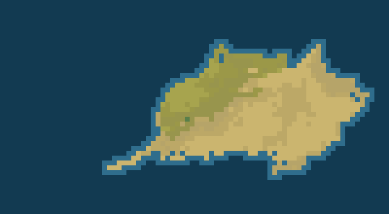

# Terra Form MCP server

An [MCP](https://modelcontextprotocol.io) server that lets an agent drive the **running** Terra Form app:
frame a region of the Earth, read a compact text picture of the result, tune the sliders, capture snapshots
(optionally cropped by a lon/lat lasso), splice them on the compose canvas and export the map file.

It is a bridge, not a port. The page stays the engine: `core/bridge.js` (loaded by `index.html` after
`core/app.js`) opens a WebSocket to this server and executes every tool call in-page with the app's own
functions, through the entry points `core/app.js` exposes on `TerraForm.api`. What the agent is told is
what the user sees on screen, and the user can keep working in the app at the same time.

```
Claude Code ──stdio (MCP)──▶ mcp/server.mjs ──ws://127.0.0.1:8765──▶ core/bridge.js ──▶ TerraForm.api (core/app.js)
```

## Run it

Requirements: Node 20+, and the app open (TerraForm.exe or a browser).

```bash
cd mcp
npm install
```

The server and its helpers are written in TypeScript (`server.mts`, `call.mts`, `example.mts`, `scenarios.mts`);
the `.mjs` files beside them are the compiled output, committed so that `node mcp/server.mjs` runs with no build
step. After editing a `.mts` (or `core/bridge.ts`), run `npm install` once in the repository root and then
`npm run build` there; `npm run typecheck` checks without writing. The wire messages between the page and this
server are declared in `core/bridge-protocol.d.ts`.

1. Start the app: `python serve.py` in the project folder and open <http://localhost:8000/> (TerraForm.exe
   works too). Leave the tab open.
2. Start the server. From a shell, for a quick look:

   ```bash
   node mcp/call.mjs status
   ```

   `call.mjs` spawns the server, waits for the page to connect, runs the calls you list and exits. A green
   **MCP connected** badge shows bottom-right in the app while a server is attached.
3. Register it with Claude Code (use the absolute path of your checkout):

   ```bash
   claude mcp add terra-form -- node C:/path/to/Civ-Tile/mcp/server.mjs
   ```

   Or in any MCP client's config: `{"command": "node", "args": ["C:/path/to/Civ-Tile/mcp/server.mjs"]}`.
   The server is started by the client on demand; the page reconnects within a few seconds whenever a
   server appears, and tool calls made before that return a clear "No Terra Form page is connected" error.

Ports: the WebSocket listens on 127.0.0.1:8765. To run a second instance (or if 8765 is taken) start the
server with `TERRAFORM_WS_PORT=8766` and open the app as `http://localhost:8000/?mcp=8766`. The
`.claude/launch.json` entry `terra-form-alt` serves the app on port 8010 for exactly that case (two sessions,
one page each: `http://localhost:8010/?mcp=8766`).

Run the worked example below end to end with `node mcp/example.mjs --out mcp/out`.

## Tools

Every tool that changes the frame or the canvas returns the same **feedback block**:

```
frame 40x28 civ4 | bounds W 48.86 S 16.5 E 63.14 N 26.5
land 636 (57%)  water 484 | hills 182  peaks 93 | river edges 37
terrain: ~=ocean 369  d=desert 361  A-Z=hills (uppercase terrain letter) 182  ,=coast 115  ^=peak 93
landmasses 2: #1 583t x0-30 y0-27; #2 53t x23-39 y0-3
grid step 1: x 0..39, y 0..27 (row 0 = north, col 0 = west; ruler = x of every 10th column)
    0         10        20        30
  0|dddd,,,,~~~~~~~~~~~,,,,D^^^^^^^^^^^^^^^^
  1|DDd,,,d,~~~~~~~~~~,,^,,,D^^^D^^^^^^^D^DD
  ...
```

Stats: land / water counts, hills and peaks (the module's relief classes), river edge count, per-terrain
counts keyed by glyph, connected landmasses (count, sizes, tile bounding boxes), then the glyph grid: one
character per tile, row 0 north, with a y label per row and an x ruler every 10 columns. All tools taking a
view accept `grid:false` (stats only), `bbox:[x0,y0,x1,y1]` (crop, inclusive tile coords) and `step`
(subsample, one glyph per `step` tiles; the default keeps the grid within about 120x80).

Lines that appear when they apply: a snapshot's header ends with its tile size (`0.357°/tile`) and
`cut: 118 mask-fill tiles (not coast)` when a lasso/rect left fill inside the crop; `edges:` carries each
side's connector label and anchors; a compose block carries `collisions:` (pairs of patches whose land
overlaps, with the tile count, or `none`), `budget:` (land share against the `targetLand` given to
`compose_new`, with the tiles to add or remove), `warnings:` (the seam lint) and `notes:` (informational
lint, such as rivers that were already endorheic in their source); `placed` / `attached` lines end with
`clipped: N land tiles off the canvas (2 rows south)` when a stamp overhangs.

| tool | what it does |
|---|---|
| `status` | game, mode, frame size and bounds, compose canvas, shelf count, every tunable parameter, the glyph legend |
| `set_game {id}` | `civ4`, `civ5` (hex) |
| `set_frame {bounds:[W,S,E,N] \| center:[lon,lat], spanX, W, H, rot, game}` | frame a region; the frame keeps the grid's W:H aspect, so it covers the box and may extend beyond it on one axis (the block reports the actual bounds). Switches the page to the Civ preview |
| `tune {params:{...}, reset}` | set sliders by name (see below) and re-evaluate; `{}` just reads them; `reset:true` first puts every control back to its default (settings persist on the page between sessions) |
| `frame_view` | the feedback block for the current frame |
| `snapshot {name, lasso:[[lon,lat],...] \| rect:[W,S,E,N]}` | capture the frame to the shelf, cropped to the lasso / box (outside it becomes the default fill); returns the snapshot id and its block |
| `list_snapshots`, `snapshot_info {id}`, `delete_snapshot {id}` | the shelf; snapshots are addressed by id or exact name |
| `compose_new {W, H, fill:'water'\|'barrier', clear, latitudes, targetLand, degPerTile}` | switch to Compose, clear, size the canvas; `barrier` makes empty canvas impassable mountain; `targetLand` (a share, or `[lo,hi]`) adds a budget line to every compose block; `degPerTile` declares the canvas scale for the codebook |
| `place {snapshot, x, y, landOnly, avoidLand, gap, ragged, preview}` | stamp a snapshot with its top-left at x,y (may overhang; the block says how much land was clipped); `landOnly` (default) stamps only its land; `avoidLand` shifts it to the nearest spot whose land touches no existing land (`gap` water tiles between, default 1); `ragged` feathers its cut edges; `preview` reports without keeping the patch |
| `move_patch {patch, x, y \| dx, dy}`, `remove_patch`, `raise_patch`, `lower_patch`, `set_land_only {patch, landOnly}` | edit patches by id; later patches draw over earlier ones |
| `erase {rect:[x0,y0,x1,y1]}`, `unerase` | punch holes (default fill) in the collage; holes stay put when patches move |
| `compose_view`, `compose_stats` | the canvas as it will export (coast ring and river edges re-derived) |
| `export {name, dir}` | build with the active game module and write: with `dir`, the files are written there by this server; without, the app writes where Generate would (its chosen folder, else a browser download) |
| `describe {target, rows, codes, degPerTile}` | landform morphology of the canvas, frame or a snapshot: paragraph, warnings, notes and a compact JSON; `rows:true` adds the per-row table, `codes:true` the landform-codebook summary (see Landform layer) |
| `suggest_lasso {mode:'land'\|'ridge', landmass, at, side, margin, tolerance, maxVertices}` | an irregular lasso built from the frame itself: a landmass outline with a sea margin, or one side of a mountain spine with the crest; `snapshot {lassoFrom:{...}}` captures with it in one call |
| `catalog_search {tags \| text \| climate}`, `snapshot_from_catalog {entry, W, H, rot, params, bounds, crop}` | the real-piece catalog; several words in `text` match any of them, ranked (see Landform layer) |
| `attach {a, edgeA, b, edgeB, overlap, shift, align, autoShift, searchShift, clamp, ragged}`, `scatter {snapshots, along, spacing, start, avoidLand, gap}` | composite operators (see Landform layer) |
| `trim_rivers {rids, endorheic}`, `extend_river {rid \| at, maxLength}` | river repair on the collage: drop systems cut by the seams (or named ones), carry a dead end on to the nearest water (see Landform layer) |
| `flip_snapshot {id, axis:'x'\|'y'\|'xy', name}` | a mirrored (or 180°-rotated) copy on the shelf: tiles, river edges and flow directions flipped together; disguises recognisable pieces |
| `catalog_index {entries}`, `catalog_lint` | record each catalog entry's connector labels and measured climate mix (slow, once), then check the catalog for connector types with no partner |
| `thumbnail {target, path, maxPx}` | the app's tile renderer on the canvas / frame / a snapshot, written as a PNG |
| `add_lake {at \| lonlat, area, compact, outlet, saltFringe, descend, target}`, `add_salt_pan {at \| lonlat, area, compact, target}`, `add_river {from \| lonlat, discharge, meander, join, target}` | generate a lake, salt pan or river on the frame (world-pinned, on the real elevation) or the compose canvas (tile-pinned, on the collage's heights); see Generated features |
| `features {action:'list'\|'remove'\|'clear', id, target}` | the generated features of the frame or the canvas; removing a lake also removes its outlet river and salt fringe |

View options on every block: `grid:false`, `bbox`, `step`, `overlay:'rivers'` (prints `=` on every tile a
river edge touches, so river courses read through a uniform desert) and `overlay:'codes'` (one glyph per
landform-codebook class on land and shore tiles; legend under Landform codebook below). `compose_new` takes
`latitudes:{top,bottom}`: a declared virtual latitude span for row 0 and the bottom edge, written to the
export header in place of the nominal ±45° and used by the `latitude-mismatch` lint (polar tile at a low
latitude, tropical tile at a high one). A compose canvas never wraps east-west (the export writes
`wrapX=0`); a world map built on it has hard edges.

`tune` parameter names. Core: `islandBias seawayBias islandExpand expandSteep expandMaxMult roughHalo
mtnPass flatSpots coastThr nudgeX nudgeY riverN riverEstuaries hill peak blendHill blendPeak fill`.
Game controls go by their control id: Civ4/Civ5 `alpine clim fpAmt forestDens jungleDens oasisDens
fpKoppen feat np`; OpenFront `ofPlains ofHighland ofMountain ofDesert ofDesertMag ofName`. Values are
clamped to the slider's range; the page's sliders and readouts move with them.

### Glyph legend

One character per tile. The alphabet is the game module's `preview.ascii(t)` (games/README.md):

| game | glyphs |
|---|---|
| Civ4, Civ5 | `~` ocean  `,` coast  `g` grass  `p` plains  `d` desert  `t` tundra  `s` snow  `f` forest  `j` jungle  `r` flood plains  `o` oasis  `^` peak. An **uppercase** letter is that terrain on hills. |
| OpenFront | `~` water; land by magnitude: digits `0`-`9` plains, `a`-`j` highland 10-19, `A`-`K` mountain 20-30 |
| other games | `~` water  `.` flat  `n` hills  `^` peak |

Civ5 (hex) grids print the half-tile-east rows indented by one space. In every game `_` is a **salt pan**
(land that is mostly playa, real or generated); Civ4 and Civ5 export it as flat desert.

### Generated features

`add_lake`, `add_salt_pan` and `add_river` (core/generate.js) work on both pathways with the same two
algorithms; `target` picks the pathway (default: whichever the page shows).

- **Frame (a region of the real Earth).** The feature is computed on an analysis grid over the frame (up to
  6x6 cells per tile, heights interpolated from the working elevation grid) and stored in lon/lat. A lake or pan
  is a polygon that sampling folds into each tile's land fraction or playa fraction; a river is a polyline added
  to the real river reaches, always kept (never ranked out by `riverN`). So the classifier, the coast halo, the
  estuary bridging and the features pass treat them as real data, re-framing the same area keeps them, and a
  snapshot bakes them into its tiles and river edges. They live in the page's memory until a reload.
- **Compose canvas.** The feature is computed on the collage's tiles, using the `_h` height every classified tile
  now carries (a pseudo-height from relief and distance to water where it is missing, e.g. snapshots made
  before this field existed; the block says so). It is stored in canvas tile coordinates like an erasure:
  lakes and pans are repainted through the game's `paint(t, kind)` hook after every patch and erasure, rivers
  are rasterised onto tile edges by the same corner-snap rasteriser as real rivers. Moving a patch leaves them
  where they were drawn; `compose_new` (clear) drops them; a saved collage keeps them.

The algorithms:

- **Lake / salt pan: basin fill.** From the seed (`at` tile, or `lonlat` on a frame) the water walks downhill to
  the local low point (`descend:false` keeps the seed), then floods the lowest ground first until it covers
  `area` tiles, with a small distance penalty (`compact`, height units per tile, default 0.004 ≈ 26 m for a lake, 0.05 for a pan, which is a flat floor) that
  keeps it from running down a valley. Water and a whole tile around it are never flooded, so a lake cannot
  become a bay or touch the sea once sampled. The block reports the surface height, the natural basin (the
  depression the seed drains into, from a priority flood; a lake larger than it would overflow in reality) and
  the shore climate. Without a seed, a lake goes into the deepest closed depression, a salt pan into the lowest
  basin in arid (Köppen B) country, kept clear of the map edge by max(3 tiles, 10% of the shorter side) plus the
  feature's own radius and fringe. A seed that touches water is moved to the nearest dry cell (the block says so).
  A generated salt pan is flat ground with no feature: on a frame its tiles are forced flat and the game's
  features pass skips them (real playas are classified as before).
- **Outlets.** `outlet:'auto'` (default) gives a lake an outflow river from its lowest rim when its shore is
  humid and the water reaches the basin's spill point; an arid lake, or one standing below its spill point,
  stays closed (the block gives the metres). `'river'` always (a carved channel when below the spill point),
  `'none'` never. `saltFringe:n` adds a ring of salt pan n tiles wide around the water (an endorheic desert
  lake). Both get their own ids (`lake-3-outlet`, `lake-3-salt`) and go with the lake on `features remove`.
- **River: flow routing.** A priority flood (Barnes et al. 2014) from every water cell and the map edge gives
  each land cell a receiver on a depression-free surface; the river follows the receivers from `from` until it
  reaches water, leaves through the map edge (the world goes on past the frame), or meets an existing river
  (`join:false` runs on through it), in which case it ends exactly on a corner of that river so the edges
  connect. The path is smoothed (Chaikin), given a gentle seeded meander (`meander` 0..1) and split into four
  reaches of rising discharge: by default from its real length and climate (Hack's law for the catchment, a
  runoff of 0.010 m³/s per km² humid down to 0.002 arid: about 70 m³/s for a 300 km humid river), or
  `discharge` m³/s at the mouth. Without `from`, the source is the high, humid ground, at least two tiles from
  the edge and from any river, with the longest way to water (not out of the frame). Generated rivers never
  take a real river's place in the `riverN` ranking, and `riverN:0` hides only the real ones.

Limits: on a frame the heights come from the 10 km working grid, so on very fine frames (well under 0.1°/tile)
lake shores follow a smoothed version of the terrain rather than the 1 km one. OpenFront has no salt terrain: a
pan is marked `_` but its magnitudes are unchanged.

### The sculpt pathway: original terrain

The frame and compose pathways can only show or rearrange the real Earth. `sculpt_*` builds terrain that is not
Earth's (core/sculpt.js), then derives everything else from it:

1. `sculpt_new {W, H, latitudes, degPerTile}` starts a height field (2x2 cells per tile, metres) at ocean floor.
2. Build it with `sculpt_shape` primitives — `blob` (land masses: several of them make a continent and fill the
   space between pieces), `ridge`, `rift` (a trough with raised shoulders; below sea level a narrow sea),
   `plateau`, `basin`, `chain` (a hotspot track from tall young volcanoes to atolls at the old end, every island
   generated individually: elongated volcanoes, the oldest inside barrier reefs, then atolls as one-tile rings of
   islets and reef around a shallow lagoon, up to ~7 tiles across, sized by `atollRadius` and capped by the
   spacing; `atollLand` sets how much of the rim is land), `fjords` (glacial troughs cut into a mountainous coast after the sea level is set),
   `noise`, `smooth` — and `sculpt_stamp`, which drops a small fragment of real elevation anywhere at any size,
   rotation and mirror, feathered in. Each real source box is stamped once (no piece of the world is pasted
   twice); rotate and mix many small fragments for real-feeling relief in an original arrangement.
3. `sculpt_sea {land: 0.35}` sets the sea level by target land share; later shapes keep that share.
4. `sculpt_view` shows elevation glyphs (`~` deep, `-` shelf, `.` 0-200 m, `:` 200-600, `+` 600-1200,
   `n` 1200-2400, `^` 2400+), land share, elevation bands and landmass sizes. Cheap: use it often.
5. `sculpt_realize` makes the game map: land and relief from absolute heights (900 m / 2600 m plus local range
   by default, so pieces agree), climate from a physical model (core/climate.js: temperature by latitude and
   lapse rate, maritime warmth on windward mid-latitude coasts and cold lee coasts and interiors, seasonality
   from continentality, zonal tables read at a meandering latitude and patchy rainfall (climate borders wander
   like storm tracks instead of following lines of latitude), moisture carried by each latitude
   band's prevailing wind —
   trades, westerlies, polar easterlies — and wrung out on windward slopes, leaving rain shadows; Mediterranean
   west coasts and monsoon coasts; then the Köppen decision tree), satellite-like colour from the real mean
   colour of each Köppen class, the game's own classifier and features, lakes in closed basins (salt-fringed
   when arid) and rivers from rainfall-weighted flow accumulation (a river near the map border leaves straight
   across it; `edgeOutlets:false` makes the border a wall, so the drainage that reaches it runs along it to
   the sea — keep the default unless the map really ends there). The result replaces the compose canvas as one
   patch, so `describe`, the lint, `add_lake`/`add_river` and `export` all apply, and the block prints the
   climate mix by latitude band as a sanity check.

`reclimate` runs the same climate model over a collage: every land tile gets the climate of where it now sits
(the declared canvas latitudes, its height, its distance from the sea, the winds), the game reclassifies it,
and the canvas is replaced by the result. Use it after moving or mirroring real pieces, so a piece does not keep
the climate of its origin. `wetness` (default 1) scales rainfall: a temperate collage of sea-girt pieces is
humid everywhere, so ~0.3 is what turns its interior and the lee of its ranges into steppe (Civ4 plains).

`add_island {path, width, gaps}` raises a low island, sandbar or key along a tile polyline (1 tile wide by default;
`gaps` leaves a share of it as passes). Thin real islands vanish at coarse scales — the Chandeleurs are ~1 km wide
against ~4 km tiles on a 128-wide South Louisiana map — so trace them back with this, then `reclimate`.

`paint {kind, polygon|rect, density}` stamps a feature or terrain over the land inside a polygon: jungle (grass
under it), forest, oasis, flood_plains, grass / plains / desert / tundra, clear. It is for the pockets a climate
model cannot know — a cypress swamp in a desert, a gallery forest, an oasis belt — and goes AFTER `reclimate`,
which reclassifies everything. Reclimated and sculpted land carries a synthetic colour, so the game's oasis
detector (which reads green specks in the satellite colour) finds nothing there: give a desert its oases with
`paint {kind:'oasis', rect, density: ~0.01}` (flat desert only). `add_river {path}` hand-draws a channel along tile points (source first), for the
bayous and distributaries the river data lacks; `extend_river {at}` then joins its end to a real river. Note that a
real river's edges flanked by coast are dropped when the snapshot is made, so a river that "drains prematurely"
(the Mississippi below Venice) is restored by raising the banks with `add_island` and then `extend_river {rid}`.

`fill_gaps {width, rect}` closes the sea between pieces (morphological closing) into lowland that borrows its
nearest land's ground; only sea-connected water fills (lakes stay), and a river mouth it would bury keeps an
estuary channel to the open sea. After a collage: `fill_gaps`, `reclimate`, `trim_rivers` (drops seam-cut
remnants and one- or two-edge stubs), then `extend_river` with no arguments (carries every dead end on to water,
or into a river that flows on to the sea).

### Joining pieces: interest maps, fuse, unique pastes

Every snapshot has an **interest** score per land tile (0-9): high on peaks and ridge edges, rivers (by
discharge), real coastline (more at capes and bay heads), climate boundaries, oases, flood plains, salt, lake
shores; low in uniform interior; 0 for sea and lasso fill. `overlay:'interest'` prints it on any grid, and
`snapshot_info` reports each edge's mean interest and its quietest five-tile stretch (`quiet@position`), the
best place for a seam.

The min-cut seam that `attach {ragged}` cuts through an overlap now weighs interest: cutting through a peak, a
river or a coast costs what it would destroy. `attach {overlap:'auto'}` (fuse) searches overlap depth (up to
`maxOverlap`) and slide together for the cheapest interest-weighted seam, so two pieces merge over land where
neither has anything worth keeping instead of being parked coast to coast.

A snapshot goes on the canvas **once**: `place` refuses a snapshot that is already placed and `scatter` refuses a
list with repeats or a path with more stamps than distinct snapshots (`allowRepeat:true` overrides both). Repeated
islands read as copy-paste.

## Worked example

Frame Oman, capture it with a lasso, frame Morocco, capture, compose both, view, export. This is
`mcp/example.mjs`; the output below is from a run against the app (civ4, trimmed).

```
>>> set_frame {"bounds":[51.5,16.5,60.5,26.5],"W":40,"H":28}
frame 40x28 civ4 | bounds W 48.86 S 16.5 E 63.14 N 26.5
land 636 (57%)  water 484 | hills 182  peaks 93 | river edges 37
terrain: ~=ocean 369  d=desert 361  A-Z=hills (uppercase terrain letter) 182  ,=coast 115  ^=peak 93
landmasses 2: #1 583t x0-30 y0-27; #2 53t x23-39 y0-3
grid step 1: x 0..39, y 0..27 (row 0 = north, col 0 = west; ruler = x of every 10th column)
    0         10        20        30
  0|dddd,,,,~~~~~~~~~~~,,,,D^^^^^^^^^^^^^^^^
  1|DDd,,,d,~~~~~~~~~~,,^,,,D^^^D^^^^^^^D^DD
  2|DDdd,,d,,~~~~~~~~,,d^,~,,,dddDDDDDDDDDDD
  ...
 27|DD^^^^^^^^^^,,,,,,~~~~~~~~~~~~~~~~~~~~~~

>>> snapshot {"name":"Oman","lasso":[[51.8,24.4],[56.4,26.6],[59.9,22.8],[59.5,16.6],[52.6,16.6],[52,19.5]]}
snapshot snap_mvbp60nm_0_bgutl5 "Oman" 23x28 civ4 | lat 16.5..26.5
land 350 (54%)  water 294 | hills 98  peaks 50 | river edges 7
terrain: ~=ocean 204  d=desert 202  A-Z=hills (uppercase terrain letter) 98  ,=coast 90  ^=peak 50
landmasses 1: #1 350t x0-22 y1-27
grid step 1: x 0..22, y 0..27 (row 0 = north, col 0 = west; ruler = x of every 10th column)
    0         10        20
  0|~~~~~~~~~~~,,,~~~~~~~~~
  1|~~~~~~~~~~,,^,~~~~~~~~~
  ...
 10|ddddDDDDDDdddD^^^^^^^,,
  ...
 27|~,^^,,,,,,~~~~~~~~~~~~~

>>> set_frame {"bounds":[-13.5,27.5,-0.5,36],"W":40,"H":28}
frame 40x28 civ4 | bounds W -13.5 S 27.2 E -0.5 N 36.3
land 695 (62%)  water 425 | hills 188  peaks 118 | river edges 145
...

>>> snapshot {"name":"Morocco","rect":[-13.5,27.6,-1,35.9]}
snapshot snap_mvbp63zk_1_g71akj "Morocco" 38x26 civ4 | lat 27.53..35.98
land 605 (61%)  water 383 | hills 174  peaks 115 | river edges 144
...

>>> list_snapshots {}
snap_mvbp63zk_1_g71akj  "Morocco"  38x26 civ4  centre -7,31.75
snap_mvbp60nm_0_bgutl5  "Oman"  23x28 civ4  centre 56,21.5

>>> compose_new {"W":80,"H":44,"fill":"water"}
compose canvas 80x44 civ4 | 0 patches | 0 erased tiles
land 0 (0%)  water 3520 | hills 0  peaks 0 | river edges 0
...

>>> place {"snapshot":"snap_mvbp63zk_1_g71akj","x":2,"y":4,"grid":false}
compose canvas 80x44 civ4 | 1 patch | 0 erased tiles
land 605 (17%)  water 2915 | hills 174  peaks 115 | river edges 144
terrain: ~=ocean 2781  d=desert 264  A-Z=hills (uppercase terrain letter) 174  ,=coast 134  ^=peak 115  p=plains 52
landmasses 1: #1 605t x3-39 y4-29
patches (bottom to top): [1] "Morocco" 38x26 @2,4
placed patch 1 at 2,4 (land only)

>>> place {"snapshot":"snap_mvbp60nm_0_bgutl5","x":40,"y":10,"grid":false}
compose canvas 80x44 civ4 | 2 patches | 0 erased tiles
land 955 (27%)  water 2565 | hills 272  peaks 165 | river edges 151
...
placed patch 2 at 40,10 (land only)

>>> move_patch {"patch":2,"dx":-4,"dy":2,"grid":false}
compose canvas 80x44 civ4 | 2 patches | 0 erased tiles
land 917 (26%)  water 2603 | hills 270  peaks 165 | river edges 151
landmasses 1: #1 917t x3-58 y4-39
patches (bottom to top): [1] "Morocco" 38x26 @2,4; [2] "Oman" 23x28 @36,12

>>> compose_view {}
compose canvas 80x44 civ4 | 2 patches | 0 erased tiles
land 917 (26%)  water 2603 | hills 270  peaks 165 | river edges 151
terrain: ~=ocean 2399  d=desert 430  A-Z=hills (uppercase terrain letter) 270  ,=coast 204  ^=peak 165  p=plains 52
landmasses 1: #1 917t x3-58 y4-39
patches (bottom to top): [1] "Morocco" 38x26 @2,4; [2] "Oman" 23x28 @36,12
grid step 1: x 0..79, y 0..43 (row 0 = north, col 0 = west; ruler = x of every 10th column)
    0         10        20        30        40        50        60        70
  0|~~~~~~~~~~~~~~~~~~~~~~~~~~~~~~~~~~~~~~~~~~~~~~~~~~~~~~~~~~~~~~~~~~~~~~~~~~~~~~~~
  ...
 18|~~~~~~~~~~~~,DPPP^^^^^^^^^^^DDdddddddDdd,,ddddd^^^,,,~~~~~~~~~~~~~~~~~~~~~~~~~~~
 19|~~~~~~~~~~~~,D^^^^^^^DDD^^^DDdDddddddddddddddddD^^^D,,,,,~~~~~~~~~~~~~~~~~~~~~~~
 20|~~~~~~~~~~~~,D^^^P^^^^^^^^DDdDDddddddddddddddDdd^^^^^^^D,~~~~~~~~~~~~~~~~~~~~~~~
  ...
 39|~~~~~~~~~~~~~~~~~~~~~~~~~~~~~~~~~~~~~,^^,,,,,,~~~~~~~~~~~~~~~~~~~~~~~~~~~~~~~~~~
  ...

>>> export {"name":"oman_morocco","dir":"mcp/out"}
export compose civ4 80x44
wrote ...\mcp\out\oman_morocco.CivBeyondSwordWBSave (263882 bytes)
ok   plots written = 80×44 · 3520 / 3520
ok   land ↔ plot-type consistent · all 3520 ok
ok   river edges written · 151 / 151 (12 rivers)
ok   no river on all-water edge · ok
ok   no tile with rivers on all 4 sides · ok
ok   estuary bridges to open ocean · 0 edge(s)
ok   starting plots on land · 0 placed
ok   header + map block present · ok
```

The page followed along: after the run it sits in Compose with both patches placed, the inspector
reading 2 patches, land / water 917 / 2603, and the shelf holding Morocco and Oman.

## Landform layer

The agent already knows physical geography; this layer gives those nouns handles in the tool surface and
in the feedback, and polices the seams between spliced real pieces (each piece is coherent on its own; only
the joins go wrong). It lives in `core/landforms.js`, pure functions over the tile grid, and goes through the
game module for everything game-specific (`isWater`, `preview.relief`, and the Civ4 tile's `kc` Köppen class
where present; a game without those simply gets fewer lines).

### `describe` and the `landforms:` line

`describe {target}` (compose canvas, frame, or a snapshot) returns a paragraph, the warnings for a collage,
and a JSON object. Every mutation's feedback block carries the one-line form as `landforms:`.

| noun | how it is found | reported |
|---|---|---|
| landmass | connected land on the active lattice | id (by size), size, position, climate mix (Köppen groups: ice cap, tundra, arid, tropical, temperate, continental), hills / peaks |
| isthmus | erode the landmass by r = 1, 2, 3 tiles; the smallest r that splits it into two real parts marks a neck | position, width (about 2r), the two part sizes it joins |
| strait | water on the border between two landmasses' nearest-land regions, within 4 tiles of both | the pair, narrowest width in tiles, position, length |
| bay | water inside the landmass's convex hull (at least 4 tiles, touching the land) | size, position, the compass side it opens to |
| peninsula | land dropped by a morphological opening (erode 2, dilate 2) | size, position, the direction it points |
| mountain spine | a component of hills + peaks (at least 6 tiles), oriented by its principal axis | orientation (N-S, NE-SW, E-W, NW-SE), length, size, peak count |
| river systems | edges grouped by river id; an edge continues when another edge has a corner within one step | systems that reach water, leave the map, or dead-end |

Example (the Oman + Morocco collage): `1 landmass: #1 854t at 51,23 (arid 87%, temperate 13%). Bay of 48t
on #1 at 56,10 opening N; ... Mountain spine NE-SW 38 long (260t, 113 peaks) on #1 at 43,21; ... 13 river
systems (151 edges): 7 reach water, 0 leave the map, 6 dead-end.`

### Seam lint (`warnings:`)

Run after every compose mutation, over the composite plus a per-tile patch-owner map. Each rule is one small
pure function in `RULES` in `core/landforms.js`; add a rule by appending one.

| rule | fires when |
|---|---|
| `climate-jump` | two adjacent flat land tiles from different patches are in different Köppen groups (temperate next to continental, and ice cap next to tundra, are allowed; a hill, peak or water between them clears it) |
| `truncated-wall` | a run of 3+ hill/peak tiles from one patch sits against flat land of another patch (a range that stops dead at the seam) |
| `river-dead-end` | a river edge whose downstream corner has neither a continuing edge nor water, and which the source snapshot did NOT have: cut at a patch boundary, by an erase or by an overlapping stamp (sources are upstream ends and do not count) |
| `river-endorheic` (a note, not a warning) | the same dead end, but the source snapshot already had it: a real endorheic river (a Saharan wadi); on a frame or a snapshot every dead end is of this kind |
| `straight-edge-coast` | a ruler-straight shoreline: 7+ collinear land tiles of one patch all facing water on the same side, or 4+ that carry the snapshot's cut flag. The message says which it is: `a lasso/mask cut`, `the capture rectangle edge (a rect or frame cut)`, or `no cut flag: a straight real coast` |
| `scale-mismatch` | two touching patches whose tile sizes sit more than one codebook band apart (a factor of about 2.3 in °/tile): a 0.05°/tile delta against a 0.6°/tile peninsula |
| `latitude-mismatch` | only with declared `latitudes`: an ice-cap/tundra tile below 35°, a tropical tile above 45°, a desert tile above 62° of virtual latitude |

`describe` also lists water bodies (`seas`, with `inland` when none of their tiles touch the canvas edge),
which water body each river system reaches (a tributary that joins another river reaches what that river
reaches, `via`), and, with `rows:true`, per-row land and Köppen-group counts for latitude-band checks (the
table is about half the payload, so it is opt-in).

**Cut edges are not coastline, and real coastline is not a cut.** A lasso or rect capture replaces the tiles
outside the shape with fill, and the snapshot remembers which (`cut`) and, among those, which were *land* in
the source (`cutLand`): only there did the mask cut through land and make an artificial shore. Fill that was
sea is just trimmed sea, and the coast beside it is the real one (Oman's lasso: `118 mask-fill tiles, 41
through land`; its north and east edges, where the lasso ran through the Gulf, stay `open sea`, its west
edge through the Rub al Khali is a `cut edge`). Downstream: a connector that is mostly cut-through-land is
labelled `cut edge` rather than `coast`; `attach`'s seam cost leaves those pairs out of the count (`N
cut-edge pairs ignored`); the `straight-edge-coast` rule names a straight shore as a mask cut when the flag
confirms it; and `ragged:true` on `place`/`attach` feathers only the artificial shores (the cut-through-land
boundary and the capture rectangle's own land border), never a land tile that touches real water, so a
distinctive coastline survives even where the lasso ran right beside it. To pin more, `ragged` takes
options: `{preserve:[[x0,y0,x1,y1],...]}` snapshot-tile rects never feathered or min-cut (a coastline you
like), `preserveSides:['N',...]` rectangle borders left alone, `preserveCoast:false` to feather real coast
too, `feather:false` / `minCut:false` to switch either half off; in `attach`, `preserveA` / `preserveSidesA`
do the same for A. `flip_snapshot` carries the flags along.

Not implemented yet: coast-type discontinuity where two shorelines meet. A warning is `{rule, at:[x,y], n,
patches, msg}` (`level:'info'` for a note); the block prints up to 8 warnings and 6 notes.

The climate rule is evidence-based rather than hand-written (the Karth & Smith framing in
`docs/landform-grammar-papers.md`): `mcp/mine_koppen_adjacency.py` counts which Köppen classes border each
other on land in `data/koppen_2048.png` at several strides and writes `mcp/koppen_adjacency.json`; the page
fetches it, and a group pair under 0.1% of real adjacencies (tropical next to continental, ice cap next to
anything but tundra, ...) or a class pair that never occurs is reported as a contradiction with its real-world
share. Without the file the rule falls back to a small allow list.

### Spines as chains, seam cost, connectors as tile colours

- Mountain spines are skeletonised (Zhang-Suen thinning on the hills+peaks mask, square lattice) and read as a
  graph: `chain` (longest end-to-end path), `branches` (ends) and `knots` (junctions with three or more arms,
  with coordinates) sit next to the PCA orientation. "Two chains meeting at a knot" is now a checkable claim.
- `attach` reports a **seam cost** over the overlap strip (or the two facing rows when the pieces only touch):
  the share of tile pairs that disagree on water, climate group or relief (Zhou et al. 2007 in tile form; mask
  fill is left out), and the **best shift** along the seam within ±`searchShift` (default 16; the block says
  when the optimum sits on the window's edge); `autoShift:true` applies it. `ragged:true` runs the Zhou et al.
  **min-cut seam**: the cheapest path through the overlap strip from one end of the seam to the other (water
  against land 1, both land 0.25 + 0.5 per climate-group or relief disagreement, both water 0), and B's tiles
  on A's side of the path are left unstamped, so the join is a ragged line through sea and matching terrain
  rather than a rectangle edge.
- Connectors are Wang-tile edge colours (Cohen et al. 2003), with corner labels too (the 3x3 around each corner,
  after Lagae). `catalog_index` captures catalog entries once and records their labels in `landforms.json`;
  `catalog_lint` tallies supply per label and side and flags labels with no partner on the opposite side.

Geomorphons / TPI (Jasiewicz & Stepinski; Weiss) need an elevation field per tile; Civ4 tiles carry only the
relief class, so they are not implemented. OpenFront and Culture Wars tiles carry metres (`m`) and are the
place to add them.

### Catalog and connectors

`mcp/landforms.json` is a typed catalog of real pieces: `{name, bounds [W,S,E,N], size [W,H], lasso | rect,
tags, climate, params, notes}`. `catalog_search {tags | text | climate}` finds them (no arguments lists all);
`snapshot_from_catalog {entry, W, H, rot, params}` frames the entry at its default size, applies its crop and
its suggested `params` (the island expander for atolls), captures it under its name and returns the block.
Tags in the seed catalog: peninsula, isthmus, strait, archipelago, atoll, chain, delta, rift, inland-sea,
basin, mountain-spine, mountain-chain, mountain-wall, rain-shadow, fjords, volcanic, desert, salt-pan,
steppe, forest, boreal, polar.

Every capture computes a **connector** per edge (N/E/S/W) from the tiles along that edge: land fraction,
relief fraction, dominant climate group, mean height where the game's tile carries metres, and whether a
river reaches the edge. They are stored on the snapshot and printed by `snapshot`, `snapshot_info` and
`describe` as `edges: N open sea | E desert + river exit [relief@11, land@13 (2..25)] | S desert | W cut edge`.
Labels: `cut edge` (half or more of the edge is mask fill), `open sea` (land under 10%), `coast` (under 50%),
`mountain wall` (half or more of the land is hills/peaks), `desert`, `tropical land`, `ice`, `temperate land`,
`continental land`, `land`; `+ river exit` when a river leaves there. The bracket holds the **anchors**
(Mawhorter & Mateas: where along the edge the feature sits): `relief@` the centre of the longest run of edge
positions with hills/peaks within 4 tiles of the edge, `land@` the centre of the longest land run along the
edge, with the land runs themselves. `attach {align:'relief'|'coast'}` lines two edges' anchors up.
`catalog_index` also records each entry's measured climate mix (`climateMeasured`, from the captured
landmasses), which `catalog_search {climate}` matches alongside the hand-written field.

### Composite operators

- `attach {a, edgeA, b, edgeB, overlap, shift, align, clamp, ragged}`: puts B against A so A's edge meets B's
  opposite edge, centred along the seam (or with `align:'relief'` / `'coast'`, with the two edges' anchors on
  one line, so a range runs into a range). A keeps its patch (or is placed at the canvas centre); B is moved
  or placed. `overlap` pulls B into A (with land-only stamping the coastlines interleave), `shift` slides B
  along the seam. B is clamped along the seam so its land stays on the canvas when it fits (`clamp:false`
  to allow overhang); what still overhangs is reported as `clipped`. `ragged` feathers both pieces' cut
  edges (real coast kept; `preserve` rects pin more) and cuts the min-cut seam through the overlap. The
  block names both edges' connectors, the seam cost and best shift, and carries the seam lint for the join.
- `place {avoidLand, gap, ragged, preview}` and `scatter {avoidLand, gap}`: `avoidLand` searches outward
  (by Chebyshev radius) for the nearest position whose land is on the canvas and at least `gap` water tiles
  from any existing land, and reports the shift; the compose block's `collisions:` line names the patches
  whose land still overlaps. `place {preview:true}` is a dry run: the block as if placed (budget line
  included), nothing kept.
- `scatter {snapshots, along, spacing, start}`: stamps the snapshots, cycling, centred on their land every
  `spacing` tiles along the polyline. Built for atoll chains on an ocean canvas; read the `landforms:` line
  (landmass count, straits) to see that none touch. Single atolls (Tarawa, Funafuti, Majuro, Addu) capture
  at their default 8x8 as 5-14 tile islets, at 16x16 / 24x24 as 50-110 tile blobs (the island expander fills
  the lagoon); the chain entries (Maldives, Tuvalu, Marshalls) give several islets each.
- `trim_rivers {rids, endorheic}` and `extend_river {rid | at, maxLength}` turn the river warnings into
  actions. `trim_rivers` drops the collage's river systems that end on land without reaching water or the
  map edge: by default only those the source snapshots did not already have (cut by a seam, an erase or an
  overlapping stamp), `endorheic:'trim'` also the real endorheic ones, `rids` named systems. `extend_river`
  carries a dead end on to the nearest water (or into another river) by breadth-first search over tile
  corners along edges with land on both sides, adding the edges to the collage with the flow pointing
  downstream. Both are edits of the collage (per-patch edge drops, canvas-level added edges), serialized
  with it; the snapshots are untouched.
- `suggest_lasso {mode, landmass, at, side, margin, tolerance, maxVertices}`: a hand-typed lasso is a few
  straight segments, so its cut edges are ruler lines. This builds the polygon from the evaluated frame:
  `mode:'land'` traces a landmass (the largest, `#landmass` from describe, or the one at tile `at`) dilated
  by `margin` tiles of sea (default 1; 0 trims every empty tile, larger keeps more sea around the real
  coast); `mode:'ridge'` keeps one `side` (N/E/S/W) of a mountain spine with the crest included, so the cut
  runs along the far foot of the ridge and the cut edge is a mountain wall, the best connector there is. The
  outer boundary of the tile mask is simplified (Douglas-Peucker, `tolerance` tiles, default 0.75, raised
  until at most `maxVertices`, default 40) and mapped from tile corners to lon/lat through the frame
  (rotation included). It returns the polygon for `snapshot {lasso}`; `snapshot {lassoFrom:{...}}` does
  both in one call and prints the polygon it used.

Worked example, continued (the same Oman and Morocco captured from the catalog, then joined):

```
>>> snapshot_from_catalog {"entry":"Morocco","grid":false}
snapshot snap_mvbpp0zp_1_6k9hxh "Morocco and the Atlas" 38x26 civ4 | lat 27.53..35.98
land 605 (61%)  water 383 | hills 174  peaks 115 | river edges 144
terrain: ~=ocean 316  d=desert 264  A-Z=hills (uppercase terrain letter) 174  ^=peak 115  ,=coast 67  p=plains 52
landmasses 1: #1 605t x1-37 y0-25
landforms: 1 landmass | 3 bays | 2 peninsulas | spines NE-SW 38L at 23,12, NE-SW 4L at 34,20 | rivers 7/12 reach water
edges: N open sea | E desert + river exit | S desert | W open sea

>>> attach {"a":"Morocco and the Atlas","edgeA":"E","b":"Oman","edgeB":"W","overlap":6,"grid":false}
compose canvas 80x44 civ4 | 2 patches | 0 erased tiles
land 854 (24%)  water 2666 | hills 247  peaks 163 | river edges 151
...
landforms: 1 landmass | 3 bays | 3 peninsulas | spines NE-SW 38L at 43,21, NE-SW 16L at 59,23 | rivers 7/13 reach water
warnings (6): [truncated-wall] mountain run of 260 tiles from patch 1 stops against flat land of patch 2 along 11 tiles near 53,20 ; [truncated-wall] mountain run of 27 tiles from patch 2 stops against flat land of patch 1 along 3 tiles near 55,32 ; [truncated-wall] mountain run of 62 tiles from patch 2 stops against flat land of patch 1 along 2 tiles near 54,28 ; [river-dead-end] river 2500 has 1 edge ending on land with no continuation, first at 33,25 ; [river-dead-end] river 3159 has 1 edge ending on land with no continuation, first at 58,28 ; [river-dead-end] river 41972 has 1 edge ending on land with no continuation, first at 71,23
attached patch 2 to patch 1 along E/W at 53,8 (A desert + river exit meets B coast)

>>> snapshot_from_catalog {"entry":"Society","grid":false}
snapshot snap_mvbpsd6u_2_v627bd "Society Islands" 40x20 civ4 | lat -18.12..-15.87
land 54 (7%)  water 746 | hills 15  peaks 10 | river edges 0
landmasses 7: #1 20t x5-10 y3-9; #2 18t x22-30 y14-17; #3 4t x1-2 y4-5; ...
landforms: 7 landmasses | 4 straits (#1/#4 w1 at 11,8 #1/#3 w2 at 3,4) | spines E-W 8L at 26,15, N-S 4L at 9,7

>>> compose_new {"W":64,"H":40,"grid":false}
>>> scatter {"snapshots":["Society Islands","Tuvalu and the Gilberts","Maldives"],"along":[[8,34],[20,22],[36,12],[56,6]],"spacing":14}
compose canvas 64x40 civ4 | 5 patches | 0 erased tiles
land 84 (3%)  water 2476 | hills 26  peaks 17 | river edges 0
landmasses 16: #1 21t x27-32 y3-10; #2 18t x44-52 y14-17; #3 11t x10-16 y38-39; ... (+6 smaller)
landforms: 16 landmasses | 6 straits (#1/#5 w1 at 33,8 #1/#4 w2 at 25,4) | spines E-W 8L at 48,15, E-W 6L at 13,39
warnings: none
scattered 5: [3] Society Islands @-12,24; [4] Tuvalu and the Gilberts @2,2; ...
```

### Landform codebook (`codes:`)

`docs/landform-codebook.md` describes a learned vocabulary of 7x7-tile landforms, one codebook per scale band
(8 bands over 0.01-3 °/tile, up to 128 codes each, captioned from Natural Earth labels). The page ports its
`assign`: `core/landforms.js` fetches `data/landform/codebook.json` on first use, picks the band from the
tile size (a snapshot's or frame's latitude span over its rows; for a collage the `degPerTile` declared to
`compose_new`, else the patches' median), and scores every land and shore tile's window against the band's
centroids over the 8 dihedral orientations with the dot-product formula of the doc (centroids premultiplied
by the squared channel weights, laid out per orientation). Checked against the Python `assign` on five
captures across bands 2, 3 and 5: identical codes on all but one tile in 3800 (a float tie).

- `describe {codes:true}` adds a `codes:` line and a sentence to the paragraph: the band, how many tiles were
  coded, and the top three captions per landmass with their share (`#1 reads desert / plain / pen/cape 23%,
  ...`), plus the JSON `codes` object. `degPerTile` overrides the tile size.
- `overlay:'codes'` on any view prints one glyph per code class: the leading caption label, else the code's
  kind. `b` basin, `B` bay, `c` channel, `,` coast, `D` delta, `v` depression, `d` desert, `F` fjord, `h`
  foothills, `G` gorge, `U` gulf, `i` inlet, `I` island, `A` island group, `T` isthmus, `L` lagoon, `l`
  lowland, `C` pen/cape, `P` peninsula, `p` plain, `t` plateau, `M` range/mtn, `r` reef, `s` sound, `S`
  strait, `u` tundra, `V` valley, `w` wetlands; uncaptioned codes by kind: `~` open water / islands, `,`
  coast, `^` inland peaks, `n` inland hills, `.` inland flat. Open sea away from land is left `~` (it is where
  the time goes and reads as one code).
- The `scale-mismatch` lint rule (above) uses the same bands: two touching patches more than one band apart
  carry landforms from different vocabularies.

## The owner's Oman + Morocco attach, after the fixes

The join the owner tested (Morocco from its rect crop, Oman from its lasso, attached E/W with overlap 6),
re-run with `ragged:true` on an 80x44 canvas and followed by `trim_rivers`. What changed in the block: Oman's
header says `cut: 118 mask-fill tiles (41 through land, the rest trimmed sea)`, its west edge is `cut edge`
while its north and east edges, where the lasso ran through the Gulf, stay `open sea`; the seam cost leaves
the 19 cut-through-land pairs out; the best shift (1) is inside the ±16 window; the Oman wadi and Morocco's
Saharan river are `notes` (endorheic in their source), while the one river the overlap really cut is a
warning until `trim_rivers` drops its dangling edge; the straight south edge of Morocco's crop and the
straight west edge of Oman's lasso are feathered away (`ragged: 98 tiles of B and 104 of A skipped, min-cut
seam 26 long`) with every tile that touches real sea kept, so Morocco's Atlantic headlands and Oman's Hajar
and Dhofar coasts are the real ones; what is left straight is Morocco's Mediterranean shore, which the lint
names as such.

```
>>> snapshot_from_catalog {"entry":"Oman","grid":false}
snapshot snap_mvbv04i8_0_7kfxy2 "Oman" 23x28 civ4 | lat 16.5..26.5 | 0.357°/tile | cut: 118 mask-fill tiles (41 through land, the rest trimmed sea)
...
edges: N open sea [relief@11] | E open sea [relief@10, land@11 (11..11)] | S open sea [relief@5, land@2 (2..3)] | W cut edge [relief@19, land@9 (7..11)]
warnings (2): [straight-edge-coast] ruler-straight coast: 11 land tiles of patch 1 along column 1 (y 12..22) face water to the W, a lasso/mask cut ; [straight-edge-coast] ruler-straight coast: 5 land tiles of patch 1 along column 2 (y 23..27) face water to the W, a lasso/mask cut

>>> attach {"a":"Morocco and the Atlas","edgeA":"E","b":"Oman","edgeB":"W","overlap":6,"ragged":true,"grid":false}
compose canvas 80x44 civ4 | 2 patches | 0 erased tiles
land 753 (21%)  water 2767 | hills 235  peaks 158 | river edges 141
landmasses 1: #1 753t x22-75 y9-35
patches (bottom to top): [1] "Morocco and the Atlas" 38x26 @21,9; [2] "Oman" 23x28 @53,8
warnings (3): [truncated-wall] mountain run of 316 tiles from patch 1/2 stops against flat land of patch 2/1 along 24 tiles near 54,20 ; [river-dead-end] river 3159 has 1 edge ending on land with no continuation, first at 58,28 (not in its source: cut at a patch boundary, by an erase or by an overlapping stamp) ; [straight-edge-coast] ruler-straight coast: 7 land tiles of patch 1 along row 11 (x 47..53) face water to the N (no cut flag: a straight real coast)
notes (2): [river-endorheic] river 2500 dead-ends on land at 33,25 as it did in its source (patch 1): endorheic, not a seam ; [river-endorheic] river 41972 dead-ends on land at 71,23 as it did in its source (patch 2): endorheic, not a seam
attached patch 2 to patch 1 along E/W at 53,8 (A desert + river exit meets B cut edge) | seam cost 0.526 over 137 tiles (water 21, climate 0, relief 51, 19 cut-edge pairs ignored) | best shift 1 (cost 0.518, window ±16) | ragged: 98 tiles of B and 104 of A skipped, min-cut seam 26 long through a 6-wide strip (cost/tile 0.365)

>>> trim_rivers {"grid":false}
...
trimmed 0 river systems and 1 edge(s) of cut side branches (1 edges): none | kept 1 endorheic (source) system(s): 41972

>>> describe {"target":"compose","codes":true}
1 landmass: #1 753t at 52,22 (arid 85%, temperate 14%). Bay of 95t on #1 at 42,33 opening SW; Bay of 48t on #1 at 56,10 opening N; Bay of 36t on #1 at 29,28 opening W. Peninsula of 25t on #1 at 30,32 pointing SW; Peninsula of 15t on #1 at 73,20 pointing E; Peninsula of 14t on #1 at 58,33 pointing SE. Mountain spine E-W 37 long (316t, 112 peaks, chain 44, 10 ends, 0 knots) on #1 at 47,21; Mountain spine NW-SE 16 long (52t, 35 peaks, chain 16, 2 ends, 0 knots) on #1 at 68,16; Mountain spine NE-SW 13 long (19t, 11 peaks, chain 12, 2 ends, 0 knots) on #1 at 61,33. 13 river systems (140 edges): 12 reach water (2 different water bodies), 0 leave the map, 1 dead-end. Codebook band 3 (0.2605°/tile for 0.3571°/tile): #1 reads desert / plain / pen/cape 21%, desert / plain / depression 12%, range/mtn / desert / basin 11%.
warnings (2): [truncated-wall] ... ; [straight-edge-coast] ruler-straight coast: 7 land tiles of patch 1 along row 11 (x 47..53) face water to the N (no cut flag: a straight real coast)

>>> compose_view {"bbox":[18,4,78,38]}
    (the join, rows 14-35; the seam ran down columns 53-58; Oman's Hajar coast at the right, Morocco's south-west headland bottom left)
 14|~~~~~~~~~~~~~~~~~~~~~~,,pppPPPP^PddP^PPpdddddd^^^,,,~~~~~~~~~
 18|~~~~~~~~~~~~~~~,,pppppppPPP^^PPDdDPPDDdDDDDDDdddD^^^^^^^,,,~~
 19|~~~~~~~~~~~~~~~,pppppppppP^^^^^^^^PDDDDdDDDDDddddD^DDD,^^D,~~
 22|~~~~~~~~~~~~~,,PPppppP^^^^^^^dDDdddddddDDDDDDDdddddddddd,,~~~
 26|~~~~~~~~~~~~~,,ppP^^^^^D^^DDDdddddddddddDddddddddddD,~~~~~~~~
 30|~~~~~~~~~,,,dDDD^DDdDdddddddddddDdddDdddddddddddD,,~~~~~~~~~~
 31|~~~~~~~~,,dDD,,DD,D,ddddd,dd,,,,,dd,,d,ddddddDDD,,~~~~~~~~~~~
 32|~~~~~,,,,dd,,,,d,ddd,,,,d,,,,~~~,,,,,,dddddD^,,,,~~~~~~~~~~~~
 33|~~~,,,dddd,,~~,,,,,,,~~,,,~~~~~~~~~~~,,D,^^^^,~~~~~~~~~~~~~~~
 34|~~~,ddd,,,,~~~~~~~~~~~~~~~~~~~~~~~~~~,^^^^D^,,~~~~~~~~~~~~~~~
 35|~~~,,,,,~~~~~~~~~~~~~~~~~~~~~~~~~~~~~,^,,,,,,~~~~~~~~~~~~~~~~
```



What still shows: the `truncated-wall` warning is real (the Atlas runs into Oman's desert interior at the
seam: `align:'relief'` with Oman's `W` edge anchor would put the Hajar against it instead), and the
feathered south edge of Morocco's crop keeps a few straight runs of 4-6 tiles, below the rule's threshold.

## How it fits the code

- `core/app.js` gained `TerraForm.api` (at the end of the file): thin wrappers over the existing functions
  (`setGame`, `clampView`+`render`, `evaluateFrame`, `captureSnapshot`, the shelf, the `compose*` functions,
  `buildExport`), each doing what the equivalent UI handler would do around the call. `generate()` was split
  so the export build is reachable without the Save As step. Nothing in the classifier or the writers changed.
- `core/bridge.js` is the WebSocket client and command dispatcher; it also builds the feedback block
  (counts, landmass flood fill on the active lattice, the glyph grid) and the composite operators.
- `core/landforms.js` holds the landform vocabulary: `describe`, the lint `RULES`, `connectors` (with anchors
  and cut edges), the codebook port (`loadCodebook`, `assignCodes`, `codeSummary`), and the grid primitives
  they share (components, distance transform, thinning skeleton, convex hull).
- Compose patches carry three bridge-made edits, all properties of the collage and serialized with it:
  `skip` (snapshot tile indices not stamped: the ragged seam and feathered cuts), `riverSkip` (edge keys
  dropped by `trim_rivers`) and the canvas-level `riverAdd` list (`extend_river`). `compositeCompose` honours
  them; the snapshots are never modified. Snapshots carry `cut` (the mask-fill tile indices) from `maskFrame`.
- `mcp/landforms.json` is the catalog; `mcp/koppen_adjacency.json` the mined climate adjacency table
  (regenerate with `python -P mcp/mine_koppen_adjacency.py`); `mcp/scenarios.mjs` plays the acceptance
  scenarios of `SCENARIOS.md`.
- The game-module contract has three optional preview hooks (`games/README.md`): `preview.ascii(t)`,
  `preview.asciiLegend()`, `preview.relief(t)` + `reliefLabels`. Civ4 (and so Civ5) and OpenFront implement
  them; a module without them gets the generic alphabet.
- Commands run one at a time, in order. A frame change waits for the view's tiles (fine height, Köppen,
  satellite, coast, rivers) to finish loading before it evaluates, so the block describes what the page draws.

Limits of this prototype: one page at a time (a second page replaces the first); `export` without `dir`
cannot open a Save As dialog (browsers need a click for that), so choose a folder in the app first or pass
`dir`; a `set_frame` on a large OpenFront grid takes a few seconds per call, like a pan in the app. MCP clients
time out a tool call after 60 s by default (the SDK's request timeout; Claude Code's is `MCP_TOOL_TIMEOUT`), so
call `catalog_index` with 3-4 entries at a time, or raise the timeout as `call.mjs` and `scenarios.mjs` do.
