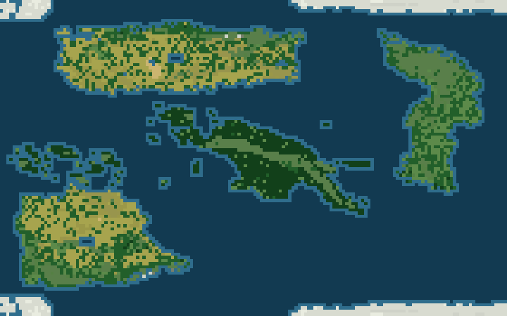
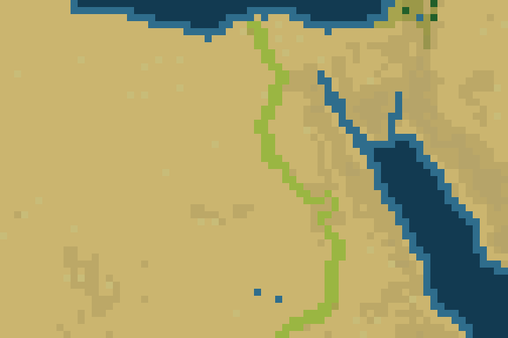
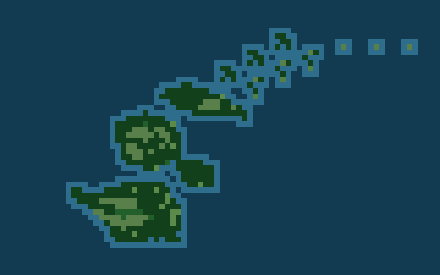
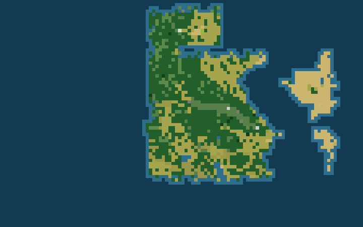

# Scenario results

Generated by `node mcp/scenarios.mjs` (last run 2026-10-17).

## Scenario 1: Earthlike alien world

**Prompt.** Build an Earthlike world that is not recognisable as Earth: 4-6 continents of varied size, polar caps top and bottom, tropics in the middle, at least two inland seas and one large archipelago.

**Result: 8/8 assertions pass.**

| assertion | result | detail |
|---|---|---|
| land 28-38% | pass | 28.8% land |
| 4-6 continents (landmasses >= 60 tiles outside the top/bottom 10% rows) | pass | 4 continents (1267, 1132, 742, 714) |
| >= 8 small landmasses (archipelago) | pass | 26 landmasses under 20 tiles |
| snow/tundra only in the top and bottom 15% of rows | pass | 0 of 542 snow/tundra tiles outside the caps |
| tropical groups only in the middle 40% of rows | pass | 0 of 773 tropical tiles outside rows 30-70 |
| >= 2 inland seas | pass | 15t at 55,18; 15t at 27,76; 6t at 89,20 |
| zero seam-lint warnings | pass | 0 warnings: none |
| >= 80% of river systems reach water | pass | 33/33 reach water |

**describe.** 35 landmasses: #1 1267t at 55,18 (continental 51%, temperate 40%); #2 1132t at 27,76 (temperate 85%, arid 14%); #3 742t at 137,34 (continental 95%, temperate 5%); #4 714t at 83,50 (tropical 86%, temperate 14%); #5 215t at 129,1 (ice cap 100%) and 30 smaller. Strait 1 wide between #14 and #18 at 13,51; Strait 1 wide between #1 and #17 at 21,11; Strait 2 wide between #4 and #12 at 106,53; Strait 3 wide between #2 and #8 at 12,93. Bay of 227t on #3 at 127,34 opening W; Bay of 98t on #3 at 145,46 opening SE; Bay of 95t on #4 at 68,51 opening W; Bay of 73t on #4 at 97,62 opening SE. Peninsula of 64t on #4 at 106,62 pointing SE; Peninsula of 46t on #4 at 61,43 pointing W; Peninsula of 44t on #5 at 102,1 pointing W; Peninsula of 44t on #6 at 102,98 pointing W. Mountain spine E-W 69 long (519t, 181 peaks, chain 74, 12 ends, 0 knots) on #1 at 66,16; Mountain spine E-W 52 long (337t, 103 peaks, chain 66, 10 ends, 0 knots) on #2 at 28,82; Mountain spine N-S 35 long (335t, 182 peaks, chain 41, 6 ends, 0 knots) on #3 at 135,26. 3 inland seas: 15t at 55,18; 15t at 27,76; 6t at 89,20. 33 river systems (559 edges): 33 reach water (2 different water bodies), 0 leave the map, 0 dead-end.

Warnings: none



<details><summary>Tool-call sequence and feedback</summary>

```
>>> set_game {"id":"civ4"}
game civ4 | mode compose | frame 40x28 | bounds W 48.86 S 16.5 E 63.14 N 26.5
compose canvas 80x44: 2 patches, 0 erased | shelf 93 snapshot(s) | fill ocean | mask none
games: civ4 (square 8x8..160x120), civ5 (hex 8x8..160x120), openfront (square 16x16..512x512 step 4), culture_wars (square 16x16..512x512 step 4)
params: islandBias=0 seawayBias=0 islandExpand=0 expandSteep=1 expandMaxMult=1.5 roughHalo=0 mtnPass=0 flatSpots=0 coastThr=30 nudgeX=0 nudgeY=0 riverN=12 riverEstuaries=true hill=0.55 peak=0.8 blendHill=0.9 blendPeak=0.7 fill=ocean
game params: sea=0.5 dryPlains=0.42 dryDesert=0.66 tempTundra=0.39 tempSnow=0.27 latTundra=55 latIce=70 alpine=0.6 clim=0.46 feat=false fpKoppen=true fpThresh=0.36 oasisThresh=0.33 oasisRatio=0.14 oasisMultDesert=10 oasisMultSemiArid=3 forestDens=0.5 jungleDens=0.5
legend: ~ ocean  , coast  g grass  p plains  d desert  t tundra  s snow  f forest  j jungle  r flood plains  o oasis  ^ peak  A-Z hills (uppercase terrain letter) | relief: flat / hills / peaks
```
```
>>> tune {"params":{},"reset":true,"report":false}
{
 "params": {
  "islandBias": 0,
  "seawayBias": 0,
  "islandExpand": 0,
  "expandSteep": 1,
  "expandMaxMult": 1.5,
  "roughHalo": 0,
  "mtnPass": 0,
  "flatSpots": 0,
  "coastThr": 30,
  "nudgeX": 0,
  "nudgeY": 0,
  "riverN": 12,
...
```
```
>>> tune {"params":{"feat":true,"alpine":0.2},"report":false}
{
 "params": {
  "islandBias": 0,
  "seawayBias": 0,
  "islandExpand": 0,
  "expandSteep": 1,
  "expandMaxMult": 1.5,
  "roughHalo": 0,
  "mtnPass": 0,
  "flatSpots": 0,
  "coastThr": 30,
  "nudgeX": 0,
  "nudgeY": 0,
  "riverN": 12,
...
```
```
>>> snapshot_from_catalog {"entry":"Antarctic coast","W":160,"H":14,"grid":false}
snapshot snap_mvbum81n_2_su817w "Antarctic coast" 160x14 civ4 | lat -78..-69 | 0.643°/tile
land 1045 (47%)  water 1195 | hills 443  peaks 20 | river edges 0
terrain: ~=ocean 1011  s=snow 582  A-Z=hills (uppercase terrain letter) 443  ,=coast 184  ^=peak 20
landmasses 2: #1 899t x57-159 y2-13; #2 146t x0-16 y0-11
landforms: 2 landmasses | 4 bays | 2 peninsulas | spines E-W 104L at 119,6, NE-SW 18L at 8,6
edges: N open sea [relief@135, land@8 (5..12, 0..2)] | E mountain wall [relief@5, land@7 (2..13)] | S ice [relief@73, land@108 (57..159)] | W mountain wall [relief@8, land@9 (7..11, 0..1)]
corners: NW mountain wall | NE open sea | SE ice | SW open sea
```
```
>>> flip_snapshot {"id":"Antarctic coast","axis":"y","name":"North cap","grid":false}
snapshot snap_mvbum85g_3_v1xae7 "North cap" 160x14 civ4 | lat -78..-69 | 0.643°/tile
land 1045 (47%)  water 1195 | hills 443  peaks 20 | river edges 0
terrain: ~=ocean 1011  s=snow 582  A-Z=hills (uppercase terrain letter) 443  ,=coast 184  ^=peak 20
landmasses 2: #1 899t x57-159 y0-11; #2 146t x0-16 y2-13
landforms: 2 landmasses | 4 bays | 2 peninsulas | spines E-W 104L at 119,7, NW-SE 18L at 8,7
edges: N ice [relief@73, land@108 (57..159)] | E mountain wall [relief@8, land@5 (0..11)] | S open sea [relief@135, land@8 (5..12, 0..2)] | W mountain wall [relief@4, land@4 (2..6, 9..10)]
corners: NW open sea | NE ice | SE open sea | SW mountain wall
```
```
>>> snapshot_from_catalog {"entry":"Anatolia","W":84,"H":35,"grid":false}
snapshot snap_mvbumb3a_4_5mqc68 "Anatolia" 82x26 civ4 | lat 36.1..42.13 | 0.232°/tile | cut: 266 mask-fill tiles (not coast)
land 1620 (76%)  water 512 | hills 559  peaks 259 | river edges 210
terrain: A-Z=hills (uppercase terrain letter) 559  p=plains 498  ^=peak 259  ,=coast 256  ~=ocean 256  f=forest 250  g=grass 28  d=desert 23  j=jungle 3
landmasses 3: #1 1617t x0-81 y0-25; #2 2t x1-1 y12-13; #3 1t x0-0 y16-16
landforms: 3 landmasses | 3 bays | 3 peninsulas | spines E-W 72L at 53,11, E-W 30L at 18,20 | 2 inland seas | rivers 9/10 reach water
edges: N cut edge [relief@34, land@38 (38..38)] | E cut edge [relief@15, land@5 (4..7)] | S cut edge [relief@14, land@46 (43..50, 27..33)] | W cut edge + river exit [relief@10, land@2 (1..3, 16..16)]
warnings (8): [straight-edge-coast] ruler-straight coast: 13 land tiles of patch 1 along row 5 (x 51..63) face water to the N (no cut flag: a straight real coast) ; [straight-edge-coast] ruler-straight coast: 12 land tiles of patch 1 along row 3 (x 69..80) face water to the N, a lasso/mask cut ; [straight-edge-coast] ruler-straight coast: 10 land tiles of patch 1 along row 1 (x 28..37) face water to the N, a lasso/mask cut ; [straight-edge-coast] ruler-straight coast: 9 land tiles of patch 1 along row 22 (x 68..76) face water to the S, a lasso/mask cut ; [straight-edge-coast] ruler-straight coast: 9 land tiles of patch 1 along row 24 (x 51..59) face water to the S, a lasso/mask cut ; [straight-edge-coast] ruler-straight coast: 9 land tiles of patch 1 along row 4 (x 12..20) face water to the N (no cut flag: a straight real coast) ; [straight-edge-coast] ruler-straight coast: 8 land tiles of patch 1 along row 4 (x 6..13) face water to the S (no cut flag: a straight real coast) ; [straight-edge-coast] ruler-straight coast: 8 land tiles of patch 1 along row 23 (x 60..67) face water to the S, a lasso/mask cut
corners: NW cut edge | NE cut edge | SE cut edge | SW cut edge
```
```
>>> snapshot_from_catalog {"entry":"Korea","W":46,"H":59,"grid":false}
snapshot snap_mvbume8y_5_n8worv "Korea" 41x54 civ4 | lat 34.14..42.84 | 0.161°/tile | cut: 920 mask-fill tiles (not coast)
land 908 (41%)  water 1306 | hills 270  peaks 228 | river edges 168
terrain: ~=ocean 1065  A-Z=hills (uppercase terrain letter) 270  ,=coast 241  ^=peak 228  g=grass 205  f=forest 196  j=jungle 9
landmasses 1: #1 908t x0-39 y0-52
landforms: 1 landmass | 3 bays | 3 peninsulas | spines N-S 40L at 19,17, NE-SW 12L at 20,44 | rivers 7/11 reach water
edges: N cut edge [relief@31, land@39 (39..39)] | E cut edge [relief@2] | S cut edge | W cut edge [relief@16, land@18 (18..18)]
warnings (5): [straight-edge-coast] ruler-straight coast: 6 land tiles of patch 1 along row 2 (x 28..33) face water to the N, a lasso/mask cut ; [straight-edge-coast] ruler-straight coast: 6 land tiles of patch 1 along column 28 (y 32..37) face water to the E, a lasso/mask cut ; [straight-edge-coast] ruler-straight coast: 5 land tiles of patch 1 along row 1 (x 34..38) face water to the N, a lasso/mask cut ; [straight-edge-coast] ruler-straight coast: 5 land tiles of patch 1 along row 3 (x 23..27) face water to the N, a lasso/mask cut ; [straight-edge-coast] ruler-straight coast: 4 land tiles of patch 1 along row 5 (x 16..19) face water to the N, a lasso/mask cut
corners: NW cut edge | NE cut edge | SE cut edge | SW cut edge
```
```
>>> flip_snapshot {"id":"Korea","axis":"x","name":"Korea mirrored","grid":false}
snapshot snap_mvbumecn_6_kf4egx "Korea mirrored" 41x54 civ4 | lat 34.14..42.84 | 0.161°/tile | cut: 920 mask-fill tiles (not coast)
land 908 (41%)  water 1306 | hills 270  peaks 228 | river edges 168
terrain: ~=ocean 1065  A-Z=hills (uppercase terrain letter) 270  ,=coast 241  ^=peak 228  g=grass 205  f=forest 196  j=jungle 9
landmasses 1: #1 908t x1-40 y0-52
landforms: 1 landmass | 3 bays | 3 peninsulas | spines N-S 40L at 21,17, NW-SE 12L at 20,44 | rivers 7/11 reach water
edges: N cut edge [relief@9, land@1 (1..1)] | E cut edge [relief@16, land@18 (18..18)] | S cut edge | W cut edge [relief@2]
warnings (5): [straight-edge-coast] ruler-straight coast: 6 land tiles of patch 1 along row 2 (x 7..12) face water to the N, a lasso/mask cut ; [straight-edge-coast] ruler-straight coast: 6 land tiles of patch 1 along column 12 (y 32..37) face water to the W, a lasso/mask cut ; [straight-edge-coast] ruler-straight coast: 5 land tiles of patch 1 along row 1 (x 2..6) face water to the N, a lasso/mask cut ; [straight-edge-coast] ruler-straight coast: 5 land tiles of patch 1 along row 3 (x 13..17) face water to the N, a lasso/mask cut ; [straight-edge-coast] ruler-straight coast: 4 land tiles of patch 1 along row 5 (x 21..24) face water to the N, a lasso/mask cut
corners: NW cut edge | NE cut edge | SE cut edge | SW cut edge
```
```
>>> snapshot_from_catalog {"entry":"New Guinea","W":76,"H":38,"grid":false}
snapshot snap_mvbumh31_7_70r2ha "New Guinea" 76x38 civ4 | lat -11..0.5 | 0.303°/tile
land 774 (27%)  water 2114 | hills 197  peaks 153 | river edges 156
terrain: ~=ocean 1722  ,=coast 392  j=jungle 374  A-Z=hills (uppercase terrain letter) 197  ^=peak 153  g=grass 41  f=forest 9
landmasses 14: #1 714t x6-70 y3-36; #2 26t x64-75 y16-21; #3 10t x0-5 y11-13; #4 7t x17-18 y20-23; #5 3t x7-8 y26-27; #6 2t x5-6 y2-2; #7 2t x22-23 y4-5; #8 2t x23-24 y7-7; #9 2t x58-59 y8-8; #10 2t x70-71 y32-33 (+4 smaller)
landforms: 14 landmasses | 3 straits (#1/#2 w2 at 62,22 #1/#3 w4 at 7,12) | 4 bays | 3 peninsulas | spines E-W 61L at 43,20, NW-SE 8L at 13,5 | rivers 10/12 reach water
edges: N open sea [relief@11] | E coast [relief@18, land@17 (16..19, 12..12)] | S open sea [relief@67, land@44 (44..44)] | W open sea [relief@11, land@11 (11..12)]
corners: NW open sea | NE open sea | SE open sea | SW open sea
```
```
>>> snapshot_from_catalog {"entry":"Iberia","W":60,"H":38,"grid":false}
snapshot snap_mvbuminv_8_1ckuhs "Iberia" 58x35 civ4 | lat 35.92..43.8 | 0.225°/tile | cut: 502 mask-fill tiles (not coast)
land 1248 (61%)  water 782 | hills 365  peaks 195 | river edges 217
terrain: ~=ocean 585  p=plains 371  A-Z=hills (uppercase terrain letter) 365  f=forest 230  ,=coast 197  ^=peak 195  g=grass 83  j=jungle 3  d=desert 1
landmasses 1: #1 1248t x1-56 y0-34
landforms: 1 landmass | 3 bays | 3 peninsulas | spines E-W 53L at 27,9, E-W 21L at 27,27 | rivers 7/11 reach water
edges: N cut edge [relief@25, land@7 (7..8)] | E cut edge [relief@6] | S cut edge [relief@19, land@17 (17..17)] | W cut edge [relief@7]
warnings (7): [straight-edge-coast] ruler-straight coast: 11 land tiles of patch 1 along row 1 (x 9..19) face water to the N (no cut flag: a straight real coast) ; [straight-edge-coast] ruler-straight coast: 8 land tiles of patch 1 along row 2 (x 27..34) face water to the N (no cut flag: a straight real coast) ; [straight-edge-coast] ruler-straight coast: 7 land tiles of patch 1 along row 30 (x 23..29) face water to the S (no cut flag: a straight real coast) ; [straight-edge-coast] ruler-straight coast: 5 land tiles of patch 1 along row 4 (x 46..50) face water to the N, a lasso/mask cut ; [straight-edge-coast] ruler-straight coast: 4 land tiles of patch 1 along row 2 (x 38..41) face water to the N, a lasso/mask cut ; [straight-edge-coast] ruler-straight coast: 4 land tiles of patch 1 along row 3 (x 42..45) face water to the N, a lasso/mask cut ; [straight-edge-coast] ruler-straight coast: 4 land tiles of patch 1 along row 5 (x 51..54) face water to the N, a lasso/mask cut
corners: NW open sea | NE cut edge | SE cut edge | SW cut edge
```
```
>>> flip_snapshot {"id":"Iberia","axis":"y","name":"Iberia mirrored","grid":false}
snapshot snap_mvbumisc_9_poj6o7 "Iberia mirrored" 58x35 civ4 | lat 35.92..43.8 | 0.225°/tile | cut: 502 mask-fill tiles (not coast)
land 1248 (61%)  water 782 | hills 365  peaks 195 | river edges 217
terrain: ~=ocean 585  p=plains 371  A-Z=hills (uppercase terrain letter) 365  f=forest 230  ,=coast 197  ^=peak 195  g=grass 83  j=jungle 3  d=desert 1
landmasses 1: #1 1248t x1-56 y0-34
landforms: 1 landmass | 3 bays | 3 peninsulas | spines E-W 53L at 27,25, E-W 21L at 27,7 | rivers 7/11 reach water
edges: N cut edge [relief@19, land@17 (17..17)] | E cut edge [relief@28] | S cut edge [relief@25, land@7 (7..8)] | W cut edge [relief@27]
warnings (7): [straight-edge-coast] ruler-straight coast: 11 land tiles of patch 1 along row 33 (x 9..19) face water to the S (no cut flag: a straight real coast) ; [straight-edge-coast] ruler-straight coast: 8 land tiles of patch 1 along row 32 (x 27..34) face water to the S (no cut flag: a straight real coast) ; [straight-edge-coast] ruler-straight coast: 7 land tiles of patch 1 along row 4 (x 23..29) face water to the N (no cut flag: a straight real coast) ; [straight-edge-coast] ruler-straight coast: 5 land tiles of patch 1 along row 30 (x 46..50) face water to the S, a lasso/mask cut ; [straight-edge-coast] ruler-straight coast: 4 land tiles of patch 1 along row 29 (x 51..54) face water to the S, a lasso/mask cut ; [straight-edge-coast] ruler-straight coast: 4 land tiles of patch 1 along row 31 (x 42..45) face water to the S, a lasso/mask cut ; [straight-edge-coast] ruler-straight coast: 4 land tiles of patch 1 along row 32 (x 38..41) face water to the S, a lasso/mask cut
corners: NW cut edge | NE cut edge | SE cut edge | SW open sea
```
```
>>> snapshot_from_catalog {"entry":"Society Islands","W":32,"H":16,"grid":false}
snapshot snap_mvbumj8m_10_4q8tge "Society Islands" 32x16 civ4 | lat -18.12..-15.87 | 0.141°/tile
land 34 (7%)  water 478 | hills 8  peaks 7 | river edges 0
terrain: ~=ocean 384  ,=coast 94  j=jungle 15  A-Z=hills (uppercase terrain letter) 8  ^=peak 7  g=grass 3  f=forest 1
landmasses 7: #1 13t x4-8 y2-7; #2 11t x18-23 y11-14; #3 3t x10-11 y5-6; #4 3t x20-21 y7-8; #5 2t x1-1 y3-4; #6 1t x13-13 y12-12; #7 1t x31-31 y14-14
landforms: 7 landmasses | spine NW-SE 7L at 21,12
edges: N open sea | E open sea [land@14 (14..14)] | S open sea [relief@21] | W open sea
corners: NW open sea | NE open sea | SE coast | SW open sea
```
```
>>> snapshot_from_catalog {"entry":"Tahiti","grid":false}
snapshot snap_mvbumk0a_11_vxcjuw "Tahiti" 12x8 civ4 | lat -17.95..-17.35 | 0.075°/tile
land 19 (20%)  water 77 | hills 4  peaks 5 | river edges 0
terrain: ~=ocean 46  ,=coast 31  j=jungle 10  ^=peak 5  A-Z=hills (uppercase terrain letter) 4
landmasses 2: #1 18t x3-8 y2-6; #2 1t x0-0 y2-2
landforms: 2 landmasses | spine E-W 4L at 4,3
edges: N open sea [relief@4] | E open sea [relief@5] | S open sea [relief@4] | W coast [relief@3, land@2 (2..2)]
corners: NW open sea | NE open sea | SE open sea | SW open sea
```
```
>>> snapshot_from_catalog {"entry":"Upolu","grid":false}
snapshot snap_mvbumkrq_12_qqhh66 "Upolu" 12x8 civ4 | lat -14.19..-13.66 | 0.067°/tile
land 25 (26%)  water 71 | hills 8  peaks 3 | river edges 0
terrain: ~=ocean 39  ,=coast 32  j=jungle 13  A-Z=hills (uppercase terrain letter) 8  ^=peak 3  g=grass 1
landmasses 1: #1 25t x1-10 y2-5
landforms: 1 landmass | spine NW-SE 5L at 6,4
edges: N open sea [relief@6] | E open sea [relief@4] | S open sea [relief@6] | W open sea
corners: NW open sea | NE open sea | SE open sea | SW open sea
```
```
>>> snapshot_from_catalog {"entry":"Funafuti","grid":false}
snapshot snap_mvbumlje_13_sb9wtr "Funafuti" 8x8 civ4 | lat -8.81..-8.29 | 0.066°/tile
land 5 (8%)  water 59 | hills 2  peaks 1 | river edges 0
terrain: ~=ocean 40  ,=coast 19  j=jungle 2  A-Z=hills (uppercase terrain letter) 2  ^=peak 1
landmasses 1: #1 5t x2-4 y2-5
landforms: 1 landmass
edges: N open sea [relief@2] | E open sea | S open sea [relief@3] | W open sea [relief@2]
corners: NW open sea | NE open sea | SE open sea | SW open sea
```
```
>>> snapshot_from_catalog {"entry":"Tarawa","grid":false}
snapshot snap_mvbummbe_14_ezslgl "Tarawa" 8x8 civ4 | lat 1.19..1.71 | 0.066°/tile
land 14 (22%)  water 50 | hills 6  peaks 1 | river edges 0
terrain: ,=coast 26  ~=ocean 24  j=jungle 7  A-Z=hills (uppercase terrain letter) 6  ^=peak 1
landmasses 1: #1 14t x1-6 y2-5
landforms: 1 landmass
edges: N open sea [relief@3] | E open sea [relief@4] | S open sea [relief@1] | W open sea [relief@2]
corners: NW open sea | NE open sea | SE open sea | SW open sea
```
```
>>> compose_new {"W":160,"H":100,"fill":"water","latitudes":{"top":80,"bottom":-80},"targetLand":[0.28,0.38],"grid":false}
compose canvas 160x100 civ4 | 0 patches | 0 erased tiles | latitudes 80..-80
land 0 (0%)  water 16000 | hills 0  peaks 0 | river edges 0
terrain: ~=ocean 16000
landmasses 0
patches: none
landforms: 0 landmasses
budget: land 0.0% of target 28-38% (add 4480..6080 land tiles)
warnings: none
```
```
>>> place {"snapshot":"North cap","x":0,"y":-8,"grid":false}
compose canvas 160x100 civ4 | 1 patch | 0 erased tiles | latitudes 80..-80
land 290 (2%)  water 15710 | hills 247  peaks 19 | river edges 0
terrain: ~=ocean 15583  A-Z=hills (uppercase terrain letter) 247  ,=coast 127  s=snow 24  ^=peak 19
landmasses 2: #1 215t x92-159 y0-3; #2 75t x0-15 y0-5
patches (bottom to top): [3] "North cap" 160x14 @0,-8
landforms: 2 landmasses | 3 bays | 2 peninsulas | spines E-W 68L at 129,1, E-W 12L at 10,3
budget: land 1.8% of target 28-38% (add 4190..5790 land tiles)
warnings (4): [straight-edge-coast] ruler-straight coast: 11 land tiles of patch 3 along row 3 (x 130..140) face water to the S (no cut flag: a straight real coast) ; [straight-edge-coast] ruler-straight coast: 8 land tiles of patch 3 along row 5 (x 5..12) face water to the S, the capture rectangle edge (a rect or frame cut) ; [straight-edge-coast] ruler-straight coast: 7 land tiles of patch 3 along row 2 (x 149..155) face water to the S (no cut flag: a straight real coast) ; [straight-edge-coast] ruler-straight coast: 7 land tiles of patch 3 along row 3 (x 121..127) face water to the S (no cut flag: a straight real coast)
placed patch 3 at 0,-8 (land only) | clipped: 755 land tiles off the canvas (8 rows north)
```
```
>>> place {"snapshot":"Antarctic coast","x":0,"y":94,"grid":false}
compose canvas 160x100 civ4 | 2 patches | 0 erased tiles | latitudes 80..-80
land 580 (4%)  water 15420 | hills 494  peaks 38 | river edges 0
terrain: ~=ocean 15166  A-Z=hills (uppercase terrain letter) 494  ,=coast 254  s=snow 48  ^=peak 38
landmasses 4: #1 215t x92-159 y0-3; #2 215t x92-159 y96-99; #3 75t x0-15 y0-5; #4 75t x0-15 y94-99
patches (bottom to top): [3] "North cap" 160x14 @0,-8; [4] "Antarctic coast" 160x14 @0,94
landforms: 4 landmasses | 6 bays | 4 peninsulas | spines E-W 68L at 129,1, E-W 68L at 129,98
collisions: none
budget: land 3.6% of target 28-38% (add 3900..5500 land tiles)
warnings (8): [straight-edge-coast] ruler-straight coast: 11 land tiles of patch 3 along row 3 (x 130..140) face water to the S (no cut flag: a straight real coast) ; [straight-edge-coast] ruler-straight coast: 11 land tiles of patch 4 along row 96 (x 130..140) face water to the N (no cut flag: a straight real coast) ; [straight-edge-coast] ruler-straight coast: 8 land tiles of patch 3 along row 5 (x 5..12) face water to the S, the capture rectangle edge (a rect or frame cut) ; [straight-edge-coast] ruler-straight coast: 8 land tiles of patch 4 along row 94 (x 5..12) face water to the N, the capture rectangle edge (a rect or frame cut) ; [straight-edge-coast] ruler-straight coast: 7 land tiles of patch 3 along row 2 (x 149..155) face water to the S (no cut flag: a straight real coast) ; [straight-edge-coast] ruler-straight coast: 7 land tiles of patch 3 along row 3 (x 121..127) face water to the S (no cut flag: a straight real coast) ; [straight-edge-coast] ruler-straight coast: 7 land tiles of patch 4 along row 96 (x 121..127) face water to the N (no cut flag: a straight real coast) ; [straight-edge-coast] ruler-straight coast: 7 land tiles of patch 4 along row 97 (x 149..155) face water to the N (no cut flag: a straight real coast)
placed patch 4 at 0,94 (land only) | clipped: 755 land tiles off the canvas (8 rows south)
```
```
>>> place {"snapshot":"New Guinea","x":44,"y":31,"ragged":true,"grid":false}
compose canvas 160x100 civ4 | 3 patches | 0 erased tiles | latitudes 80..-80
land 1336 (8%)  water 14664 | hills 677  peaks 190 | river edges 156
terrain: ~=ocean 14040  A-Z=hills (uppercase terrain letter) 677  ,=coast 624  j=jungle 372  ^=peak 190  s=snow 48  g=grass 40  f=forest 9
landmasses 16: #1 714t x50-114 y34-67; #2 215t x92-159 y0-3; #3 215t x92-159 y96-99; #4 75t x0-15 y0-5; #5 75t x0-15 y94-99; #6 16t x108-116 y51-52; #7 7t x61-62 y51-54; #8 4t x47-49 y43-44; #9 3t x51-52 y57-58; #10 2t x49-50 y33-33 (+6 smaller)
patches (bottom to top): [3] "North cap" 160x14 @0,-8; [4] "Antarctic coast" 160x14 @0,94; [5] "New Guinea" 76x38 @44,31
landforms: 16 landmasses | 3 straits (#1/#6 w2 at 106,53 #1/#8 w4 at 51,43) | 6 bays | 6 peninsulas | spines E-W 61L at 87,51, E-W 68L at 129,1 | rivers 10/12 reach water
collisions: none
budget: land 8.4% of target 28-38% (add 3144..4744 land tiles)
warnings (8): [straight-edge-coast] ruler-straight coast: 11 land tiles of patch 3 along row 3 (x 130..140) face water to the S (no cut flag: a straight real coast) ; [straight-edge-coast] ruler-straight coast: 11 land tiles of patch 4 along row 96 (x 130..140) face water to the N (no cut flag: a straight real coast) ; [straight-edge-coast] ruler-straight coast: 9 land tiles of patch 5 along row 51 (x 108..116) face water to the N (no cut flag: a straight real coast) ; [straight-edge-coast] ruler-straight coast: 8 land tiles of patch 3 along row 5 (x 5..12) face water to the S, the capture rectangle edge (a rect or frame cut) ; [straight-edge-coast] ruler-straight coast: 8 land tiles of patch 5 along row 62 (x 83..90) face water to the S (no cut flag: a straight real coast) ; [straight-edge-coast] ruler-straight coast: 8 land tiles of patch 4 along row 94 (x 5..12) face water to the N, the capture rectangle edge (a rect or frame cut) ; [straight-edge-coast] ruler-straight coast: 7 land tiles of patch 3 along row 2 (x 149..155) face water to the S (no cut flag: a straight real coast) ; [straight-edge-coast] ruler-straight coast: 7 land tiles of patch 3 along row 3 (x 121..127) face water to the S (no cut flag: a straight real coast)
notes (2): [river-endorheic] river 86752 dead-ends on land at 90,59 as it did in its source (patch 5): endorheic, not a seam ; [river-endorheic] river 81750 dead-ends on land at 95,47 as it did in its source (patch 5): endorheic, not a seam
placed patch 5 at 44,31 (land only) | ragged: 18 edge tiles feathered
```
```
>>> place {"snapshot":"Anatolia","x":2,"y":8,"ragged":true,"avoidLand":true,"gap":2,"grid":false}
compose canvas 160x100 civ4 | 4 patches | 0 erased tiles | latitudes 80..-80
land 2623 (16%)  water 13377 | hills 1137  peaks 389 | river edges 345
terrain: ~=ocean 12446  A-Z=hills (uppercase terrain letter) 1137  ,=coast 931  ^=peak 389  p=plains 385  j=jungle 374  f=forest 213  g=grass 60  s=snow 48  d=desert 17
landmasses 18: #1 1282t x18-95 y7-29; #2 714t x50-114 y34-67; #3 215t x92-159 y0-3; #4 215t x92-159 y96-99; #5 75t x0-15 y0-5; #6 75t x0-15 y94-99; #7 16t x108-116 y51-52; #8 7t x61-62 y51-54; #9 5t x18-21 y9-10; #10 4t x47-49 y43-44 (+8 smaller)
patches (bottom to top): [3] "North cap" 160x14 @0,-8; [4] "Antarctic coast" 160x14 @0,94; [5] "New Guinea" 76x38 @44,31; [6] "Anatolia" 82x26 @16,5
landforms: 18 landmasses | 6 straits (#1/#9 w1 at 21,11 #2/#7 w2 at 106,53) | 6 bays | 6 peninsulas | spines E-W 69L at 66,16, E-W 61L at 87,51 | 1 inland sea | rivers 18/21 reach water
collisions: none
budget: land 16.4% of target 28-38% (add 1857..3457 land tiles)
warnings (9): [latitude-mismatch] desert tile at 63° latitude (1 tiles) near 32,10 ; [straight-edge-coast] ruler-straight coast: 13 land tiles of patch 6 along row 10 (x 67..79) face water to the N (no cut flag: a straight real coast) ; [straight-edge-coast] ruler-straight coast: 12 land tiles of patch 6 along row 9 (x 25..36) face water to the N (no cut flag: a straight real coast) ; [straight-edge-coast] ruler-straight coast: 11 land tiles of patch 3 along row 3 (x 130..140) face water to the S (no cut flag: a straight real coast) ; [straight-edge-coast] ruler-straight coast: 11 land tiles of patch 4 along row 96 (x 130..140) face water to the N (no cut flag: a straight real coast) ; [straight-edge-coast] ruler-straight coast: 9 land tiles of patch 5 along row 51 (x 108..116) face water to the N (no cut flag: a straight real coast) ; [straight-edge-coast] ruler-straight coast: 8 land tiles of patch 3 along row 5 (x 5..12) face water to the S, the capture rectangle edge (a rect or frame cut) ; [straight-edge-coast] ruler-straight coast: 8 land tiles of patch 5 along row 62 (x 83..90) face water to the S (no cut flag: a straight real coast) ; +1 more
notes (2): [river-endorheic] river 86752 dead-ends on land at 90,59 as it did in its source (patch 5): endorheic, not a seam ; [river-endorheic] river 81750 dead-ends on land at 95,47 as it did in its source (patch 5): endorheic, not a seam
placed patch 6 at 16,5 (land only) | avoidLand shifted it by 14,-3 | ragged: 333 edge tiles feathered
```
```
>>> place {"snapshot":"Korea mirrored","x":114,"y":8,"ragged":true,"avoidLand":true,"gap":2,"grid":false}
compose canvas 160x100 civ4 | 5 patches | 0 erased tiles | latitudes 80..-80
land 3365 (21%)  water 12635 | hills 1338  peaks 583 | river edges 460
terrain: ~=ocean 11451  A-Z=hills (uppercase terrain letter) 1338  ,=coast 1184  ^=peak 583  p=plains 385  j=jungle 382  f=forest 370  g=grass 242  s=snow 48  d=desert 17
landmasses 19: #1 1282t x18-95 y7-29; #2 742t x120-151 y10-60; #3 714t x50-114 y34-67; #4 215t x92-159 y0-3; #5 215t x92-159 y96-99; #6 75t x0-15 y0-5; #7 75t x0-15 y94-99; #8 16t x108-116 y51-52; #9 7t x61-62 y51-54; #10 5t x18-21 y9-10 (+9 smaller)
patches (bottom to top): [3] "North cap" 160x14 @0,-8; [4] "Antarctic coast" 160x14 @0,94; [5] "New Guinea" 76x38 @44,31; [6] "Anatolia" 82x26 @16,5; [7] "Korea mirrored" 41x54 @114,8
landforms: 19 landmasses | 6 straits (#1/#10 w1 at 21,11 #3/#8 w2 at 106,53) | 6 bays | 6 peninsulas | spines E-W 69L at 66,16, N-S 35L at 135,26 | 1 inland sea | rivers 26/30 reach water
collisions: none
budget: land 21.0% of target 28-38% (add 1115..2715 land tiles)
warnings (10): [latitude-mismatch] desert tile at 63° latitude (1 tiles) near 32,10 ; [river-dead-end] river 54791 has 1 edge ending on land with no continuation, first at 142,38 (not in its source: cut at a patch boundary, by an erase or by an overlapping stamp) ; [straight-edge-coast] ruler-straight coast: 13 land tiles of patch 6 along row 10 (x 67..79) face water to the N (no cut flag: a straight real coast) ; [straight-edge-coast] ruler-straight coast: 12 land tiles of patch 6 along row 9 (x 25..36) face water to the N (no cut flag: a straight real coast) ; [straight-edge-coast] ruler-straight coast: 11 land tiles of patch 3 along row 3 (x 130..140) face water to the S (no cut flag: a straight real coast) ; [straight-edge-coast] ruler-straight coast: 11 land tiles of patch 4 along row 96 (x 130..140) face water to the N (no cut flag: a straight real coast) ; [straight-edge-coast] ruler-straight coast: 9 land tiles of patch 5 along row 51 (x 108..116) face water to the N (no cut flag: a straight real coast) ; [straight-edge-coast] ruler-straight coast: 8 land tiles of patch 3 along row 5 (x 5..12) face water to the S, the capture rectangle edge (a rect or frame cut) ; +2 more
notes (2): [river-endorheic] river 86752 dead-ends on land at 90,59 as it did in its source (patch 5): endorheic, not a seam ; [river-endorheic] river 81750 dead-ends on land at 95,47 as it did in its source (patch 5): endorheic, not a seam
placed patch 7 at 114,8 (land only) | ragged: 166 edge tiles feathered
```
```
>>> place {"snapshot":"Iberia mirrored","x":4,"y":60,"ragged":true,"avoidLand":true,"gap":2,"grid":false}
compose canvas 160x100 civ4 | 6 patches | 0 erased tiles | latitudes 80..-80
land 4512 (28%)  water 11488 | hills 1675  peaks 735 | river edges 654
terrain: ~=ocean 10085  A-Z=hills (uppercase terrain letter) 1675  ,=coast 1403  p=plains 746  ^=peak 735  f=forest 583  j=jungle 384  g=grass 323  s=snow 48  d=desert 18
landmasses 20: #1 1282t x18-95 y7-29; #2 1147t x5-59 y58-90; #3 742t x120-151 y10-60; #4 714t x50-114 y34-67; #5 215t x92-159 y0-3; #6 215t x92-159 y96-99; #7 75t x0-15 y0-5; #8 75t x0-15 y94-99; #9 16t x108-116 y51-52; #10 7t x61-62 y51-54 (+10 smaller)
patches (bottom to top): [3] "North cap" 160x14 @0,-8; [4] "Antarctic coast" 160x14 @0,94; [5] "New Guinea" 76x38 @44,31; [6] "Anatolia" 82x26 @16,5; [7] "Korea mirrored" 41x54 @114,8; [8] "Iberia mirrored" 58x35 @4,57
landforms: 20 landmasses | 6 straits (#1/#11 w1 at 21,11 #4/#9 w2 at 106,53) | 6 bays | 6 peninsulas | spines E-W 69L at 66,16, E-W 52L at 28,81 | 1 inland sea | rivers 32/39 reach water
collisions: none
budget: land 28.2% of target 28-38% (within target)
warnings (11): [latitude-mismatch] desert tile at 63° latitude (1 tiles) near 32,10 ; [river-dead-end] river 54791 has 1 edge ending on land with no continuation, first at 142,38 (not in its source: cut at a patch boundary, by an erase or by an overlapping stamp) ; [river-dead-end] river 32943 has 1 edge ending on land with no continuation, first at 26,88 (not in its source: cut at a patch boundary, by an erase or by an overlapping stamp) ; [straight-edge-coast] ruler-straight coast: 13 land tiles of patch 6 along row 10 (x 67..79) face water to the N (no cut flag: a straight real coast) ; [straight-edge-coast] ruler-straight coast: 12 land tiles of patch 6 along row 9 (x 25..36) face water to the N (no cut flag: a straight real coast) ; [straight-edge-coast] ruler-straight coast: 11 land tiles of patch 3 along row 3 (x 130..140) face water to the S (no cut flag: a straight real coast) ; [straight-edge-coast] ruler-straight coast: 11 land tiles of patch 4 along row 96 (x 130..140) face water to the N (no cut flag: a straight real coast) ; [straight-edge-coast] ruler-straight coast: 9 land tiles of patch 8 along row 90 (x 15..23) face water to the S (no cut flag: a straight real coast) ; +3 more
notes (3): [river-endorheic] river 86752 dead-ends on land at 90,59 as it did in its source (patch 5): endorheic, not a seam ; [river-endorheic] river 81750 dead-ends on land at 95,47 as it did in its source (patch 5): endorheic, not a seam ; [river-endorheic] river 32943 dead-ends on land at 48,78 as it did in its source (patch 8): endorheic, not a seam
placed patch 8 at 4,57 (land only) | avoidLand shifted it by 0,-3 | ragged: 101 edge tiles feathered
```
```
>>> place {"snapshot":"Society Islands","x":4,"y":44,"avoidLand":true,"grid":false}
compose canvas 160x100 civ4 | 7 patches | 0 erased tiles | latitudes 80..-80
land 4546 (28%)  water 11454 | hills 1683  peaks 742 | river edges 654
terrain: ~=ocean 9960  A-Z=hills (uppercase terrain letter) 1683  ,=coast 1494  p=plains 746  ^=peak 742  f=forest 584  j=jungle 399  g=grass 326  s=snow 48  d=desert 18
landmasses 27: #1 1282t x18-95 y7-29; #2 1147t x5-59 y58-90; #3 742t x120-151 y10-60; #4 714t x50-114 y34-67; #5 215t x92-159 y0-3; #6 215t x92-159 y96-99; #7 75t x0-15 y0-5; #8 75t x0-15 y94-99; #9 16t x108-116 y51-52; #10 13t x8-12 y46-51 (+17 smaller)
patches (bottom to top): [3] "North cap" 160x14 @0,-8; [4] "Antarctic coast" 160x14 @0,94; [5] "New Guinea" 76x38 @44,31; [6] "Anatolia" 82x26 @16,5; [7] "Korea mirrored" 41x54 @114,8; [8] "Iberia mirrored" 58x35 @4,57; [9] "Society Islands" 32x16 @4,44
landforms: 27 landmasses | 6 straits (#2/#11 w1 at 26,59 #1/#13 w1 at 21,11) | 6 bays | 6 peninsulas | spines E-W 69L at 66,16, E-W 52L at 28,81 | 1 inland sea | rivers 32/39 reach water
collisions: none
budget: land 28.4% of target 28-38% (within target)
warnings (11): [latitude-mismatch] desert tile at 63° latitude (1 tiles) near 32,10 ; [river-dead-end] river 54791 has 1 edge ending on land with no continuation, first at 142,38 (not in its source: cut at a patch boundary, by an erase or by an overlapping stamp) ; [river-dead-end] river 32943 has 1 edge ending on land with no continuation, first at 26,88 (not in its source: cut at a patch boundary, by an erase or by an overlapping stamp) ; [straight-edge-coast] ruler-straight coast: 13 land tiles of patch 6 along row 10 (x 67..79) face water to the N (no cut flag: a straight real coast) ; [straight-edge-coast] ruler-straight coast: 12 land tiles of patch 6 along row 9 (x 25..36) face water to the N (no cut flag: a straight real coast) ; [straight-edge-coast] ruler-straight coast: 11 land tiles of patch 3 along row 3 (x 130..140) face water to the S (no cut flag: a straight real coast) ; [straight-edge-coast] ruler-straight coast: 11 land tiles of patch 4 along row 96 (x 130..140) face water to the N (no cut flag: a straight real coast) ; [straight-edge-coast] ruler-straight coast: 9 land tiles of patch 8 along row 90 (x 15..23) face water to the S (no cut flag: a straight real coast) ; +3 more
notes (3): [river-endorheic] river 86752 dead-ends on land at 90,59 as it did in its source (patch 5): endorheic, not a seam ; [river-endorheic] river 81750 dead-ends on land at 95,47 as it did in its source (patch 5): endorheic, not a seam ; [river-endorheic] river 32943 dead-ends on land at 48,78 as it did in its source (patch 8): endorheic, not a seam
placed patch 9 at 4,44 (land only)
```
```
>>> scatter {"snapshots":["Tahiti","Funafuti","Upolu","Tarawa"],"along":[[8,52],[40,54]],"spacing":6,"avoidLand":true,"grid":false}
compose canvas 160x100 civ4 | 13 patches | 0 erased tiles | latitudes 80..-80
land 4633 (29%)  water 11367 | hills 1709  peaks 758 | river edges 654
terrain: ~=ocean 9747  A-Z=hills (uppercase terrain letter) 1709  ,=coast 1620  ^=peak 758  p=plains 746  f=forest 584  j=jungle 443  g=grass 327  s=snow 48  d=desert 18
landmasses 35: #1 1282t x18-95 y7-29; #2 1147t x5-59 y58-90; #3 742t x120-151 y10-60; #4 714t x50-114 y34-67; #5 215t x92-159 y0-3; #6 215t x92-159 y96-99; #7 75t x0-15 y0-5; #8 75t x0-15 y94-99; #9 25t x15-24 y46-49; #10 18t x32-37 y48-52 (+25 smaller)
patches (bottom to top): [3] "North cap" 160x14 @0,-8; [4] "Antarctic coast" 160x14 @0,94; [5] "New Guinea" 76x38 @44,31; [6] "Anatolia" 82x26 @16,5; [7] "Korea mirrored" 41x54 @114,8; [8] "Iberia mirrored" 58x35 @4,57; [9] "Society Islands" 32x16 @4,44; [10] "Tahiti" 12x8 @3,48; [11] "Funafuti" 8x8 @11,50; [12] "Upolu" 12x8 @14,44; [13] "Tarawa" 8x8 @26,49; [14] "Tahiti" 12x8 @29,46; [15] "Funafuti" 8x8 @34,52
landforms: 35 landmasses | 6 straits (#14/#18 w1 at 13,51 #1/#17 w1 at 21,11) | 6 bays | 6 peninsulas | spines E-W 69L at 66,16, E-W 52L at 28,81 | 1 inland sea | rivers 32/39 reach water
collisions: none
budget: land 29.0% of target 28-38% (within target)
warnings (11): [latitude-mismatch] desert tile at 63° latitude (1 tiles) near 32,10 ; [river-dead-end] river 54791 has 1 edge ending on land with no continuation, first at 142,38 (not in its source: cut at a patch boundary, by an erase or by an overlapping stamp) ; [river-dead-end] river 32943 has 1 edge ending on land with no continuation, first at 26,88 (not in its source: cut at a patch boundary, by an erase or by an overlapping stamp) ; [straight-edge-coast] ruler-straight coast: 13 land tiles of patch 6 along row 10 (x 67..79) face water to the N (no cut flag: a straight real coast) ; [straight-edge-coast] ruler-straight coast: 12 land tiles of patch 6 along row 9 (x 25..36) face water to the N (no cut flag: a straight real coast) ; [straight-edge-coast] ruler-straight coast: 11 land tiles of patch 3 along row 3 (x 130..140) face water to the S (no cut flag: a straight real coast) ; [straight-edge-coast] ruler-straight coast: 11 land tiles of patch 4 along row 96 (x 130..140) face water to the N (no cut flag: a straight real coast) ; [straight-edge-coast] ruler-straight coast: 9 land tiles of patch 8 along row 90 (x 15..23) face water to the S (no cut flag: a straight real coast) ; +3 more
notes (3): [river-endorheic] river 86752 dead-ends on land at 90,59 as it did in its source (patch 5): endorheic, not a seam ; [river-endorheic] river 81750 dead-ends on land at 95,47 as it did in its source (patch 5): endorheic, not a seam ; [river-endorheic] river 32943 dead-ends on land at 48,78 as it did in its source (patch 8): endorheic, not a seam
scattered 6: [10] Tahiti @3,48 (shifted -1,0); [11] Funafuti @11,50 (shifted 1,2); [12] Upolu @14,44 (shifted 0,-5); [13] Tarawa @26,49 (shifted 4,0); [14] Tahiti @29,46 (shifted 2,-3); [15] Funafuti @34,52 (shifted 0,2)
```
```
>>> compose_view {"step":1}
compose canvas 160x100 civ4 | 13 patches | 0 erased tiles | latitudes 80..-80
land 4633 (29%)  water 11367 | hills 1709  peaks 758 | river edges 654
terrain: ~=ocean 9747  A-Z=hills (uppercase terrain letter) 1709  ,=coast 1620  ^=peak 758  p=plains 746  f=forest 584  j=jungle 443  g=grass 327  s=snow 48  d=desert 18
landmasses 35: #1 1282t x18-95 y7-29; #2 1147t x5-59 y58-90; #3 742t x120-151 y10-60; #4 714t x50-114 y34-67; #5 215t x92-159 y0-3; #6 215t x92-159 y96-99; #7 75t x0-15 y0-5; #8 75t x0-15 y94-99; #9 25t x15-24 y46-49; #10 18t x32-37 y48-52 (+25 smaller)
patches (bottom to top): [3] "North cap" 160x14 @0,-8; [4] "Antarctic coast" 160x14 @0,94; [5] "New Guinea" 76x38 @44,31; [6] "Anatolia" 82x26 @16,5; [7] "Korea mirrored" 41x54 @114,8; [8] "Iberia mirrored" 58x35 @4,57; [9] "Society Islands" 32x16 @4,44; [10] "Tahiti" 12x8 @3,48; [11] "Funafuti" 8x8 @11,50; [12] "Upolu" 12x8 @14,44; [13] "Tarawa" 8x8 @26,49; [14] "Tahiti" 12x8 @29,46; [15] "Funafuti" 8x8 @34,52
landforms: 35 landmasses | 6 straits (#14/#18 w1 at 13,51 #1/#17 w1 at 21,11) | 6 bays | 6 peninsulas | spines E-W 69L at 66,16, E-W 52L at 28,81 | 1 inland sea | rivers 32/39 reach water
collisions: none
budget: land 29.0% of target 28-38% (within target)
warnings (11): [latitude-mismatch] desert tile at 63° latitude (1 tiles) near 32,10 ; [river-dead-end] river 54791 has 1 edge ending on land with no continuation, first at 142,38 (not in its source: cut at a patch boundary, by an erase or by an overlapping stamp) ; [river-dead-end] river 32943 has 1 edge ending on land with no continuation, first at 26,88 (not in its source: cut at a patch boundary, by an erase or by an overlapping stamp) ; [straight-edge-coast] ruler-straight coast: 13 land tiles of patch 6 along row 10 (x 67..79) face water to the N (no cut flag: a straight real coast) ; [straight-edge-coast] ruler-straight coast: 12 land tiles of patch 6 along row 9 (x 25..36) face water to the N (no cut flag: a straight real coast) ; [straight-edge-coast] ruler-straight coast: 11 land tiles of patch 3 along row 3 (x 130..140) face water to the S (no cut flag: a straight real coast) ; [straight-edge-coast] ruler-straight coast: 11 land tiles of patch 4 along row 96 (x 130..140) face water to the N (no cut flag: a straight real coast) ; [straight-edge-coast] ruler-straight coast: 9 land tiles of patch 8 along row 90 (x 15..23) face water to the S (no cut flag: a straight real coast) ; +3 more
notes (3): [river-endorheic] river 86752 dead-ends on land at 90,59 as it did in its source (patch 5): endorheic, not a seam ; [river-endorheic] river 81750 dead-ends on land at 95,47 as it did in its source (patch 5): endorheic, not a seam ; [river-endorheic] river 32943 dead-ends on land at 48,78 as it did in its source (patch 8): endorheic, not a seam
grid step 1: x 0..159, y 0..99 (row 0 = north, col 0 = west; ruler = x of every 10th column)
    0         10        20        30        40        50        60        70        80        90        100       110       120       130       140       150       
  0|,,s,,,,SSSsssSSS,~~~~~~~~~~~~~~~~~~~~~~~~~~~~~~~~~~~~~~~~~~~~~~~~~~~~~~~~~~~~~~~~~~~~~~~~~~,SSSsSSSSSSSSSSSSSSSSSSSSSssssSSSSSSSSSSSSSSSSSSSSSS^^SSSSS^^^SSSSSSS
  1|SSSSS,,SSsSsSSSs,~~~~~~~~~~~~~~~~~~~~~~~~~~~~~~~~~~~~~~~~~~~~~~~~~~~~~~~~~~~~~~~~~~~~~~~~~~,,,SssSSSSSSSSSSSSSSSSSSSS^^^^^^^^^^^S^^^SSSSSSSSSSSSSSSSSSSSSSSSSSSS
...
```
```
>>> erase {"rect":[53,17,57,19],"grid":false}
compose canvas 160x100 civ4 | 13 patches | 15 erased tiles | latitudes 80..-80
land 4618 (29%)  water 11382 | hills 1708  peaks 758 | river edges 646
terrain: ~=ocean 9750  A-Z=hills (uppercase terrain letter) 1708  ,=coast 1632  ^=peak 758  p=plains 739  f=forest 577  j=jungle 443  g=grass 327  s=snow 48  d=desert 18
landmasses 35: #1 1267t x18-95 y7-29; #2 1147t x5-59 y58-90; #3 742t x120-151 y10-60; #4 714t x50-114 y34-67; #5 215t x92-159 y0-3; #6 215t x92-159 y96-99; #7 75t x0-15 y0-5; #8 75t x0-15 y94-99; #9 25t x15-24 y46-49; #10 18t x32-37 y48-52 (+25 smaller)
patches (bottom to top): [3] "North cap" 160x14 @0,-8; [4] "Antarctic coast" 160x14 @0,94; [5] "New Guinea" 76x38 @44,31; [6] "Anatolia" 82x26 @16,5; [7] "Korea mirrored" 41x54 @114,8; [8] "Iberia mirrored" 58x35 @4,57; [9] "Society Islands" 32x16 @4,44; [10] "Tahiti" 12x8 @3,48; [11] "Funafuti" 8x8 @11,50; [12] "Upolu" 12x8 @14,44; [13] "Tarawa" 8x8 @26,49; [14] "Tahiti" 12x8 @29,46; [15] "Funafuti" 8x8 @34,52
landforms: 35 landmasses | 6 straits (#14/#18 w1 at 13,51 #1/#17 w1 at 21,11) | 6 bays | 6 peninsulas | spines E-W 69L at 66,16, E-W 52L at 28,81 | 2 inland seas | rivers 32/39 reach water
collisions: none
budget: land 28.9% of target 28-38% (within target)
warnings (11): [latitude-mismatch] desert tile at 63° latitude (1 tiles) near 32,10 ; [river-dead-end] river 54791 has 1 edge ending on land with no continuation, first at 142,38 (not in its source: cut at a patch boundary, by an erase or by an overlapping stamp) ; [river-dead-end] river 32943 has 1 edge ending on land with no continuation, first at 26,88 (not in its source: cut at a patch boundary, by an erase or by an overlapping stamp) ; [straight-edge-coast] ruler-straight coast: 13 land tiles of patch 6 along row 10 (x 67..79) face water to the N (no cut flag: a straight real coast) ; [straight-edge-coast] ruler-straight coast: 12 land tiles of patch 6 along row 9 (x 25..36) face water to the N (no cut flag: a straight real coast) ; [straight-edge-coast] ruler-straight coast: 11 land tiles of patch 3 along row 3 (x 130..140) face water to the S (no cut flag: a straight real coast) ; [straight-edge-coast] ruler-straight coast: 11 land tiles of patch 4 along row 96 (x 130..140) face water to the N (no cut flag: a straight real coast) ; [straight-edge-coast] ruler-straight coast: 9 land tiles of patch 8 along row 90 (x 15..23) face water to the S (no cut flag: a straight real coast) ; +3 more
notes (3): [river-endorheic] river 86752 dead-ends on land at 90,59 as it did in its source (patch 5): endorheic, not a seam ; [river-endorheic] river 81750 dead-ends on land at 95,47 as it did in its source (patch 5): endorheic, not a seam ; [river-endorheic] river 32943 dead-ends on land at 48,78 as it did in its source (patch 8): endorheic, not a seam
erased now: 15 tiles
```
```
>>> erase {"rect":[25,75,29,77],"grid":false}
compose canvas 160x100 civ4 | 13 patches | 30 erased tiles | latitudes 80..-80
land 4603 (29%)  water 11397 | hills 1705  peaks 755 | river edges 640
terrain: ~=ocean 9753  A-Z=hills (uppercase terrain letter) 1705  ,=coast 1644  ^=peak 755  p=plains 733  f=forest 574  j=jungle 443  g=grass 327  s=snow 48  d=desert 18
landmasses 35: #1 1267t x18-95 y7-29; #2 1132t x5-59 y58-90; #3 742t x120-151 y10-60; #4 714t x50-114 y34-67; #5 215t x92-159 y0-3; #6 215t x92-159 y96-99; #7 75t x0-15 y0-5; #8 75t x0-15 y94-99; #9 25t x15-24 y46-49; #10 18t x32-37 y48-52 (+25 smaller)
patches (bottom to top): [3] "North cap" 160x14 @0,-8; [4] "Antarctic coast" 160x14 @0,94; [5] "New Guinea" 76x38 @44,31; [6] "Anatolia" 82x26 @16,5; [7] "Korea mirrored" 41x54 @114,8; [8] "Iberia mirrored" 58x35 @4,57; [9] "Society Islands" 32x16 @4,44; [10] "Tahiti" 12x8 @3,48; [11] "Funafuti" 8x8 @11,50; [12] "Upolu" 12x8 @14,44; [13] "Tarawa" 8x8 @26,49; [14] "Tahiti" 12x8 @29,46; [15] "Funafuti" 8x8 @34,52
landforms: 35 landmasses | 6 straits (#14/#18 w1 at 13,51 #1/#17 w1 at 21,11) | 6 bays | 6 peninsulas | spines E-W 69L at 66,16, E-W 52L at 28,82 | 3 inland seas | rivers 32/39 reach water
collisions: none
budget: land 28.8% of target 28-38% (within target)
warnings (12): [latitude-mismatch] desert tile at 63° latitude (1 tiles) near 32,10 ; [river-dead-end] river 54791 has 1 edge ending on land with no continuation, first at 142,38 (not in its source: cut at a patch boundary, by an erase or by an overlapping stamp) ; [river-dead-end] river 32943 has 1 edge ending on land with no continuation, first at 26,88 (not in its source: cut at a patch boundary, by an erase or by an overlapping stamp) ; [river-dead-end] river 33878 has 1 edge ending on land with no continuation, first at 28,74 (not in its source: cut at a patch boundary, by an erase or by an overlapping stamp) ; [straight-edge-coast] ruler-straight coast: 13 land tiles of patch 6 along row 10 (x 67..79) face water to the N (no cut flag: a straight real coast) ; [straight-edge-coast] ruler-straight coast: 12 land tiles of patch 6 along row 9 (x 25..36) face water to the N (no cut flag: a straight real coast) ; [straight-edge-coast] ruler-straight coast: 11 land tiles of patch 3 along row 3 (x 130..140) face water to the S (no cut flag: a straight real coast) ; [straight-edge-coast] ruler-straight coast: 11 land tiles of patch 4 along row 96 (x 130..140) face water to the N (no cut flag: a straight real coast) ; +4 more
notes (3): [river-endorheic] river 86752 dead-ends on land at 90,59 as it did in its source (patch 5): endorheic, not a seam ; [river-endorheic] river 81750 dead-ends on land at 95,47 as it did in its source (patch 5): endorheic, not a seam ; [river-endorheic] river 32943 dead-ends on land at 48,78 as it did in its source (patch 8): endorheic, not a seam
erased now: 15 tiles
```
```
>>> trim_rivers {"grid":false}
compose canvas 160x100 civ4 | 13 patches | 30 erased tiles | latitudes 80..-80
land 4603 (29%)  water 11397 | hills 1705  peaks 755 | river edges 559
terrain: ~=ocean 9753  A-Z=hills (uppercase terrain letter) 1705  ,=coast 1644  ^=peak 755  p=plains 733  f=forest 574  j=jungle 443  g=grass 327  s=snow 48  d=desert 18
landmasses 35: #1 1267t x18-95 y7-29; #2 1132t x5-59 y58-90; #3 742t x120-151 y10-60; #4 714t x50-114 y34-67; #5 215t x92-159 y0-3; #6 215t x92-159 y96-99; #7 75t x0-15 y0-5; #8 75t x0-15 y94-99; #9 25t x15-24 y46-49; #10 18t x32-37 y48-52 (+25 smaller)
patches (bottom to top): [3] "North cap" 160x14 @0,-8; [4] "Antarctic coast" 160x14 @0,94; [5] "New Guinea" 76x38 @44,31; [6] "Anatolia" 82x26 @16,5; [7] "Korea mirrored" 41x54 @114,8; [8] "Iberia mirrored" 58x35 @4,57; [9] "Society Islands" 32x16 @4,44; [10] "Tahiti" 12x8 @3,48; [11] "Funafuti" 8x8 @11,50; [12] "Upolu" 12x8 @14,44; [13] "Tarawa" 8x8 @26,49; [14] "Tahiti" 12x8 @29,46; [15] "Funafuti" 8x8 @34,52
landforms: 35 landmasses | 6 straits (#14/#18 w1 at 13,51 #1/#17 w1 at 21,11) | 6 bays | 6 peninsulas | spines E-W 69L at 66,16, E-W 52L at 28,82 | 3 inland seas | rivers 33/33 reach water
collisions: none
budget: land 28.8% of target 28-38% (within target)
warnings (9): [latitude-mismatch] desert tile at 63° latitude (1 tiles) near 32,10 ; [straight-edge-coast] ruler-straight coast: 13 land tiles of patch 6 along row 10 (x 67..79) face water to the N (no cut flag: a straight real coast) ; [straight-edge-coast] ruler-straight coast: 12 land tiles of patch 6 along row 9 (x 25..36) face water to the N (no cut flag: a straight real coast) ; [straight-edge-coast] ruler-straight coast: 11 land tiles of patch 3 along row 3 (x 130..140) face water to the S (no cut flag: a straight real coast) ; [straight-edge-coast] ruler-straight coast: 11 land tiles of patch 4 along row 96 (x 130..140) face water to the N (no cut flag: a straight real coast) ; [straight-edge-coast] ruler-straight coast: 9 land tiles of patch 8 along row 90 (x 15..23) face water to the S (no cut flag: a straight real coast) ; [straight-edge-coast] ruler-straight coast: 9 land tiles of patch 5 along row 51 (x 108..116) face water to the N (no cut flag: a straight real coast) ; [straight-edge-coast] ruler-straight coast: 8 land tiles of patch 3 along row 5 (x 5..12) face water to the S, the capture rectangle edge (a rect or frame cut) ; +1 more
notes (2): [river-endorheic] river 86752 dead-ends on land at 90,59 as it did in its source (patch 5): endorheic, not a seam ; [river-endorheic] river 81750 dead-ends on land at 95,47 as it did in its source (patch 5): endorheic, not a seam
trimmed 6 river systems and 2 edge(s) of cut side branches (81 edges): 32943, 1445909, 55498, 85571, 33137, 1651316 | kept 1 endorheic (source) system(s): 86752
```
```
>>> compose_view {"step":1}
compose canvas 160x100 civ4 | 13 patches | 30 erased tiles | latitudes 80..-80
land 4603 (29%)  water 11397 | hills 1705  peaks 755 | river edges 559
terrain: ~=ocean 9753  A-Z=hills (uppercase terrain letter) 1705  ,=coast 1644  ^=peak 755  p=plains 733  f=forest 574  j=jungle 443  g=grass 327  s=snow 48  d=desert 18
landmasses 35: #1 1267t x18-95 y7-29; #2 1132t x5-59 y58-90; #3 742t x120-151 y10-60; #4 714t x50-114 y34-67; #5 215t x92-159 y0-3; #6 215t x92-159 y96-99; #7 75t x0-15 y0-5; #8 75t x0-15 y94-99; #9 25t x15-24 y46-49; #10 18t x32-37 y48-52 (+25 smaller)
patches (bottom to top): [3] "North cap" 160x14 @0,-8; [4] "Antarctic coast" 160x14 @0,94; [5] "New Guinea" 76x38 @44,31; [6] "Anatolia" 82x26 @16,5; [7] "Korea mirrored" 41x54 @114,8; [8] "Iberia mirrored" 58x35 @4,57; [9] "Society Islands" 32x16 @4,44; [10] "Tahiti" 12x8 @3,48; [11] "Funafuti" 8x8 @11,50; [12] "Upolu" 12x8 @14,44; [13] "Tarawa" 8x8 @26,49; [14] "Tahiti" 12x8 @29,46; [15] "Funafuti" 8x8 @34,52
landforms: 35 landmasses | 6 straits (#14/#18 w1 at 13,51 #1/#17 w1 at 21,11) | 6 bays | 6 peninsulas | spines E-W 69L at 66,16, E-W 52L at 28,82 | 3 inland seas | rivers 33/33 reach water
collisions: none
budget: land 28.8% of target 28-38% (within target)
warnings (9): [latitude-mismatch] desert tile at 63° latitude (1 tiles) near 32,10 ; [straight-edge-coast] ruler-straight coast: 13 land tiles of patch 6 along row 10 (x 67..79) face water to the N (no cut flag: a straight real coast) ; [straight-edge-coast] ruler-straight coast: 12 land tiles of patch 6 along row 9 (x 25..36) face water to the N (no cut flag: a straight real coast) ; [straight-edge-coast] ruler-straight coast: 11 land tiles of patch 3 along row 3 (x 130..140) face water to the S (no cut flag: a straight real coast) ; [straight-edge-coast] ruler-straight coast: 11 land tiles of patch 4 along row 96 (x 130..140) face water to the N (no cut flag: a straight real coast) ; [straight-edge-coast] ruler-straight coast: 9 land tiles of patch 8 along row 90 (x 15..23) face water to the S (no cut flag: a straight real coast) ; [straight-edge-coast] ruler-straight coast: 9 land tiles of patch 5 along row 51 (x 108..116) face water to the N (no cut flag: a straight real coast) ; [straight-edge-coast] ruler-straight coast: 8 land tiles of patch 3 along row 5 (x 5..12) face water to the S, the capture rectangle edge (a rect or frame cut) ; +1 more
notes (2): [river-endorheic] river 86752 dead-ends on land at 90,59 as it did in its source (patch 5): endorheic, not a seam ; [river-endorheic] river 81750 dead-ends on land at 95,47 as it did in its source (patch 5): endorheic, not a seam
grid step 1: x 0..159, y 0..99 (row 0 = north, col 0 = west; ruler = x of every 10th column)
    0         10        20        30        40        50        60        70        80        90        100       110       120       130       140       150       
  0|,,s,,,,SSSsssSSS,~~~~~~~~~~~~~~~~~~~~~~~~~~~~~~~~~~~~~~~~~~~~~~~~~~~~~~~~~~~~~~~~~~~~~~~~~~,SSSsSSSSSSSSSSSSSSSSSSSSSssssSSSSSSSSSSSSSSSSSSSSSS^^SSSSS^^^SSSSSSS
  1|SSSSS,,SSsSsSSSs,~~~~~~~~~~~~~~~~~~~~~~~~~~~~~~~~~~~~~~~~~~~~~~~~~~~~~~~~~~~~~~~~~~~~~~~~~~,,,SssSSSSSSSSSSSSSSSSSSSS^^^^^^^^^^^S^^^SSSSSSSSSSSSSSSSSSSSSSSSSSSS
...
```
```
>>> export {"name":"scenario1","dir":"C:\\Users\\cdupu\\Documents\\GitHub\\Civ-Tile\\.claude\\worktrees\\unruffled-visvesvaraya-0fe553\\mcp\\out"}
export compose civ4 160x100
wrote C:\Users\cdupu\Documents\GitHub\Civ-Tile\.claude\worktrees\unruffled-visvesvaraya-0fe553\mcp\out\scenario1.CivBeyondSwordWBSave (1278392 bytes)
ok   plots written = 160×100 · 16000 / 16000
ok   land ↔ plot-type consistent · all 16000 ok
ok   river edges written · 559 / 559 (12 rivers)
ok   no river on all-water edge · ok
ok   no tile with rivers on all 4 sides · ok
ok   estuary bridges to open ocean · 13 edge(s)
ok   starting plots on land · 0 placed
ok   header + map block present · ok
```

</details>


## Scenario 2: A desert

**Prompt.** A desert map with a Nile-like exotic river running from a mountain rim to the sea, an oasis belt along the river, a salt pan basin, and a semi-arid steppe fringe on one edge.

**Result: 7/7 assertions pass.**

| assertion | result | detail |
|---|---|---|
| desert >= 55% of land | pass | 95.8% desert (flood plains and oases counted as desert) |
| plains/grass <= 25% of land | pass | 0.8% plains/grass/forest |
| plains/grass within 3 tiles of the river or on the steppe edge | pass | 22/22 green tiles near the river or the north edge |
| >= 1 river with >= 15 edges reaching the coast | pass | river 1759 73 edges |
| hills+peaks 10-25% of land | pass | 17.7% relief |
| relief forms a connected ridge along one side | pass | largest spine 264t of 527 relief tiles, NW-SE, bbox 47,0,71,35 |
| flood plains present along the river | pass | 97 flood-plain tiles |

**describe.** 1 landmass: #1 2981t at 33,24 (arid 100%, temperate 0%). Bay of 280t on #1 at 60,30 opening E; Bay of 154t on #1 at 33,1 opening N. Peninsula of 13t on #1 at 57,1 pointing NE; Peninsula of 7t on #1 at 53,18 pointing E. Mountain spine NW-SE 38 long (264t, 90 peaks, chain 37, 6 ends, 0 knots) on #1 at 60,16; Mountain spine NW-SE 44 long (179t, 10 peaks, chain 40, 4 ends, 0 knots) on #1 at 51,29; Mountain spine NW-SE 11 long (34t, 0 peaks, chain 12, 2 ends, 0 knots) on #1 at 12,39. 3 river systems (91 edges): 2 reach water, 1 leave the map, 0 dead-end.

Warnings: none



<details><summary>Tool-call sequence and feedback</summary>

```
>>> set_game {"id":"civ4"}
game civ4 | mode compose | frame 8x8 | bounds W 172.79 S 1.19 E 173.31 N 1.71
compose canvas 160x100: 13 patches, 30 erased | shelf 106 snapshot(s) | fill ocean | mask none
games: civ4 (square 8x8..160x120), civ5 (hex 8x8..160x120), openfront (square 16x16..512x512 step 4), culture_wars (square 16x16..512x512 step 4)
params: islandBias=0.6 seawayBias=0 islandExpand=0.9 expandSteep=1 expandMaxMult=1.5 roughHalo=0 mtnPass=0 flatSpots=0 coastThr=30 nudgeX=0 nudgeY=0 riverN=12 riverEstuaries=true hill=0.55 peak=0.8 blendHill=0.9 blendPeak=0.7 fill=ocean
game params: sea=0.5 dryPlains=0.42 dryDesert=0.66 tempTundra=0.39 tempSnow=0.27 latTundra=55 latIce=70 alpine=0.2 clim=0.46 feat=true fpKoppen=true fpThresh=0.36 oasisThresh=0.33 oasisRatio=0.14 oasisMultDesert=10 oasisMultSemiArid=3 forestDens=0.5 jungleDens=0.5
legend: ~ ocean  , coast  g grass  p plains  d desert  t tundra  s snow  f forest  j jungle  r flood plains  o oasis  ^ peak  A-Z hills (uppercase terrain letter) | relief: flat / hills / peaks
```
```
>>> tune {"params":{},"reset":true,"report":false}
{
 "params": {
  "islandBias": 0,
  "seawayBias": 0,
  "islandExpand": 0,
  "expandSteep": 1,
  "expandMaxMult": 1.5,
  "roughHalo": 0,
  "mtnPass": 0,
  "flatSpots": 0,
  "coastThr": 30,
  "nudgeX": 0,
  "nudgeY": 0,
  "riverN": 12,
  "riverEstuaries": true,
  "hill": 0.55,
  "peak": 0.8,
  "blendHill": 0.9,
  "blendPeak": 0.7,
  "fill": "ocean"
 },
 "gameParams": {
  "sea": 0.5,
  "dryPlains": 0.42,
  "dryDesert": 0.66,
  "tempTundra": 0.39,
  "tempSnow": 0.27,
  "latTundra": 55,
  "latIce": 70,
  "alpine": 0.6,
  "clim": 0.46,
  "feat": false,
  "fpKoppen": true,
  "fpThresh": 0.3588188204120155,
  "oasisThresh": 0.32999999999999996,
  "oasisRatio": 0.14,
  "oasisMultDesert": 10,
  "oasisMultSemiArid": 3,
  "forestDens": 0.5,
  "jungleDens": 0.5
 }
}
```
```
>>> tune {"params":{"feat":true,"fpAmt":0.9,"oasisDens":0.3,"riverN":5,"hill":0.8,"peak":0.94,"alpine":0.3},"report":false}
{
 "params": {
  "islandBias": 0,
  "seawayBias": 0,
  "islandExpand": 0,
  "expandSteep": 1,
  "expandMaxMult": 1.5,
  "roughHalo": 0,
  "mtnPass": 0,
  "flatSpots": 0,
  "coastThr": 30,
  "nudgeX": 0,
  "nudgeY": 0,
  "riverN": 5,
  "riverEstuaries": true,
  "hill": 0.8,
  "peak": 0.94,
  "blendHill": 0.9,
  "blendPeak": 0.7,
  "fill": "ocean"
 },
 "gameParams": {
  "sea": 0.5,
  "dryPlains": 0.42,
  "dryDesert": 0.66,
  "tempTundra": 0.39,
  "tempSnow": 0.27,
  "latTundra": 55,
  "latIce": 70,
  "alpine": 0.3,
  "clim": 0.46,
  "feat": true,
  "fpKoppen": true,
  "fpThresh": 0.25315478672240094,
  "oasisThresh": 0.258,
  "oasisRatio": 0.3,
  "oasisMultDesert": 10,
  "oasisMultSemiArid": 3,
  "forestDens": 0.5,
  "jungleDens": 0.5
 }
}
```
```
>>> set_frame {"bounds":[24,22,37,32],"W":72,"H":48,"grid":false}
frame 72x48 civ4 | bounds W 23 S 22 E 38 N 32
land 2981 (86%)  water 475 | hills 427  peaks 100 | river edges 91
terrain: d=desert 2308  A-Z=hills (uppercase terrain letter) 427  ~=ocean 302  ,=coast 173  ^=peak 100  r=flood plains 97  o=oasis 39  p=plains 10
landmasses 1: #1 2981t x0-71 y0-47
landforms: 1 landmass | 2 bays | 2 peninsulas | spines NW-SE 38L at 60,16, NW-SE 44L at 51,29 | rivers 2/3 reach water
```
```
>>> frame_view {"overlay":"rivers"}
frame 72x48 civ4 | bounds W 23 S 22 E 38 N 32
land 2981 (86%)  water 475 | hills 427  peaks 100 | river edges 91
terrain: d=desert 2308  A-Z=hills (uppercase terrain letter) 427  ~=ocean 302  ,=coast 173  ^=peak 100  r=flood plains 97  o=oasis 39  p=plains 10
landmasses 1: #1 2981t x0-71 y0-47
landforms: 1 landmass | 2 bays | 2 peninsulas | spines NW-SE 38L at 60,16, NW-SE 44L at 51,29 | rivers 2/3 reach water
grid step 1: x 0..71, y 0..47 (row 0 = north, col 0 = west; ruler = x of every 10th column)
    0         10        20        30        40        50        60        70
  0|dddddddddd,~~~~~~~~~~~~~~~~~~~~~~~~~~~~~~~~~~~~~~~~~~~,,====DFDddddddddd
  1|dddddddddd,,,,,,,,,~~~~~~~~~~~~~~~~,,,,,,,~~~~~~~~~~~~,ppFP=DPdddddddddd
  2|dddddddddddddddddd,,,,~~~~~~~~~~,,,,d,ddd,,,~~~~~~~~,,,ppPP,PFdddddddDdd
  3|ddddddddddddddddddddd,,,,,,~~~~,,dd==ddoddd,,,,,,,,,,pppdDDPPDDddddddddo
  4|dddddddddddddddddddddddddd,,,,,,ddop=rdddddddd,ddddddddddDDDPDddddddoddd
  5|ddddddddddddddddddddddddddddd,dddddd=rdoddoddddddddddddDDDDD^Ddddddddddd
  6|dddddddddddddddddddddddddddddddddddd==dddddddddddDDdDDDDDDdD^Ddddddddddd
  7|ddddddddddddddddddddddddddddddddddddd=rdodddddddddDdddDDDDdDDddddddddddd
  8|dddddddddddoddddddddddoddoddddddddddd==ddddddodDDdDddddDDDD^Dddddddddddd
  9|ddddddddddddddddddddoddddddddddddddddd==dddDDddDDdddddDddDD^Dddddddddddd
 10|ddodddddddddddddddddddddddddddddddddddd=rDDDD,dDDddddDdddD^D^DdddddDDDdd
 11|ddddddddddddddddddddddddddddddddddddddd=rDDDD,,dDDddodDDDD^^^DDdddDDDDdd
 12|dddddddddddddddddddddddddodddddddddddd=rDDDD^D,dDDdDDDDDDD^^^DdddDDDDDod
 13|ddddddddddddddddddododdddddddddddddddo=rdddDDD,,DDDDD^^D,D^^DDdddDDddddd
 14|dddddddddddddddddddddddddddddddddddddd=rddddDD,,,DD^^^^D,^^^^DddddDDdddd
 15|ddddddddddddddddddddddddddddddddddddd=rddddD^^d,,D^^^^DD,^^^^^ddddddDddd
 16|ddddddddddddddddddddddddddddddddddddd=rddddDDDDd,DD^^^^,,D^^D^DddddDDdod
 17|dddddddddddddddddddddddddddddddddddd=rdddddDDDDd,,DD^^D,DdD^^DDDddddDddd
 18|dddddddddddddddddddddddddddddddddddd==dddddodDDDd,,d^^D,dddD^^DDDDdddddd
 19|ddddddddddddddddddddddddddddddddddddd=rdddddDdDDDd,,dDD,,,,dD^DD^^DDdddd
 20|ddddddddddddddddddddddddddddddodddddd=rddddddDdDDd,,,,,,~~,,D^^^^^DDDddd
 21|ddddddddddddddddddddddddddddddddddddd=rddddddDdDDdd,,~~~~~~,DDDDD^=DDDdd
 22|ddddddddddddddddddddddddddddddddddddd===dddddDdDDDdd,~~~~~~,,dDDD^==DDdd
 23|ddddddddddddddddddddddddddddddddddddddr==ddddDdDD^Dd,,~~~~~~,,dDD^^==DDD
 24|dddddddddddddddddddddddodddddddddddddddd=DdddDDdD^^DD,~~~~~~~,,ddDD^==^D
 25|dddddddddddddddddddddddddddddddddddddddd==ddddDddDDDD,~~~~~~~~,ddDD^^==^
 26|ddddddddddddddddddddddddddddddddddddddddd==DDDDDdDDDD,,~~~~~~~,,DdD^^^==
 27|dddddddddddddddddddddddddddddddddddddddddd=====ddDDDDD,~~~~~~~~,DdDD^^^=
 28|dddddodddddddddddddddddddddddddddddddddddddrrr=rddDDDD,,~~~~~~~,,ddDD^^^
 29|dddddddddddddddddddddddddddDDddddDDDddddddddDD=rddDdDDD,,~~~~~~~,,dddD^D
 30|ddDodddddddddddddddddddddddDDDDddDDdddddddddD=rDDdDDDDDD,~~~~~~~~,,ddDDD
 31|ddddddddddddddddddddddddddddodoDddddddddddddD=DDDddddDDD,,~~~~~~~~,,dDDD
 32|ddddddddddodddddddddddddddddddddddddddddddddD==ddddddDDDD,~~~~~~~~~,ddD^
 33|oddddddddddddddddddddddddddddddddddddddddddddd==ddddDddDD,,~~~~~~~~,dD^^
 34|dddddddddddddddddddddddddddddddddddddddddddddDd=rdddddD^Dd,~~~~~~~~,dD^^
 35|dddddddddDDdddddddddddddddddddddddddddddddddddd=rdddodddDD,,~~~~~~~,,dD^
 36|dddddddddDDddDddddddddddddddddddddddddddddddddd=rddddddDDDd,,~~~~~~~,ddd
 37|dddddddddDDDDDddddddDddddddddddddddddddddddddd=rdddddddo^^Dd,~~~~~~~,,,D
 38|ddddddddddDdDDdddddddddddddddddddddddddddddddd=rdddddddddDDd,~~~~~~~~~,,
 39|dddddddddoDoDDdDdddddddddddddddddddddddddddddd=rddddddddddDD,~~~~~~~~~~~
 40|ddddddddddDDDDdoDddddddddddddddddddddddddddddd=rdddddddDDDDD,~~~~~~~~~~~
 41|ddddddddddddDDddDddddddddddddddddddd,ddddddddd=rddddddDDDdDD,,~~~~~~~~~~
 42|dddddddddddddDDDDdddDdddddddddddddddddd,dddddd=rddddddDDDDodd,~~~~~~~~~~
 43|dddddddddddddDDDddddddddddddddddddddddddddddd=rpdddDDDDdddDdd,,~~~~~~~~~
 44|dddddddddddDdDDddddddddddddddddddoddddddddd===rddddDdDDdDDDDdd,,,~~~~~~~
 45|dddddddddddDddddddddddddddddddddddddddddd==rrrddddodDoddddDdDddd,,~~~~~~
 46|ddddddddDddddddddddddddddddddddddddddddd=rrDddddddddddddDDDDDDDdd,,~~~~~
 47|dddddddddDdddddDddddddddddddddddddddddd=rdddddDddddoddddDDD^DDDDDd,~~~~~
```
```
>>> frame_view {"step":1}
frame 72x48 civ4 | bounds W 23 S 22 E 38 N 32
land 2981 (86%)  water 475 | hills 427  peaks 100 | river edges 91
terrain: d=desert 2308  A-Z=hills (uppercase terrain letter) 427  ~=ocean 302  ,=coast 173  ^=peak 100  r=flood plains 97  o=oasis 39  p=plains 10
landmasses 1: #1 2981t x0-71 y0-47
landforms: 1 landmass | 2 bays | 2 peninsulas | spines NW-SE 38L at 60,16, NW-SE 44L at 51,29 | rivers 2/3 reach water
grid step 1: x 0..71, y 0..47 (row 0 = north, col 0 = west; ruler = x of every 10th column)
    0         10        20        30        40        50        60        70
  0|dddddddddd,~~~~~~~~~~~~~~~~~~~~~~~~~~~~~~~~~~~~~~~~~~~,,pPPPDFDddddddddd
  1|dddddddddd,,,,,,,,,~~~~~~~~~~~~~~~~,,,,,,,~~~~~~~~~~~~,ppFPPDPdddddddddd
  2|dddddddddddddddddd,,,,~~~~~~~~~~,,,,d,ddd,,,~~~~~~~~,,,ppPP,PFdddddddDdd
  3|ddddddddddddddddddddd,,,,,,~~~~,,ddrrddoddd,,,,,,,,,,pppdDDPPDDddddddddo
  4|dddddddddddddddddddddddddd,,,,,,ddoprrdddddddd,ddddddddddDDDPDddddddoddd
  5|ddddddddddddddddddddddddddddd,ddddddrrdoddoddddddddddddDDDDD^Ddddddddddd
  6|ddddddddddddddddddddddddddddddddddddrrdddddddddddDDdDDDDDDdD^Ddddddddddd
  7|dddddddddddddddddddddddddddddddddddddrrdodddddddddDdddDDDDdDDddddddddddd
  8|dddddddddddoddddddddddoddodddddddddddrrddddddodDDdDddddDDDD^Dddddddddddd
  9|ddddddddddddddddddddodddddddddddddddddrrdddDDddDDdddddDddDD^Dddddddddddd
 10|ddoddddddddddddddddddddddddddddddddddddrrDDDD,dDDddddDdddD^D^DdddddDDDdd
 11|dddddddddddddddddddddddddddddddddddddddrrDDDD,,dDDddodDDDD^^^DDdddDDDDdd
 12|dddddddddddddddddddddddddoddddddddddddrrDDDD^D,dDDdDDDDDDD^^^DdddDDDDDod
 13|ddddddddddddddddddododdddddddddddddddorrdddDDD,,DDDDD^^D,D^^DDdddDDddddd
 14|ddddddddddddddddddddddddddddddddddddddrrddddDD,,,DD^^^^D,^^^^DddddDDdddd
 15|dddddddddddddddddddddddddddddddddddddrrddddD^^d,,D^^^^DD,^^^^^ddddddDddd
 16|dddddddddddddddddddddddddddddddddddddrrddddDDDDd,DD^^^^,,D^^D^DddddDDdod
 17|ddddddddddddddddddddddddddddddddddddrrdddddDDDDd,,DD^^D,DdD^^DDDddddDddd
 18|ddddddddddddddddddddddddddddddddddddrrdddddodDDDd,,d^^D,dddD^^DDDDdddddd
 19|dddddddddddddddddddddddddddddddddddddrrdddddDdDDDd,,dDD,,,,dD^DD^^DDdddd
 20|ddddddddddddddddddddddddddddddoddddddrrddddddDdDDd,,,,,,~~,,D^^^^^DDDddd
 21|dddddddddddddddddddddddddddddddddddddrrddddddDdDDdd,,~~~~~~,DDDDD^^DDDdd
 22|dddddddddddddddddddddddddddddddddddddrrrdddddDdDDDdd,~~~~~~,,dDDD^^^DDdd
 23|ddddddddddddddddddddddddddddddddddddddrrrddddDdDD^Dd,,~~~~~~,,dDD^^^DDDD
 24|dddddddddddddddddddddddoddddddddddddddddrDdddDDdD^^DD,~~~~~~~,,ddDD^^^^D
 25|ddddddddddddddddddddddddddddddddddddddddrrddddDddDDDD,~~~~~~~~,ddDD^^^^^
 26|dddddddddddddddddddddddddddddddddddddddddrrDDDDDdDDDD,,~~~~~~~,,DdD^^^^D
 27|ddddddddddddddddddddddddddddddddddddddddddrrDDrddDDDDD,~~~~~~~~,DdDD^^^D
 28|dddddodddddddddddddddddddddddddddddddddddddrrrDrddDDDD,,~~~~~~~,,ddDD^^^
 29|dddddddddddddddddddddddddddDDddddDDDddddddddDDDrddDdDDD,,~~~~~~~,,dddD^D
 30|ddDodddddddddddddddddddddddDDDDddDDdddddddddDrrDDdDDDDDD,~~~~~~~~,,ddDDD
 31|ddddddddddddddddddddddddddddodoDddddddddddddDrDDDddddDDD,,~~~~~~~~,,dDDD
 32|ddddddddddodddddddddddddddddddddddddddddddddDDrddddddDDDD,~~~~~~~~~,ddD^
 33|odddddddddddddddddddddddddddddddddddddddddddddrrddddDddDD,,~~~~~~~~,dD^^
 34|dddddddddddddddddddddddddddddddddddddddddddddDdrrdddddD^Dd,~~~~~~~~,dD^^
 35|dddddddddDDddddddddddddddddddddddddddddddddddddrrdddodddDD,,~~~~~~~,,dD^
 36|dddddddddDDddDdddddddddddddddddddddddddddddddddrrddddddDDDd,,~~~~~~~,ddd
 37|dddddddddDDDDDddddddDdddddddddddddddddddddddddrrdddddddo^^Dd,~~~~~~~,,,D
 38|ddddddddddDdDDddddddddddddddddddddddddddddddddrrdddddddddDDd,~~~~~~~~~,,
 39|dddddddddoDoDDdDddddddddddddddddddddddddddddddrrddddddddddDD,~~~~~~~~~~~
 40|ddddddddddDDDDdoDdddddddddddddddddddddddddddddrrdddddddDDDDD,~~~~~~~~~~~
 41|ddddddddddddDDddDddddddddddddddddddd,dddddddddrrddddddDDDdDD,,~~~~~~~~~~
 42|dddddddddddddDDDDdddDdddddddddddddddddd,ddddddrrddddddDDDDodd,~~~~~~~~~~
 43|dddddddddddddDDDdddddddddddddddddddddddddddddrrpdddDDDDdddDdd,,~~~~~~~~~
 44|dddddddddddDdDDddddddddddddddddddodddddddddrrrrddddDdDDdDDDDdd,,,~~~~~~~
 45|dddddddddddDdddddddddddddddddddddddddddddrrrrrddddodDoddddDdDddd,,~~~~~~
 46|ddddddddDdddddddddddddddddddddddddddddddrrrDddddddddddddDDDDDDDdd,,~~~~~
 47|dddddddddDdddddDdddddddddddddddddddddddrrdddddDddddoddddDDD^DDDDDd,~~~~~
```
```
>>> frame_view {"step":1,"overlay":"rivers"}
frame 72x48 civ4 | bounds W 23 S 22 E 38 N 32
land 2981 (86%)  water 475 | hills 427  peaks 100 | river edges 91
terrain: d=desert 2308  A-Z=hills (uppercase terrain letter) 427  ~=ocean 302  ,=coast 173  ^=peak 100  r=flood plains 97  o=oasis 39  p=plains 10
landmasses 1: #1 2981t x0-71 y0-47
landforms: 1 landmass | 2 bays | 2 peninsulas | spines NW-SE 38L at 60,16, NW-SE 44L at 51,29 | rivers 2/3 reach water
grid step 1: x 0..71, y 0..47 (row 0 = north, col 0 = west; ruler = x of every 10th column)
    0         10        20        30        40        50        60        70
  0|dddddddddd,~~~~~~~~~~~~~~~~~~~~~~~~~~~~~~~~~~~~~~~~~~~,,====DFDddddddddd
  1|dddddddddd,,,,,,,,,~~~~~~~~~~~~~~~~,,,,,,,~~~~~~~~~~~~,ppFP=DPdddddddddd
  2|dddddddddddddddddd,,,,~~~~~~~~~~,,,,d,ddd,,,~~~~~~~~,,,ppPP,PFdddddddDdd
  3|ddddddddddddddddddddd,,,,,,~~~~,,dd==ddoddd,,,,,,,,,,pppdDDPPDDddddddddo
  4|dddddddddddddddddddddddddd,,,,,,ddop=rdddddddd,ddddddddddDDDPDddddddoddd
  5|ddddddddddddddddddddddddddddd,dddddd=rdoddoddddddddddddDDDDD^Ddddddddddd
  6|dddddddddddddddddddddddddddddddddddd==dddddddddddDDdDDDDDDdD^Ddddddddddd
  7|ddddddddddddddddddddddddddddddddddddd=rdodddddddddDdddDDDDdDDddddddddddd
  8|dddddddddddoddddddddddoddoddddddddddd==ddddddodDDdDddddDDDD^Dddddddddddd
  9|ddddddddddddddddddddoddddddddddddddddd==dddDDddDDdddddDddDD^Dddddddddddd
 10|ddodddddddddddddddddddddddddddddddddddd=rDDDD,dDDddddDdddD^D^DdddddDDDdd
 11|ddddddddddddddddddddddddddddddddddddddd=rDDDD,,dDDddodDDDD^^^DDdddDDDDdd
 12|dddddddddddddddddddddddddodddddddddddd=rDDDD^D,dDDdDDDDDDD^^^DdddDDDDDod
 13|ddddddddddddddddddododdddddddddddddddo=rdddDDD,,DDDDD^^D,D^^DDdddDDddddd
 14|dddddddddddddddddddddddddddddddddddddd=rddddDD,,,DD^^^^D,^^^^DddddDDdddd
 15|ddddddddddddddddddddddddddddddddddddd=rddddD^^d,,D^^^^DD,^^^^^ddddddDddd
 16|ddddddddddddddddddddddddddddddddddddd=rddddDDDDd,DD^^^^,,D^^D^DddddDDdod
 17|dddddddddddddddddddddddddddddddddddd=rdddddDDDDd,,DD^^D,DdD^^DDDddddDddd
 18|dddddddddddddddddddddddddddddddddddd==dddddodDDDd,,d^^D,dddD^^DDDDdddddd
 19|ddddddddddddddddddddddddddddddddddddd=rdddddDdDDDd,,dDD,,,,dD^DD^^DDdddd
 20|ddddddddddddddddddddddddddddddodddddd=rddddddDdDDd,,,,,,~~,,D^^^^^DDDddd
 21|ddddddddddddddddddddddddddddddddddddd=rddddddDdDDdd,,~~~~~~,DDDDD^=DDDdd
 22|ddddddddddddddddddddddddddddddddddddd===dddddDdDDDdd,~~~~~~,,dDDD^==DDdd
 23|ddddddddddddddddddddddddddddddddddddddr==ddddDdDD^Dd,,~~~~~~,,dDD^^==DDD
 24|dddddddddddddddddddddddodddddddddddddddd=DdddDDdD^^DD,~~~~~~~,,ddDD^==^D
 25|dddddddddddddddddddddddddddddddddddddddd==ddddDddDDDD,~~~~~~~~,ddDD^^==^
 26|ddddddddddddddddddddddddddddddddddddddddd==DDDDDdDDDD,,~~~~~~~,,DdD^^^==
 27|dddddddddddddddddddddddddddddddddddddddddd=====ddDDDDD,~~~~~~~~,DdDD^^^=
 28|dddddodddddddddddddddddddddddddddddddddddddrrr=rddDDDD,,~~~~~~~,,ddDD^^^
 29|dddddddddddddddddddddddddddDDddddDDDddddddddDD=rddDdDDD,,~~~~~~~,,dddD^D
 30|ddDodddddddddddddddddddddddDDDDddDDdddddddddD=rDDdDDDDDD,~~~~~~~~,,ddDDD
 31|ddddddddddddddddddddddddddddodoDddddddddddddD=DDDddddDDD,,~~~~~~~~,,dDDD
 32|ddddddddddodddddddddddddddddddddddddddddddddD==ddddddDDDD,~~~~~~~~~,ddD^
 33|oddddddddddddddddddddddddddddddddddddddddddddd==ddddDddDD,,~~~~~~~~,dD^^
 34|dddddddddddddddddddddddddddddddddddddddddddddDd=rdddddD^Dd,~~~~~~~~,dD^^
 35|dddddddddDDdddddddddddddddddddddddddddddddddddd=rdddodddDD,,~~~~~~~,,dD^
 36|dddddddddDDddDddddddddddddddddddddddddddddddddd=rddddddDDDd,,~~~~~~~,ddd
 37|dddddddddDDDDDddddddDddddddddddddddddddddddddd=rdddddddo^^Dd,~~~~~~~,,,D
 38|ddddddddddDdDDdddddddddddddddddddddddddddddddd=rdddddddddDDd,~~~~~~~~~,,
 39|dddddddddoDoDDdDdddddddddddddddddddddddddddddd=rddddddddddDD,~~~~~~~~~~~
 40|ddddddddddDDDDdoDddddddddddddddddddddddddddddd=rdddddddDDDDD,~~~~~~~~~~~
 41|ddddddddddddDDddDddddddddddddddddddd,ddddddddd=rddddddDDDdDD,,~~~~~~~~~~
 42|dddddddddddddDDDDdddDdddddddddddddddddd,dddddd=rddddddDDDDodd,~~~~~~~~~~
 43|dddddddddddddDDDddddddddddddddddddddddddddddd=rpdddDDDDdddDdd,,~~~~~~~~~
 44|dddddddddddDdDDddddddddddddddddddoddddddddd===rddddDdDDdDDDDdd,,,~~~~~~~
 45|dddddddddddDddddddddddddddddddddddddddddd==rrrddddodDoddddDdDddd,,~~~~~~
 46|ddddddddDddddddddddddddddddddddddddddddd=rrDddddddddddddDDDDDDDdd,,~~~~~
 47|dddddddddDdddddDddddddddddddddddddddddd=rdddddDddddoddddDDD^DDDDDd,~~~~~
```
```
>>> export {"name":"scenario2","dir":"C:\\Users\\cdupu\\Documents\\GitHub\\Civ-Tile\\.claude\\worktrees\\unruffled-visvesvaraya-0fe553\\mcp\\out"}
export frame civ4 72x48
wrote C:\Users\cdupu\Documents\GitHub\Civ-Tile\.claude\worktrees\unruffled-visvesvaraya-0fe553\mcp\out\scenario2.CivBeyondSwordWBSave (266420 bytes)
ok   plots written = 72×48 · 3456 / 3456
ok   land ↔ plot-type consistent · all 3456 ok
ok   river edges written · 91 / 91 (5 rivers)
ok   no river on all-water edge · ok
ok   no tile with rivers on all 4 sides · ok
ok   estuary bridges to open ocean · 4 edge(s)
ok   starting plots on land · 0 placed
ok   header + map block present · ok
```

</details>


## Scenario 3: A tropical island chain

**Prompt.** An ocean map with a curving chain of atolls and a few larger volcanic islands, spaced so none touch, a size gradient from big in the southwest to tiny in the northeast.

**Result: 7/7 assertions pass.**

| assertion | result | detail |
|---|---|---|
| land 6-14% | pass | 9.4% land |
| 12-30 landmasses | pass | 12 landmasses |
| minimum gap between islands of 5+ tiles >= 2 water tiles | pass | closest pair of 5+ tile islands has 2 water tiles between them |
| 2-4 landmasses >= 20 tiles, the rest <= 6 | pass | 3 >= 20t, 0 between 7 and 19t, sizes 155 127 56 6 6 6 5 5 5 1 1 1 |
| centroids fit a circle (mean residual <= 2 tiles) | pass | r 38.1 centre 62,46 mean residual 1.27 |
| size falls monotonically along the arc SW -> NE (3 bins, non-increasing, first > last) | pass | mean log size per bin SW->NE: 3.93 >= 1.70 >= 0.40 |
| all land tropical (A) or arid-coastal | pass | all tropical/arid |

**describe.** 12 landmasses: #1 155t at 24,38 (tropical 94%, temperate 6%); #2 127t at 29,26 (tropical 100%); #3 56t at 36,18 (tropical 100%); #4 6t at 51,7 (tropical 100%); #5 6t at 46,10 (tropical 100%) and 7 smaller. Isthmus on #2 at 32,29, about 2 wide, joining 57t and 9t. Strait 2 wide between #4 and #5 at 48,10; Strait 2 wide between #1 and #2 at 24,32; Strait 2 wide between #2 and #3 at 29,20. Bay of 11t on #2 at 34,27 opening E; Bay of 9t on #2 at 31,31 opening SE; Bay of 5t on #1 at 17,39 opening W; Bay of 4t on #1 at 17,34 opening NW. Peninsula of 29t on #2 at 35,31 pointing SE; Peninsula of 14t on #1 at 15,36 pointing W; Peninsula of 4t on #2 at 21,24 pointing W. Mountain spine E-W 15 long (70t, 28 peaks, chain 12, 2 ends, 0 knots) on #1 at 22,38; Mountain spine NE-SW 10 long (48t, 23 peaks, chain 6, 0 ends, 0 knots) on #2 at 26,25; Mountain spine E-W 6 long (20t, 7 peaks, chain 5, 2 ends, 0 knots) on #3 at 37,18. No rivers.

Warnings: none



<details><summary>Tool-call sequence and feedback</summary>

```
>>> set_game {"id":"civ4"}
game civ4 | mode civ | frame 72x48 | bounds W 23 S 22 E 38 N 32
compose canvas 160x100: 13 patches, 30 erased | shelf 106 snapshot(s) | fill ocean | mask none
games: civ4 (square 8x8..160x120), civ5 (hex 8x8..160x120), openfront (square 16x16..512x512 step 4), culture_wars (square 16x16..512x512 step 4)
params: islandBias=0 seawayBias=0 islandExpand=0 expandSteep=1 expandMaxMult=1.5 roughHalo=0 mtnPass=0 flatSpots=0 coastThr=30 nudgeX=0 nudgeY=0 riverN=5 riverEstuaries=true hill=0.8 peak=0.94 blendHill=0.9 blendPeak=0.7 fill=ocean
game params: sea=0.5 dryPlains=0.42 dryDesert=0.66 tempTundra=0.39 tempSnow=0.27 latTundra=55 latIce=70 alpine=0.3 clim=0.46 feat=true fpKoppen=true fpThresh=0.25 oasisThresh=0.26 oasisRatio=0.3 oasisMultDesert=10 oasisMultSemiArid=3 forestDens=0.5 jungleDens=0.5
legend: ~ ocean  , coast  g grass  p plains  d desert  t tundra  s snow  f forest  j jungle  r flood plains  o oasis  ^ peak  A-Z hills (uppercase terrain letter) | relief: flat / hills / peaks
```
```
>>> tune {"params":{},"reset":true,"report":false}
{
 "params": {
  "islandBias": 0,
  "seawayBias": 0,
  "islandExpand": 0,
  "expandSteep": 1,
  "expandMaxMult": 1.5,
  "roughHalo": 0,
  "mtnPass": 0,
  "flatSpots": 0,
  "coastThr": 30,
  "nudgeX": 0,
  "nudgeY": 0,
  "riverN": 12,
...
```
```
>>> tune {"params":{"feat":true,"alpine":0.1},"report":false}
{
 "params": {
  "islandBias": 0,
  "seawayBias": 0,
  "islandExpand": 0,
  "expandSteep": 1,
  "expandMaxMult": 1.5,
  "roughHalo": 0,
  "mtnPass": 0,
  "flatSpots": 0,
  "coastThr": 30,
  "nudgeX": 0,
  "nudgeY": 0,
  "riverN": 12,
...
```
```
>>> snapshot_from_catalog {"entry":"Savaii","W":24,"H":15,"grid":false}
snapshot snap_mvbumrq2_15_ynzpqi "Savaii" 24x15 civ4 | lat -13.85..-13.4 | 0.030°/tile
land 155 (43%)  water 205 | hills 43  peaks 28 | river edges 0
terrain: ~=ocean 134  ,=coast 71  j=jungle 71  A-Z=hills (uppercase terrain letter) 43  ^=peak 28  g=grass 10  f=forest 3
landmasses 1: #1 155t x2-21 y2-12
landforms: 1 landmass | 2 bays | 1 peninsula | spine E-W 15L at 11,7
edges: N open sea | E open sea | S open sea [relief@11] | W open sea [relief@5]
corners: NW open sea | NE open sea | SE open sea | SW open sea
```
```
>>> snapshot_from_catalog {"entry":"Tahiti","W":24,"H":22,"grid":false}
snapshot snap_mvbumrto_16_g2uvyq "Tahiti" 24x22 civ4 | lat -17.95..-17.35 | 0.027°/tile
land 127 (24%)  water 401 | hills 32  peaks 23 | river edges 0
terrain: ~=ocean 330  ,=coast 71  j=jungle 66  A-Z=hills (uppercase terrain letter) 32  ^=peak 23  g=grass 4  f=forest 2
landmasses 1: #1 127t x3-20 y5-18
landforms: 1 landmass | 1 isthmus (14,14 w2) | 2 bays | 2 peninsulas | spines NE-SW 10L at 8,10, NW-SE 4L at 19,15
edges: N open sea | E open sea [relief@15] | S open sea [relief@16] | W open sea
corners: NW open sea | NE open sea | SE open sea | SW open sea
```
```
>>> snapshot_from_catalog {"entry":"Upolu","W":20,"H":9,"grid":false}
snapshot snap_mvbumrvf_17_y07tb9 "Upolu" 20x9 civ4 | lat -14.11..-13.75 | 0.040°/tile
land 56 (31%)  water 124 | hills 19  peaks 8 | river edges 0
terrain: ~=ocean 74  ,=coast 50  j=jungle 28  A-Z=hills (uppercase terrain letter) 19  ^=peak 8  g=grass 1
landmasses 1: #1 56t x2-17 y1-7
landforms: 1 landmass | spine E-W 6L at 10,4
edges: N open sea [relief@9] | E open sea [relief@5] | S open sea [relief@9] | W open sea [relief@2]
corners: NW open sea | NE open sea | SE open sea | SW open sea
```
```
>>> snapshot_from_catalog {"entry":"Funafuti","params":{"islandExpand":0.9},"grid":false}
snapshot snap_mvbumrxa_18_lexnom "Funafuti" 8x8 civ4 | lat -8.81..-8.29 | 0.066°/tile
land 5 (8%)  water 59 | hills 2  peaks 1 | river edges 0
terrain: ~=ocean 40  ,=coast 19  j=jungle 2  A-Z=hills (uppercase terrain letter) 2  ^=peak 1
landmasses 1: #1 5t x2-4 y2-5
landforms: 1 landmass
edges: N open sea [relief@2] | E open sea | S open sea [relief@3] | W open sea [relief@2]
corners: NW open sea | NE open sea | SE open sea | SW open sea
```
```
>>> snapshot_from_catalog {"entry":"Tarawa","params":{"islandExpand":0.3},"grid":false}
snapshot snap_mvbumry9_19_ifmpvb "Tarawa" 8x8 civ4 | lat 1.19..1.71 | 0.066°/tile
land 6 (9%)  water 58 | hills 3  peaks 0 | river edges 0
terrain: ~=ocean 40  ,=coast 18  j=jungle 3  A-Z=hills (uppercase terrain letter) 3
landmasses 1: #1 6t x3-5 y3-5
landforms: 1 landmass
edges: N open sea [relief@4] | E open sea [relief@4] | S open sea [relief@5] | W open sea
corners: NW open sea | NE open sea | SE open sea | SW open sea
```
```
>>> snapshot_from_catalog {"entry":"Majuro","params":{"islandExpand":0.5},"grid":false}
snapshot snap_mvbumshp_20_z5s5mp "Majuro" 8x8 civ4 | lat 6.86..7.39 | 0.066°/tile
land 0 (0%)  water 64 | hills 0  peaks 0 | river edges 0
terrain: ~=ocean 64
landmasses 0
landforms: 0 landmasses
edges: N open sea | E open sea | S open sea | W open sea
corners: NW open sea | NE open sea | SE open sea | SW open sea
```
```
>>> snapshot_from_catalog {"entry":"Addu Atoll","params":{"islandExpand":0.5},"grid":false}
snapshot snap_mvbumt9m_21_kqly5j "Addu Atoll" 8x8 civ4 | lat -0.89..-0.36 | 0.066°/tile
land 1 (2%)  water 63 | hills 0  peaks 1 | river edges 0
terrain: ~=ocean 55  ,=coast 8  ^=peak 1
landmasses 1: #1 1t x3-3 y4-4
landforms: 1 landmass
edges: N open sea | E open sea | S open sea [relief@3] | W open sea [relief@4]
corners: NW open sea | NE open sea | SE open sea | SW open sea
```
```
>>> compose_new {"W":80,"H":50,"fill":"water","latitudes":{"top":12,"bottom":-12},"grid":false}
compose canvas 80x50 civ4 | 0 patches | 0 erased tiles | latitudes 12..-12
land 0 (0%)  water 4000 | hills 0  peaks 0 | river edges 0
terrain: ~=ocean 4000
landmasses 0
patches: none
landforms: 0 landmasses
budget: land 0.0% of target 28-38% (add 1120..1520 land tiles)
warnings: none
```
```
>>> scatter {"snapshots":["Savaii"],"along":[[23,38]],"grid":false}
compose canvas 80x50 civ4 | 1 patch | 0 erased tiles | latitudes 12..-12
land 155 (4%)  water 3845 | hills 43  peaks 28 | river edges 0
terrain: ~=ocean 3774  ,=coast 71  j=jungle 71  A-Z=hills (uppercase terrain letter) 43  ^=peak 28  g=grass 10  f=forest 3
landmasses 1: #1 155t x13-32 y33-43
patches (bottom to top): [16] "Savaii" 24x15 @11,31
landforms: 1 landmass | 2 bays | 1 peninsula | spine E-W 15L at 22,38
budget: land 3.9% of target 28-38% (add 965..1365 land tiles)
warnings (1): [straight-edge-coast] ruler-straight coast: 8 land tiles of patch 16 along row 33 (x 22..29) face water to the N (no cut flag: a straight real coast)
scattered 1: [16] Savaii @11,31
```
```
>>> scatter {"snapshots":["Tahiti","Upolu"],"along":[[28,30],[34,23]],"spacing":9,"avoidLand":true,"gap":2,"grid":false}
compose canvas 80x50 civ4 | 3 patches | 0 erased tiles | latitudes 12..-12
land 338 (8%)  water 3662 | hills 94  peaks 59 | river edges 0
terrain: ~=ocean 3470  ,=coast 192  j=jungle 165  A-Z=hills (uppercase terrain letter) 94  ^=peak 59  g=grass 15  f=forest 5
landmasses 3: #1 155t x13-32 y33-43; #2 127t x21-38 y20-33; #3 56t x29-44 y15-21
patches (bottom to top): [16] "Savaii" 24x15 @11,31; [17] "Tahiti" 24x22 @18,15; [18] "Upolu" 20x9 @27,14
landforms: 3 landmasses | 1 isthmus (32,29 w2) | 2 straits (#1/#2 w2 at 24,32 #2/#3 w2 at 29,20) | 4 bays | 3 peninsulas | spines E-W 15L at 22,38, NE-SW 10L at 26,25
collisions: none
budget: land 8.5% of target 28-38% (add 782..1182 land tiles)
warnings (2): [straight-edge-coast] ruler-straight coast: 9 land tiles of patch 18 along row 20 (x 35..43) face water to the S (no cut flag: a straight real coast) ; [straight-edge-coast] ruler-straight coast: 8 land tiles of patch 16 along row 33 (x 22..29) face water to the N (no cut flag: a straight real coast)
scattered 2: [17] Tahiti @18,15 (shifted 2,-3); [18] Upolu @27,14 (shifted 3,-5)
```
```
>>> scatter {"snapshots":["Tarawa","Funafuti"],"along":[[39,18.5],[48,12.9],[56.5,9.8]],"spacing":3.5,"avoidLand":true,"gap":2,"grid":false}
compose canvas 80x50 civ4 | 9 patches | 0 erased tiles | latitudes 12..-12
land 371 (9%)  water 3629 | hills 109  peaks 62 | river edges 0
terrain: ~=ocean 3326  ,=coast 303  j=jungle 180  A-Z=hills (uppercase terrain letter) 109  ^=peak 62  g=grass 15  f=forest 5
landmasses 9: #1 155t x13-32 y33-43; #2 127t x21-38 y20-33; #3 56t x29-44 y15-21; #4 6t x50-52 y6-8; #5 6t x45-47 y9-11; #6 6t x40-42 y12-14; #7 5t x55-57 y9-12; #8 5t x50-52 y11-14; #9 5t x45-47 y14-17
patches (bottom to top): [16] "Savaii" 24x15 @11,31; [17] "Tahiti" 24x22 @18,15; [18] "Upolu" 20x9 @27,14; [19] "Tarawa" 8x8 @37,9; [20] "Funafuti" 8x8 @43,12; [21] "Tarawa" 8x8 @42,6; [22] "Funafuti" 8x8 @48,9; [23] "Tarawa" 8x8 @47,3; [24] "Funafuti" 8x8 @53,7
landforms: 9 landmasses | 1 isthmus (32,29 w2) | 3 straits (#4/#5 w2 at 48,10 #1/#2 w2 at 24,32) | 4 bays | 3 peninsulas | spines E-W 15L at 22,38, NE-SW 10L at 26,25
collisions: none
budget: land 9.3% of target 28-38% (add 749..1149 land tiles)
warnings (2): [straight-edge-coast] ruler-straight coast: 9 land tiles of patch 18 along row 20 (x 35..43) face water to the S (no cut flag: a straight real coast) ; [straight-edge-coast] ruler-straight coast: 8 land tiles of patch 16 along row 33 (x 22..29) face water to the N (no cut flag: a straight real coast)
scattered 6: [19] Tarawa @37,9 (shifted 2,-5); [20] Funafuti @43,12 (shifted 5,-1); [21] Tarawa @42,6 (shifted 2,-4); [22] Funafuti @48,9 (shifted 4,0); [23] Tarawa @47,3 (shifted 0,-4); [24] Funafuti @53,7 (shifted 2,0)
```
```
>>> scatter {"snapshots":["Majuro","Addu Atoll"],"along":[[60,9],[65.5,8.2],[76,8.5]],"spacing":3,"avoidLand":true,"gap":2,"grid":false}
compose canvas 80x50 civ4 | 15 patches | 0 erased tiles | latitudes 12..-12
land 374 (9%)  water 3626 | hills 109  peaks 65 | river edges 0
terrain: ~=ocean 3299  ,=coast 327  j=jungle 180  A-Z=hills (uppercase terrain letter) 109  ^=peak 65  g=grass 15  f=forest 5
landmasses 12: #1 155t x13-32 y33-43; #2 127t x21-38 y20-33; #3 56t x29-44 y15-21; #4 6t x50-52 y6-8; #5 6t x45-47 y9-11; #6 6t x40-42 y12-14; #7 5t x55-57 y9-12; #8 5t x50-52 y11-14; #9 5t x45-47 y14-17; #10 1t x62-62 y8-8 (+2 smaller)
patches (bottom to top): [16] "Savaii" 24x15 @11,31; [17] "Tahiti" 24x22 @18,15; [18] "Upolu" 20x9 @27,14; [19] "Tarawa" 8x8 @37,9; [20] "Funafuti" 8x8 @43,12; [21] "Tarawa" 8x8 @42,6; [22] "Funafuti" 8x8 @48,9; [23] "Tarawa" 8x8 @47,3; [24] "Funafuti" 8x8 @53,7; [25] "Majuro" 8x8 @56,5; [26] "Addu Atoll" 8x8 @59,4; [27] "Majuro" 8x8 @62,4; [28] "Addu Atoll" 8x8 @65,4; [29] "Majuro" 8x8 @68,4; [30] "Addu Atoll" 8x8 @71,4
landforms: 12 landmasses | 1 isthmus (32,29 w2) | 3 straits (#4/#5 w2 at 48,10 #1/#2 w2 at 24,32) | 4 bays | 3 peninsulas | spines E-W 15L at 22,38, NE-SW 10L at 26,25
collisions: none
budget: land 9.3% of target 28-38% (add 746..1146 land tiles)
warnings (2): [straight-edge-coast] ruler-straight coast: 9 land tiles of patch 18 along row 20 (x 35..43) face water to the S (no cut flag: a straight real coast) ; [straight-edge-coast] ruler-straight coast: 8 land tiles of patch 16 along row 33 (x 22..29) face water to the N (no cut flag: a straight real coast)
scattered 6: [25] Majuro @56,5; [26] Addu Atoll @59,4; [27] Majuro @62,4; [28] Addu Atoll @65,4; [29] Majuro @68,4; [30] Addu Atoll @71,4
```
```
>>> compose_view {"step":1}
compose canvas 80x50 civ4 | 15 patches | 0 erased tiles | latitudes 12..-12
land 374 (9%)  water 3626 | hills 109  peaks 65 | river edges 0
terrain: ~=ocean 3299  ,=coast 327  j=jungle 180  A-Z=hills (uppercase terrain letter) 109  ^=peak 65  g=grass 15  f=forest 5
landmasses 12: #1 155t x13-32 y33-43; #2 127t x21-38 y20-33; #3 56t x29-44 y15-21; #4 6t x50-52 y6-8; #5 6t x45-47 y9-11; #6 6t x40-42 y12-14; #7 5t x55-57 y9-12; #8 5t x50-52 y11-14; #9 5t x45-47 y14-17; #10 1t x62-62 y8-8 (+2 smaller)
patches (bottom to top): [16] "Savaii" 24x15 @11,31; [17] "Tahiti" 24x22 @18,15; [18] "Upolu" 20x9 @27,14; [19] "Tarawa" 8x8 @37,9; [20] "Funafuti" 8x8 @43,12; [21] "Tarawa" 8x8 @42,6; [22] "Funafuti" 8x8 @48,9; [23] "Tarawa" 8x8 @47,3; [24] "Funafuti" 8x8 @53,7; [25] "Majuro" 8x8 @56,5; [26] "Addu Atoll" 8x8 @59,4; [27] "Majuro" 8x8 @62,4; [28] "Addu Atoll" 8x8 @65,4; [29] "Majuro" 8x8 @68,4; [30] "Addu Atoll" 8x8 @71,4
landforms: 12 landmasses | 1 isthmus (32,29 w2) | 3 straits (#4/#5 w2 at 48,10 #1/#2 w2 at 24,32) | 4 bays | 3 peninsulas | spines E-W 15L at 22,38, NE-SW 10L at 26,25
collisions: none
budget: land 9.3% of target 28-38% (add 746..1146 land tiles)
warnings (2): [straight-edge-coast] ruler-straight coast: 9 land tiles of patch 18 along row 20 (x 35..43) face water to the S (no cut flag: a straight real coast) ; [straight-edge-coast] ruler-straight coast: 8 land tiles of patch 16 along row 33 (x 22..29) face water to the N (no cut flag: a straight real coast)
grid step 1: x 0..79, y 0..49 (row 0 = north, col 0 = west; ruler = x of every 10th column)
    0         10        20        30        40        50        60        70        
  0|~~~~~~~~~~~~~~~~~~~~~~~~~~~~~~~~~~~~~~~~~~~~~~~~~~~~~~~~~~~~~~~~~~~~~~~~~~~~~~~~
  1|~~~~~~~~~~~~~~~~~~~~~~~~~~~~~~~~~~~~~~~~~~~~~~~~~~~~~~~~~~~~~~~~~~~~~~~~~~~~~~~~
  2|~~~~~~~~~~~~~~~~~~~~~~~~~~~~~~~~~~~~~~~~~~~~~~~~~~~~~~~~~~~~~~~~~~~~~~~~~~~~~~~~
...
```
```
>>> export {"name":"scenario3","dir":"C:\\Users\\cdupu\\Documents\\GitHub\\Civ-Tile\\.claude\\worktrees\\unruffled-visvesvaraya-0fe553\\mcp\\out"}
export compose civ4 80x50
wrote C:\Users\cdupu\Documents\GitHub\Civ-Tile\.claude\worktrees\unruffled-visvesvaraya-0fe553\mcp\out\scenario3.CivBeyondSwordWBSave (306490 bytes)
ok   plots written = 80×50 · 4000 / 4000
ok   land ↔ plot-type consistent · all 4000 ok
ok   river edges written · 0 / 0
ok   no river on all-water edge · ok
ok   no tile with rivers on all 4 sides · ok
ok   estuary bridges to open ocean · 0 edge(s)
ok   starting plots on land · 0 placed
ok   header + map block present · ok
```

</details>


## Scenario 4: A temperate region with mountain chains

**Prompt.** A temperate land with two mountain chains meeting at a knot, forested windward slopes, drier basins in the lee, rivers draining from the ranges to two different coasts.

**Result: 4/7 assertions pass.**

| assertion | result | detail |
|---|---|---|
| temperate/continental >= 70% of land | FAIL | 66.2% temperate+continental |
| hills+peaks 18-35% of land | pass | 31.9% relief |
| 1-2 chains >= 25 tiles with a junction | FAIL | 3 chains >= 25t: NE-SW 362t chain 53 0 knots, N-S 91t chain 25 0 knots, N-S 47t chain 11 0 knots |
| forest density one side of the main chain >= 1.5x the other | pass | forest 611 vs 195 tiles across the NE-SW spine (ratio 3.13) |
| grass/plains ratio flips across the chain | FAIL | grass share 22% vs 4% |
| zero truncated-wall warnings | pass | none |
| >= 2 rivers reaching distinct coasts (water bodies) | pass | rivers reach water bodies [1,2]; 19/19 reach water |

**describe.** 4 landmasses: #1 1494t at 62,32 (continental 49%, temperate 25%); #2 153t at 97,27 (arid 100%); #3 29t at 100,43 (arid 100%); #4 2t at 101,52 (arid 100%). Strait 3 wide between #2 and #3 at 97,38; Strait 6 wide between #1 and #2 at 84,21; Strait 8 wide between #1 and #2 at 83,29; Strait 8 wide between #1 and #2 at 86,32. Bay of 141t on #1 at 80,29 opening E; Bay of 138t on #1 at 68,13 opening N; Bay of 27t on #1 at 83,47 opening SE; Bay of 15t on #2 at 96,20 opening N. Peninsula of 29t on #2 at 100,21 pointing NE; Peninsula of 24t on #1 at 78,18 pointing NE; Peninsula of 13t on #1 at 55,53 pointing S; Peninsula of 11t on #1 at 47,5 pointing NW. Mountain spine NE-SW 37 long (362t, 97 peaks, chain 53, 6 ends, 0 knots) on #1 at 64,42; Mountain spine N-S 26 long (91t, 7 peaks, chain 25, 3 ends, 0 knots) on #1 at 53,12; Mountain spine N-S 14 long (47t, 3 peaks, chain 11, 3 ends, 0 knots) on #1 at 48,32. 1 inland sea: 5t at 57,48. 19 river systems (281 edges): 19 reach water (2 different water bodies), 0 leave the map, 0 dead-end.

Warnings: none



<details><summary>Tool-call sequence and feedback</summary>

```
>>> set_game {"id":"civ4"}
game civ4 | mode compose | frame 8x8 | bounds W 72.89 S -0.89 E 73.41 N -0.36
compose canvas 80x50: 15 patches, 0 erased | shelf 113 snapshot(s) | fill ocean | mask none
games: civ4 (square 8x8..160x120), civ5 (hex 8x8..160x120), openfront (square 16x16..512x512 step 4), culture_wars (square 16x16..512x512 step 4)
params: islandBias=0.6 seawayBias=0 islandExpand=0.5 expandSteep=1 expandMaxMult=1.5 roughHalo=0 mtnPass=0 flatSpots=0 coastThr=30 nudgeX=0 nudgeY=0 riverN=12 riverEstuaries=true hill=0.55 peak=0.8 blendHill=0.9 blendPeak=0.7 fill=ocean
game params: sea=0.5 dryPlains=0.42 dryDesert=0.66 tempTundra=0.39 tempSnow=0.27 latTundra=55 latIce=70 alpine=0.1 clim=0.46 feat=true fpKoppen=true fpThresh=0.36 oasisThresh=0.33 oasisRatio=0.14 oasisMultDesert=10 oasisMultSemiArid=3 forestDens=0.5 jungleDens=0.5
legend: ~ ocean  , coast  g grass  p plains  d desert  t tundra  s snow  f forest  j jungle  r flood plains  o oasis  ^ peak  A-Z hills (uppercase terrain letter) | relief: flat / hills / peaks
```
```
>>> tune {"params":{},"reset":true,"report":false}
{
 "params": {
  "islandBias": 0,
  "seawayBias": 0,
  "islandExpand": 0,
  "expandSteep": 1,
  "expandMaxMult": 1.5,
  "roughHalo": 0,
  "mtnPass": 0,
  "flatSpots": 0,
  "coastThr": 30,
  "nudgeX": 0,
  "nudgeY": 0,
  "riverN": 12,
...
```
```
>>> tune {"params":{"feat":true,"forestDens":0.7,"hill":0.68,"peak":0.88,"riverN":14,"alpine":0.3},"report":false}
{
 "params": {
  "islandBias": 0,
  "seawayBias": 0,
  "islandExpand": 0,
  "expandSteep": 1,
  "expandMaxMult": 1.5,
  "roughHalo": 0,
  "mtnPass": 0,
  "flatSpots": 0,
  "coastThr": 30,
  "nudgeX": 0,
  "nudgeY": 0,
  "riverN": 14,
...
```
```
>>> snapshot_from_catalog {"entry":"Caucasus isthmus","bounds":[40,36.5,55,47.2],"W":60,"H":44,"grid":false}
snapshot snap_mvbumuyi_22_lpnb0d "Caucasus isthmus" 60x44 civ4 | lat 36.35..47.35 | 0.250°/tile
land 1857 (70%)  water 783 | hills 443  peaks 163 | river edges 228
terrain: ~=ocean 530  f=forest 463  A-Z=hills (uppercase terrain letter) 443  p=plains 387  d=desert 343  ,=coast 253  ^=peak 163  g=grass 42  j=jungle 9  o=oasis 4  r=flood plains 3
landmasses 1: #1 1857t x0-59 y0-43
landforms: 1 landmass | 3 bays | 3 peninsulas | spines E-W 39L at 15,27, NW-SE 19L at 37,40 | 4 inland seas | rivers 13/13 reach water
edges: N desert + river exit [land@29 (0..59)] | E desert [relief@42, land@21 (0..43)] | S temperate land + river exit [relief@40, land@29 (0..59)] | W continental land + river exit [relief@30, land@34 (26..43, 0..15)]
corners: NW continental land | NE desert | SE mountain wall | SW desert
```
```
>>> snapshot_from_catalog {"entry":"Cascades and Sierra","grid":false}
snapshot snap_mvbumwjb_23_pnlp9o "Cascades and Sierra" 24x52 civ4 | lat 36..49 | 0.250°/tile
land 1156 (93%)  water 92 | hills 292  peaks 58 | river edges 198
terrain: f=forest 343  A-Z=hills (uppercase terrain letter) 292  p=plains 285  g=grass 96  d=desert 78  ^=peak 58  ~=ocean 52  ,=coast 40  r=flood plains 2  t=tundra 1  o=oasis 1
landmasses 1: #1 1156t x0-23 y0-51
landforms: 1 landmass | 2 bays | 1 peninsula | spines N-S 44L at 8,17, NW-SE 23L at 18,43 | rivers 5/14 reach water
edges: N mountain wall + river exit [relief@15, land@14 (5..23, 0..1)] | E desert + river exit [relief@47, land@25 (0..51)] | S desert [relief@21, land@16 (9..23)] | W temperate land + river exit [relief@31, land@24 (12..36, 0..10)]
corners: NW mountain wall | NE mountain wall | SE mountain wall | SW open sea
```
```
>>> compose_new {"W":112,"H":70,"fill":"water","latitudes":{"top":52,"bottom":32},"grid":false}
compose canvas 112x70 civ4 | 0 patches | 0 erased tiles | latitudes 52..32
land 0 (0%)  water 7840 | hills 0  peaks 0 | river edges 0
terrain: ~=ocean 7840
landmasses 0
patches: none
landforms: 0 landmasses
budget: land 0.0% of target 28-38% (add 2195..2979 land tiles)
warnings: none
```
```
>>> place {"snapshot":"Caucasus isthmus","x":46,"y":14,"landOnly":false,"grid":false}
compose canvas 112x70 civ4 | 1 patch | 0 erased tiles | latitudes 52..32
land 1857 (24%)  water 5983 | hills 443  peaks 163 | river edges 226
terrain: ~=ocean 5526  f=forest 463  ,=coast 457  A-Z=hills (uppercase terrain letter) 443  p=plains 387  d=desert 343  ^=peak 163  g=grass 42  j=jungle 9  o=oasis 4  r=flood plains 3
landmasses 1: #1 1857t x46-105 y14-57
patches (bottom to top): [31] "Caucasus isthmus" 60x44 @46,14 full-rect
landforms: 1 landmass | 3 bays | 3 peninsulas | spines E-W 39L at 61,41, NW-SE 19L at 83,54 | 4 inland seas | rivers 13/13 reach water
budget: land 23.7% of target 28-38% (add 338..1122 land tiles)
warnings (7): [straight-edge-coast] ruler-straight coast: 60 land tiles of patch 31 along row 57 (x 46..105) face water to the S, the capture rectangle edge (a rect or frame cut) ; [straight-edge-coast] ruler-straight coast: 60 land tiles of patch 31 along row 14 (x 46..105) face water to the N, the capture rectangle edge (a rect or frame cut) ; [straight-edge-coast] ruler-straight coast: 44 land tiles of patch 31 along column 105 (y 14..57) face water to the E, the capture rectangle edge (a rect or frame cut) ; [straight-edge-coast] ruler-straight coast: 18 land tiles of patch 31 along column 46 (y 40..57) face water to the W, the capture rectangle edge (a rect or frame cut) ; [straight-edge-coast] ruler-straight coast: 16 land tiles of patch 31 along column 46 (y 14..29) face water to the W, the capture rectangle edge (a rect or frame cut) ; [straight-edge-coast] ruler-straight coast: 8 land tiles of patch 31 along row 22 (x 91..98) face water to the N (no cut flag: a straight real coast) ; [straight-edge-coast] ruler-straight coast: 7 land tiles of patch 31 along row 57 (x 90..96) face water to the N (no cut flag: a straight real coast)
placed patch 31 at 46,14 (full rectangle)
```
```
>>> attach {"a":"Caucasus isthmus","edgeA":"W","b":"Cascades and Sierra","edgeB":"E","overlap":22,"align":"relief","ragged":true,"grid":false}
compose canvas 112x70 civ4 | 2 patches | 0 erased tiles | latitudes 52..32
land 1678 (21%)  water 6162 | hills 426  peaks 110 | river edges 309
terrain: ~=ocean 5685  ,=coast 477  f=forest 459  A-Z=hills (uppercase terrain letter) 426  p=plains 400  d=desert 189  ^=peak 110  g=grass 86  j=jungle 5  r=flood plains 2  o=oasis 1
landmasses 4: #1 1494t x45-86 y2-55; #2 153t x87-103 y16-36; #3 29t x97-103 y40-49; #4 2t x101-101 y51-52
patches (bottom to top): [31] "Caucasus isthmus" 60x44 @46,14 full-rect; [32] "Cascades and Sierra" 24x52 @44,0
landforms: 4 landmasses | 4 straits (#2/#3 w3 at 97,38 #1/#2 w6 at 84,21) | 6 bays | 6 peninsulas | spines NE-SW 37L at 64,42, N-S 26L at 53,12 | 1 inland sea | rivers 19/22 reach water
collisions: [31]x[32] 296 land tiles
budget: land 21.4% of target 28-38% (add 517..1301 land tiles)
warnings (10): [climate-jump] Csb next to Dfa (never adjacent in the Köppen raster) across the seam between patches 32 and 31 (10 tiles) near 48,19 ; [climate-jump] Csb next to Dfa (never adjacent in the Köppen raster) across the seam between patches 32 and 31 (8 tiles) near 53,48 ; [truncated-wall] mountain run of 362 tiles from patch 31/32 stops against flat land of patch 32/31 along 44 tiles near 59,29 ; [truncated-wall] mountain run of 91 tiles from patch 32 stops against flat land of patch 31 along 6 tiles near 48,21 ; [river-dead-end] river 252191 has 1 edge ending on land with no continuation, first at 62,48 (not in its source: cut at a patch boundary, by an erase or by an overlapping stamp) ; [straight-edge-coast] ruler-straight coast: 13 land tiles of patch 32 along row 13 (x 55..67) face water to the S (no cut flag: a straight real coast) ; [straight-edge-coast] ruler-straight coast: 13 land tiles of patch 31 along column 46 (y 41..53) face water to the W, the capture rectangle edge (a rect or frame cut) ; [straight-edge-coast] ruler-straight coast: 12 land tiles of patch 31 along column 46 (y 18..29) face water to the W, the capture rectangle edge (a rect or frame cut) ; +2 more
attached patch 32 to patch 31 along W/E at 44,0 (A continental land + river exit meets B desert + river exit) | aligned relief: A@30 to B@47 (shift -13) | seam cost 1.123 over 836 tiles (water 111, climate 485, relief 343) | best shift -19 (cost 0.962, window ±16) | clamped +3 along the seam to stay on the canvas | ragged: 565 tiles of B and 474 of A skipped, min-cut seam 38 long through a 22-wide strip (cost/tile 0.434)
```
```
>>> trim_rivers {"grid":false}
compose canvas 112x70 civ4 | 2 patches | 0 erased tiles | latitudes 52..32
land 1678 (21%)  water 6162 | hills 426  peaks 110 | river edges 281
terrain: ~=ocean 5685  ,=coast 477  f=forest 459  A-Z=hills (uppercase terrain letter) 426  p=plains 400  d=desert 189  ^=peak 110  g=grass 86  j=jungle 5  r=flood plains 2  o=oasis 1
landmasses 4: #1 1494t x45-86 y2-55; #2 153t x87-103 y16-36; #3 29t x97-103 y40-49; #4 2t x101-101 y51-52
patches (bottom to top): [31] "Caucasus isthmus" 60x44 @46,14 full-rect; [32] "Cascades and Sierra" 24x52 @44,0
landforms: 4 landmasses | 4 straits (#2/#3 w3 at 97,38 #1/#2 w6 at 84,21) | 6 bays | 6 peninsulas | spines NE-SW 37L at 64,42, N-S 26L at 53,12 | 1 inland sea | rivers 19/19 reach water
collisions: [31]x[32] 296 land tiles
budget: land 21.4% of target 28-38% (add 517..1301 land tiles)
warnings (9): [climate-jump] Csb next to Dfa (never adjacent in the Köppen raster) across the seam between patches 32 and 31 (10 tiles) near 48,19 ; [climate-jump] Csb next to Dfa (never adjacent in the Köppen raster) across the seam between patches 32 and 31 (8 tiles) near 53,48 ; [truncated-wall] mountain run of 362 tiles from patch 31/32 stops against flat land of patch 32/31 along 44 tiles near 59,29 ; [truncated-wall] mountain run of 91 tiles from patch 32 stops against flat land of patch 31 along 6 tiles near 48,21 ; [straight-edge-coast] ruler-straight coast: 13 land tiles of patch 32 along row 13 (x 55..67) face water to the S (no cut flag: a straight real coast) ; [straight-edge-coast] ruler-straight coast: 13 land tiles of patch 31 along column 46 (y 41..53) face water to the W, the capture rectangle edge (a rect or frame cut) ; [straight-edge-coast] ruler-straight coast: 12 land tiles of patch 31 along column 46 (y 18..29) face water to the W, the capture rectangle edge (a rect or frame cut) ; [straight-edge-coast] ruler-straight coast: 10 land tiles of patch 32 along column 67 (y 4..13) face water to the E, the capture rectangle edge (a rect or frame cut) ; +1 more
trimmed 3 river systems and 1 edge(s) of cut side branches (28 edges): 31951, 32060, 683595
```
```
>>> compose_view {"step":1}
compose canvas 112x70 civ4 | 2 patches | 0 erased tiles | latitudes 52..32
land 1678 (21%)  water 6162 | hills 426  peaks 110 | river edges 281
terrain: ~=ocean 5685  ,=coast 477  f=forest 459  A-Z=hills (uppercase terrain letter) 426  p=plains 400  d=desert 189  ^=peak 110  g=grass 86  j=jungle 5  r=flood plains 2  o=oasis 1
landmasses 4: #1 1494t x45-86 y2-55; #2 153t x87-103 y16-36; #3 29t x97-103 y40-49; #4 2t x101-101 y51-52
patches (bottom to top): [31] "Caucasus isthmus" 60x44 @46,14 full-rect; [32] "Cascades and Sierra" 24x52 @44,0
landforms: 4 landmasses | 4 straits (#2/#3 w3 at 97,38 #1/#2 w6 at 84,21) | 6 bays | 6 peninsulas | spines NE-SW 37L at 64,42, N-S 26L at 53,12 | 1 inland sea | rivers 19/19 reach water
collisions: [31]x[32] 296 land tiles
budget: land 21.4% of target 28-38% (add 517..1301 land tiles)
warnings (9): [climate-jump] Csb next to Dfa (never adjacent in the Köppen raster) across the seam between patches 32 and 31 (10 tiles) near 48,19 ; [climate-jump] Csb next to Dfa (never adjacent in the Köppen raster) across the seam between patches 32 and 31 (8 tiles) near 53,48 ; [truncated-wall] mountain run of 362 tiles from patch 31/32 stops against flat land of patch 32/31 along 44 tiles near 59,29 ; [truncated-wall] mountain run of 91 tiles from patch 32 stops against flat land of patch 31 along 6 tiles near 48,21 ; [straight-edge-coast] ruler-straight coast: 13 land tiles of patch 32 along row 13 (x 55..67) face water to the S (no cut flag: a straight real coast) ; [straight-edge-coast] ruler-straight coast: 13 land tiles of patch 31 along column 46 (y 41..53) face water to the W, the capture rectangle edge (a rect or frame cut) ; [straight-edge-coast] ruler-straight coast: 12 land tiles of patch 31 along column 46 (y 18..29) face water to the W, the capture rectangle edge (a rect or frame cut) ; [straight-edge-coast] ruler-straight coast: 10 land tiles of patch 32 along column 67 (y 4..13) face water to the E, the capture rectangle edge (a rect or frame cut) ; +1 more
grid step 1: x 0..111, y 0..69 (row 0 = north, col 0 = west; ruler = x of every 10th column)
    0         10        20        30        40        50        60        70        80        90        100       11
  0|~~~~~~~~~~~~~~~~~~~~~~~~~~~~~~~~~~~~~~~~~~~~~~~~~~~~~~~~~~~~~~~~~~~~~~~~~~~~~~~~~~~~~~~~~~~~~~~~~~~~~~~~~~~~~~~~
  1|~~~~~~~~~~~~~~~~~~~~~~~~~~~~~~~~~~~~~~~~~~~~~~~~~~~~~~,,,,,,,,~~~,,,,~~~~~~~~~~~~~~~~~~~~~~~~~~~~~~~~~~~~~~~~~~~
  2|~~~~~~~~~~~~~~~~~~~~~~~~~~~~~~~~~~~~~~~~~~~~~~,,,~~~~,,^,,^,F,~~,,Fg,~~~~~~~~~~~~~~~~~~~~~~~~~~~~~~~~~~~~~~~~~~~
...
```
```
>>> export {"name":"scenario4","dir":"C:\\Users\\cdupu\\Documents\\GitHub\\Civ-Tile\\.claude\\worktrees\\unruffled-visvesvaraya-0fe553\\mcp\\out"}
export compose civ4 112x70
wrote C:\Users\cdupu\Documents\GitHub\Civ-Tile\.claude\worktrees\unruffled-visvesvaraya-0fe553\mcp\out\scenario4.CivBeyondSwordWBSave (622416 bytes)
ok   plots written = 112×70 · 7840 / 7840
ok   land ↔ plot-type consistent · all 7840 ok
ok   river edges written · 281 / 281 (14 rivers)
ok   no river on all-water edge · ok
WARN no tile with rivers on all 4 sides · 1 tile(s)
ok   estuary bridges to open ocean · 7 edge(s)
ok   starting plots on land · 0 placed
ok   header + map block present · ok
```

</details>

