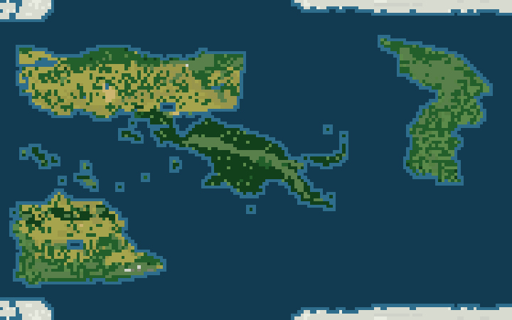

## Scenario 1: Earthlike alien world

**Prompt.** Build an Earthlike world that is not recognisable as Earth: 4-6 continents of varied size, polar caps top and bottom, tropics in the middle, at least two inland seas and one large archipelago.

**Result: 4/8 assertions pass.**

| assertion | result | detail |
|---|---|---|
| land 28-38% | FAIL | 24.7% land |
| 4-6 landmasses >= 60 tiles | FAIL | 7 landmasses >= 60t (1757, 860, 677, 215, 215, 75, 75) |
| >= 8 small landmasses (archipelago) | pass | 17 landmasses under 20 tiles |
| snow/tundra only in the top and bottom 15% of rows | pass | 0 of 542 snow/tundra tiles outside the caps |
| tropical groups only in the middle 40% of rows | pass | 0 of 676 tropical tiles outside rows 30-70 |
| >= 2 inland seas | pass | 15t at 52,33; 15t at 23,76; 4t at 68,27 |
| zero seam-lint warnings | FAIL | 14 warnings: climate-jump x2, truncated-wall x7, river-dead-end x5 |
| >= 80% of river systems reach water | FAIL | 29/43 reach water |

**describe.** 25 landmasses: #1 1757t at 52,33 (continental 33%, temperate 32%); #2 860t at 23,76 (temperate 77%, arid 11%); #3 677t at 137,33 (continental 95%, temperate 5%); #4 215t at 129,1 (ice cap 100%); #5 215t at 129,98 (ice cap 100%) and 20 smaller. Strait 2 wide between #1 and #8 at 95,51; Strait 4 wide between #2 and #10 at 26,61; Strait 4 wide between #1 and #11 at 35,38; Strait 4 wide between #1 and #12 at 53,48. Bay of 380t on #1 at 78,38 opening E; Bay of 352t on #1 at 46,44 opening SW; Bay of 216t on #3 at 127,30 opening W; Bay of 74t on #3 at 144,45 opening SE. Peninsula of 63t on #1 at 52,40 pointing S; Peninsula of 49t on #1 at 96,60 pointing SE; Peninsula of 44t on #4 at 102,1 pointing W; Peninsula of 44t on #5 at 102,98 pointing W. Mountain spine E-W 40 long (353t, 163 peaks, chain 40, 4 ends, 0 knots) on #1 at 57,25; Mountain spine N-S 35 long (332t, 156 peaks, chain 44, 4 ends, 0 knots) on #3 at 136,26; Mountain spine E-W 45 long (282t, 99 peaks, chain 66, 6 ends, 0 knots) on #2 at 27,81. 3 inland seas: 15t at 52,33; 15t at 23,76; 4t at 68,27. 43 river systems (615 edges): 29 reach water (3 different water bodies), 0 leave the map, 14 dead-end.

Warnings: [climate-jump] BSk next to Af (never adjacent in the Köppen raster) across the seam between patches 12 and 6 (10 tiles) near 34,67; [climate-jump] BSk next to Af (never adjacent in the Köppen raster) across the seam between patches 6 and 12 (4 tiles) near 31,64; [truncated-wall] mountain run of 71 tiles from patch 6/10/11/12 stops against flat land of patch 10/6/11/12 along 35 tiles near 22,65; [truncated-wall] mountain run of 5 tiles from patch 9/6 stops against flat land of patch 6/9/10 along 8 tiles near 13,66; [truncated-wall] mountain run of 15 tiles from patch 5 stops against flat land of patch 3 along 6 tiles near 47,34; [truncated-wall] mountain run of 3 tiles from patch 8/9 stops against flat land of patch 6 along 5 tiles near 12,69; [truncated-wall] mountain run of 282 tiles from patch 12/6 stops against flat land of patch 6/12 along 4 tiles near 35,67; [truncated-wall] mountain run of 7 tiles from patch 8 stops against flat land of patch 6 along 4 tiles near 7,67; [truncated-wall] mountain run of 5 tiles from patch 3/5 stops against flat land of patch 5/3 along 4 tiles near 43,34; [river-dead-end] river 53089 has 1 edge ending on land with no continuation, first at 120,13; [river-dead-end] river 55498 has 1 edge ending on land with no continuation, first at 139,45; [river-dead-end] river 86752 has 1 edge ending on land with no continuation, first at 80,57; [river-dead-end] river 34895 has 1 edge ending on land with no continuation, first at 11,66; [river-dead-end] river 929991 has 1 edge ending on land with no continuation, first at 49,35



<details><summary>Tool-call sequence and feedback</summary>

```
>>> set_game {"id":"civ4"}
game civ4 | mode color | frame 52x32 | bounds W -146.25 S -90 E 146.25 N 90
compose canvas 60x40: 0 patches, 0 erased | shelf 93 snapshot(s) | fill ocean | mask none
games: civ4 (square 8x8..160x120), civ5 (hex 8x8..160x120), openfront (square 16x16..512x512 step 4), culture_wars (square 16x16..512x512 step 4)
params: islandBias=0 seawayBias=0 islandExpand=0 expandSteep=1 expandMaxMult=1.5 roughHalo=0 mtnPass=0 flatSpots=0 coastThr=30 nudgeX=0 nudgeY=0 riverN=12 riverEstuaries=true hill=0.55 peak=0.8 blendHill=0.9 blendPeak=0.7 fill=ocean
game params: sea=0.5 dryPlains=0.42 dryDesert=0.66 tempTundra=0.39 tempSnow=0.27 latTundra=55 latIce=70 alpine=0.6 clim=0.45 feat=false fpKoppen=true fpThresh=0.36 oasisThresh=0.33 oasisRatio=0.14 oasisMultDesert=10 oasisMultSemiArid=3 forestDens=0.5 jungleDens=0.5
legend: ~ ocean  , coast  g grass  p plains  d desert  t tundra  s snow  f forest  j jungle  r flood plains  o oasis  ^ peak  A-Z hills (uppercase terrain letter) | relief: flat / hills / peaks
```
```
>>> tune {"params":{},"reset":true,"report":false}
{
 "params": {
  "islandBias": 0,
  "seawayBias": 0,
  "islandExpand": 0,
  "expandSteep": 1,
  "expandMaxMult": 1.5,
  "roughHalo": 0,
  "mtnPass": 0,
  "flatSpots": 0,
  "coastThr": 30,
  "nudgeX": 0,
  "nudgeY": 0,
  "riverN": 12,
...
```
```
>>> tune {"params":{"feat":true,"alpine":0.2},"report":false}
{
 "params": {
  "islandBias": 0,
  "seawayBias": 0,
  "islandExpand": 0,
  "expandSteep": 1,
  "expandMaxMult": 1.5,
  "roughHalo": 0,
  "mtnPass": 0,
  "flatSpots": 0,
  "coastThr": 30,
  "nudgeX": 0,
  "nudgeY": 0,
  "riverN": 12,
...
```
```
>>> snapshot_from_catalog {"entry":"Antarctic coast","W":160,"H":14,"grid":false}
snapshot snap_mvbqtdix_0_fvqhar "Antarctic coast" 160x14 civ4 | lat -78..-69
land 1045 (47%)  water 1195 | hills 443  peaks 20 | river edges 0
terrain: ~=ocean 1011  s=snow 582  A-Z=hills (uppercase terrain letter) 443  ,=coast 184  ^=peak 20
landmasses 2: #1 899t x57-159 y2-13; #2 146t x0-16 y0-11
landforms: 2 landmasses | 4 bays | 2 peninsulas | spines E-W 104L at 119,6, NE-SW 18L at 8,6
edges: N open sea | E mountain wall | S ice | W mountain wall
corners: NW mountain wall | NE open sea | SE ice | SW open sea
```
```
>>> flip_snapshot {"id":"Antarctic coast","axis":"y","name":"North cap","grid":false}
snapshot snap_mvbqtdl0_1_1nawvl "North cap" 160x14 civ4 | lat -78..-69
land 1045 (47%)  water 1195 | hills 443  peaks 20 | river edges 0
terrain: ~=ocean 1011  s=snow 582  A-Z=hills (uppercase terrain letter) 443  ,=coast 184  ^=peak 20
landmasses 2: #1 899t x57-159 y0-11; #2 146t x0-16 y2-13
landforms: 2 landmasses | 4 bays | 2 peninsulas | spines E-W 104L at 119,7, NW-SE 18L at 8,7
edges: N ice | E mountain wall | S open sea | W mountain wall
corners: NW open sea | NE ice | SE open sea | SW mountain wall
```
```
>>> snapshot_from_catalog {"entry":"Anatolia","W":72,"H":30,"grid":false}
snapshot snap_mvbqtkup_2_hp5s4j "Anatolia" 70x23 civ4 | lat 36.02..42.25
land 1193 (74%)  water 417 | hills 414  peaks 193 | river edges 184
terrain: A-Z=hills (uppercase terrain letter) 414  p=plains 372  ,=coast 216  ~=ocean 201  ^=peak 193  f=forest 177  d=desert 18  g=grass 16  j=jungle 3
landmasses 1: #1 1193t x0-69 y1-22
landforms: 1 landmass | 3 bays | 3 peninsulas | spines E-W 40L at 51,11, E-W 26L at 16,18 | 1 inland sea | rivers 8/10 reach water
edges: N open sea | E coast | S coast | W coast + river exit
corners: NW temperate land | NE open sea | SE open sea | SW open sea
```
```
>>> snapshot_from_catalog {"entry":"Korea","W":40,"H":51,"grid":false}
snapshot snap_mvbqu0ip_3_gghe66 "Korea" 35x46 civ4 | lat 34.25..42.81
land 677 (42%)  water 933 | hills 211  peaks 162 | river edges 141
terrain: ~=ocean 735  A-Z=hills (uppercase terrain letter) 211  ,=coast 198  ^=peak 162  f=forest 151  g=grass 148  j=jungle 5
landmasses 1: #1 677t x0-33 y0-44
landforms: 1 landmass | 3 bays | 3 peninsulas | spines N-S 35L at 16,14, NE-SW 9L at 16,39 | rivers 9/10 reach water
edges: N open sea | E open sea | S open sea | W open sea
corners: NW open sea | NE continental land | SE open sea | SW open sea
```
```
>>> flip_snapshot {"id":"Korea","axis":"x","name":"Korea mirrored","grid":false}
snapshot snap_mvbqu0mo_4_6e3gck "Korea mirrored" 35x46 civ4 | lat 34.25..42.81
land 677 (42%)  water 933 | hills 211  peaks 162 | river edges 141
terrain: ~=ocean 735  A-Z=hills (uppercase terrain letter) 211  ,=coast 198  ^=peak 162  f=forest 151  g=grass 148  j=jungle 5
landmasses 1: #1 677t x1-34 y0-44
landforms: 1 landmass | 3 bays | 3 peninsulas | spines N-S 35L at 18,14, NW-SE 9L at 18,39 | rivers 9/10 reach water
edges: N open sea | E open sea | S open sea | W open sea
corners: NW continental land | NE open sea | SE open sea | SW open sea
```
```
>>> snapshot_from_catalog {"entry":"New Guinea","W":70,"H":35,"grid":false}
snapshot snap_mvbqu9rx_5_8ys553 "New Guinea" 70x35 civ4 | lat -11..0.5
land 646 (26%)  water 1804 | hills 164  peaks 128 | river edges 142
terrain: ~=ocean 1443  ,=coast 361  j=jungle 318  A-Z=hills (uppercase terrain letter) 164  ^=peak 128  g=grass 33  f=forest 3
landmasses 13: #1 595t x5-65 y3-33; #2 26t x59-69 y14-20; #3 10t x0-5 y10-12; #4 4t x16-17 y19-21; #5 3t x4-6 y2-2; #6 1t x21-21 y4-4; #7 1t x3-3 y7-7; #8 1t x64-64 y9-9; #9 1t x69-69 y11-11; #10 1t x57-57 y18-18 (+3 smaller)
landforms: 13 landmasses | 3 straits (#1/#2 w2 at 57,20 #1/#3 w4 at 3,8) | 4 bays | 3 peninsulas | spines E-W 57L at 40,18, NW-SE 8L at 12,4 | rivers 7/12 reach water
edges: N open sea | E coast | S open sea | W open sea
corners: NW open sea | NE open sea | SE open sea | SW open sea
```
```
>>> snapshot_from_catalog {"entry":"Iberia","W":50,"H":32,"grid":false}
snapshot snap_mvbqviex_6_0d2g3f "Iberia" 48x29 civ4 | lat 35.97..43.8
land 874 (63%)  water 518 | hills 258  peaks 139 | river edges 174
terrain: ~=ocean 364  p=plains 266  A-Z=hills (uppercase terrain letter) 258  f=forest 155  ,=coast 154  ^=peak 139  g=grass 55  d=desert 1
landmasses 1: #1 874t x0-46 y0-28
landforms: 1 landmass | 3 bays | 3 peninsulas | spines E-W 45L at 22,10, E-W 8L at 17,16 | rivers 7/11 reach water
edges: N open sea | E open sea | S open sea | W coast
corners: NW open sea | NE open sea | SE open sea | SW open sea
```
```
>>> flip_snapshot {"id":"Iberia","axis":"y","name":"Iberia mirrored","grid":false}
snapshot snap_mvbqviie_7_4gqpdn "Iberia mirrored" 48x29 civ4 | lat 35.97..43.8
land 874 (63%)  water 518 | hills 258  peaks 139 | river edges 174
terrain: ~=ocean 364  p=plains 266  A-Z=hills (uppercase terrain letter) 258  f=forest 155  ,=coast 154  ^=peak 139  g=grass 55  d=desert 1
landmasses 1: #1 874t x0-46 y0-28
landforms: 1 landmass | 3 bays | 3 peninsulas | spines E-W 45L at 22,18, E-W 8L at 17,12 | rivers 7/11 reach water
edges: N open sea | E open sea | S open sea | W coast
corners: NW open sea | NE open sea | SE open sea | SW open sea
```
```
>>> snapshot_from_catalog {"entry":"Society Islands","W":32,"H":16,"grid":false}
snapshot snap_mvbqvkg1_8_58fws2 "Society Islands" 32x16 civ4 | lat -18.12..-15.87
land 34 (7%)  water 478 | hills 8  peaks 7 | river edges 0
terrain: ~=ocean 384  ,=coast 94  j=jungle 15  A-Z=hills (uppercase terrain letter) 8  ^=peak 7  g=grass 3  f=forest 1
landmasses 7: #1 13t x4-8 y2-7; #2 11t x18-23 y11-14; #3 3t x10-11 y5-6; #4 3t x20-21 y7-8; #5 2t x1-1 y3-4; #6 1t x13-13 y12-12; #7 1t x31-31 y14-14
landforms: 7 landmasses | spine NW-SE 7L at 21,12
edges: N open sea | E open sea | S open sea | W open sea
corners: NW open sea | NE open sea | SE coast | SW open sea
```
```
>>> snapshot_from_catalog {"entry":"Tahiti","grid":false}
snapshot snap_mvbqvl7n_9_43qgca "Tahiti" 12x8 civ4 | lat -17.95..-17.35
land 19 (20%)  water 77 | hills 4  peaks 5 | river edges 0
terrain: ~=ocean 46  ,=coast 31  j=jungle 10  ^=peak 5  A-Z=hills (uppercase terrain letter) 4
landmasses 2: #1 18t x3-8 y2-6; #2 1t x0-0 y2-2
landforms: 2 landmasses | spine E-W 4L at 4,3
edges: N open sea | E open sea | S open sea | W coast
corners: NW open sea | NE open sea | SE open sea | SW open sea
```
```
>>> snapshot_from_catalog {"entry":"Upolu","grid":false}
snapshot snap_mvbqvlze_10_kvbim8 "Upolu" 12x8 civ4 | lat -14.19..-13.66
land 25 (26%)  water 71 | hills 8  peaks 3 | river edges 0
terrain: ~=ocean 39  ,=coast 32  j=jungle 13  A-Z=hills (uppercase terrain letter) 8  ^=peak 3  g=grass 1
landmasses 1: #1 25t x1-10 y2-5
landforms: 1 landmass | spine NW-SE 5L at 6,4
edges: N open sea | E open sea | S open sea | W open sea
corners: NW open sea | NE open sea | SE open sea | SW open sea
```
```
>>> snapshot_from_catalog {"entry":"Funafuti","grid":false}
snapshot snap_mvbqvmr9_11_fnda21 "Funafuti" 8x8 civ4 | lat -8.81..-8.29
land 5 (8%)  water 59 | hills 2  peaks 1 | river edges 0
terrain: ~=ocean 40  ,=coast 19  j=jungle 2  A-Z=hills (uppercase terrain letter) 2  ^=peak 1
landmasses 1: #1 5t x2-4 y2-5
landforms: 1 landmass
edges: N open sea | E open sea | S open sea | W open sea
corners: NW open sea | NE open sea | SE open sea | SW open sea
```
```
>>> snapshot_from_catalog {"entry":"Tarawa","grid":false}
snapshot snap_mvbqvnjf_12_vojkpf "Tarawa" 8x8 civ4 | lat 1.19..1.71
land 14 (22%)  water 50 | hills 6  peaks 1 | river edges 0
terrain: ,=coast 26  ~=ocean 24  j=jungle 7  A-Z=hills (uppercase terrain letter) 6  ^=peak 1
landmasses 1: #1 14t x1-6 y2-5
landforms: 1 landmass
edges: N open sea | E open sea | S open sea | W open sea
corners: NW open sea | NE open sea | SE open sea | SW open sea
```
```
>>> compose_new {"W":160,"H":100,"fill":"water","latitudes":{"top":80,"bottom":-80},"grid":false}
compose canvas 160x100 civ4 | 0 patches | 0 erased tiles | latitudes 80..-80
land 0 (0%)  water 16000 | hills 0  peaks 0 | river edges 0
terrain: ~=ocean 16000
landmasses 0
patches: none
landforms: 0 landmasses
warnings: none
```
```
>>> place {"snapshot":"North cap","x":0,"y":-8,"grid":false}
compose canvas 160x100 civ4 | 1 patch | 0 erased tiles | latitudes 80..-80
land 290 (2%)  water 15710 | hills 247  peaks 19 | river edges 0
terrain: ~=ocean 15583  A-Z=hills (uppercase terrain letter) 247  ,=coast 127  s=snow 24  ^=peak 19
landmasses 2: #1 215t x92-159 y0-3; #2 75t x0-15 y0-5
patches (bottom to top): [1] "North cap" 160x14 @0,-8
landforms: 2 landmasses | 3 bays | 2 peninsulas | spines E-W 68L at 129,1, E-W 12L at 10,3
warnings: none
placed patch 1 at 0,-8 (land only)
```
```
>>> place {"snapshot":"Antarctic coast","x":0,"y":94,"grid":false}
compose canvas 160x100 civ4 | 2 patches | 0 erased tiles | latitudes 80..-80
land 580 (4%)  water 15420 | hills 494  peaks 38 | river edges 0
terrain: ~=ocean 15166  A-Z=hills (uppercase terrain letter) 494  ,=coast 254  s=snow 48  ^=peak 38
landmasses 4: #1 215t x92-159 y0-3; #2 215t x92-159 y96-99; #3 75t x0-15 y0-5; #4 75t x0-15 y94-99
patches (bottom to top): [1] "North cap" 160x14 @0,-8; [2] "Antarctic coast" 160x14 @0,94
landforms: 4 landmasses | 6 bays | 4 peninsulas | spines E-W 68L at 129,1, E-W 68L at 129,98
warnings: none
placed patch 2 at 0,94 (land only)
```
```
>>> place {"snapshot":"Anatolia","x":6,"y":14,"grid":false}
compose canvas 160x100 civ4 | 3 patches | 0 erased tiles | latitudes 80..-80
land 1773 (11%)  water 14227 | hills 908  peaks 231 | river edges 184
terrain: ~=ocean 13724  A-Z=hills (uppercase terrain letter) 908  ,=coast 503  p=plains 372  ^=peak 231  f=forest 177  s=snow 48  d=desert 18  g=grass 16  j=jungle 3
landmasses 5: #1 1193t x6-75 y15-36; #2 215t x92-159 y0-3; #3 215t x92-159 y96-99; #4 75t x0-15 y0-5; #5 75t x0-15 y94-99
patches (bottom to top): [1] "North cap" 160x14 @0,-8; [2] "Antarctic coast" 160x14 @0,94; [3] "Anatolia" 70x23 @6,14
landforms: 5 landmasses | 6 bays | 6 peninsulas | spines E-W 40L at 57,25, E-W 68L at 129,1 | 1 inland sea | rivers 8/10 reach water
warnings: none
placed patch 3 at 6,14 (land only)
```
```
>>> place {"snapshot":"Korea mirrored","x":118,"y":12,"grid":false}
compose canvas 160x100 civ4 | 4 patches | 0 erased tiles | latitudes 80..-80
land 2450 (15%)  water 13550 | hills 1119  peaks 393 | river edges 316
terrain: ~=ocean 12841  A-Z=hills (uppercase terrain letter) 1119  ,=coast 709  ^=peak 393  p=plains 372  f=forest 328  g=grass 164  s=snow 48  d=desert 18  j=jungle 8
landmasses 6: #1 1193t x6-75 y15-36; #2 677t x119-152 y12-56; #3 215t x92-159 y0-3; #4 215t x92-159 y96-99; #5 75t x0-15 y0-5; #6 75t x0-15 y94-99
patches (bottom to top): [1] "North cap" 160x14 @0,-8; [2] "Antarctic coast" 160x14 @0,94; [3] "Anatolia" 70x23 @6,14; [4] "Korea mirrored" 35x46 @118,12
landforms: 6 landmasses | 1 strait (#2/#3 w8 at 114,7) | 6 bays | 6 peninsulas | spines E-W 40L at 57,25, N-S 35L at 136,26 | 1 inland sea | rivers 15/20 reach water
warnings (2): [river-dead-end] river 53089 has 1 edge ending on land with no continuation, first at 120,13 ; [river-dead-end] river 55498 has 1 edge ending on land with no continuation, first at 139,45
placed patch 4 at 118,12 (land only)
```
```
>>> place {"snapshot":"New Guinea","x":38,"y":31,"grid":false}
compose canvas 160x100 civ4 | 5 patches | 0 erased tiles | latitudes 80..-80
land 3076 (19%)  water 12924 | hills 1282  peaks 520 | river edges 458
terrain: ~=ocean 11887  A-Z=hills (uppercase terrain letter) 1282  ,=coast 1037  ^=peak 520  p=plains 360  f=forest 326  j=jungle 326  g=grass 197  s=snow 48  d=desert 17
landmasses 16: #1 1772t x6-103 y15-64; #2 677t x119-152 y12-56; #3 215t x92-159 y0-3; #4 215t x92-159 y96-99; #5 75t x0-15 y0-5; #6 75t x0-15 y94-99; #7 26t x97-107 y45-51; #8 10t x38-43 y41-43; #9 4t x54-55 y50-52; #10 1t x41-41 y38-38 (+6 smaller)
patches (bottom to top): [1] "North cap" 160x14 @0,-8; [2] "Antarctic coast" 160x14 @0,94; [3] "Anatolia" 70x23 @6,14; [4] "Korea mirrored" 35x46 @118,12; [5] "New Guinea" 70x35 @38,31
landforms: 16 landmasses | 4 straits (#1/#7 w2 at 95,51 #1/#8 w4 at 35,38) | 6 bays | 6 peninsulas | spines E-W 40L at 57,25, N-S 35L at 136,26 | 1 inland sea | rivers 21/32 reach water
warnings (6): [truncated-wall] mountain run of 16 tiles from patch 5 stops against flat land of patch 3 along 10 tiles near 47,34 ; [truncated-wall] mountain run of 5 tiles from patch 3/5 stops against flat land of patch 5/3 along 4 tiles near 43,34 ; [river-dead-end] river 53089 has 1 edge ending on land with no continuation, first at 120,13 ; [river-dead-end] river 55498 has 1 edge ending on land with no continuation, first at 139,45 ; [river-dead-end] river 86752 has 1 edge ending on land with no continuation, first at 80,57 ; [river-dead-end] river 929991 has 1 edge ending on land with no continuation, first at 49,35
placed patch 5 at 38,31 (land only)
```
```
>>> place {"snapshot":"Iberia mirrored","x":4,"y":60,"grid":false}
compose canvas 160x100 civ4 | 6 patches | 0 erased tiles | latitudes 80..-80
land 3950 (25%)  water 12050 | hills 1540  peaks 659 | river edges 627
terrain: ~=ocean 10846  A-Z=hills (uppercase terrain letter) 1540  ,=coast 1204  ^=peak 659  p=plains 626  f=forest 481  j=jungle 326  g=grass 252  s=snow 48  d=desert 18
landmasses 17: #1 1772t x6-103 y15-64; #2 874t x4-50 y60-88; #3 677t x119-152 y12-56; #4 215t x92-159 y0-3; #5 215t x92-159 y96-99; #6 75t x0-15 y0-5; #7 75t x0-15 y94-99; #8 26t x97-107 y45-51; #9 10t x38-43 y41-43; #10 4t x54-55 y50-52 (+7 smaller)
patches (bottom to top): [1] "North cap" 160x14 @0,-8; [2] "Antarctic coast" 160x14 @0,94; [3] "Anatolia" 70x23 @6,14; [4] "Korea mirrored" 35x46 @118,12; [5] "New Guinea" 70x35 @38,31; [6] "Iberia mirrored" 48x29 @4,60
landforms: 17 landmasses | 5 straits (#1/#8 w2 at 95,51 #1/#9 w4 at 35,38) | 6 bays | 6 peninsulas | spines E-W 45L at 26,78, E-W 40L at 57,25 | 1 inland sea | rivers 28/43 reach water
warnings (7): [truncated-wall] mountain run of 16 tiles from patch 5 stops against flat land of patch 3 along 10 tiles near 47,34 ; [truncated-wall] mountain run of 5 tiles from patch 3/5 stops against flat land of patch 5/3 along 4 tiles near 43,34 ; [river-dead-end] river 53089 has 1 edge ending on land with no continuation, first at 120,13 ; [river-dead-end] river 55498 has 1 edge ending on land with no continuation, first at 139,45 ; [river-dead-end] river 86752 has 1 edge ending on land with no continuation, first at 80,57 ; [river-dead-end] river 34895 has 1 edge ending on land with no continuation, first at 11,66 ; [river-dead-end] river 929991 has 1 edge ending on land with no continuation, first at 49,35
placed patch 6 at 4,60 (land only)
```
```
>>> place {"snapshot":"Society Islands","x":6,"y":44,"grid":false}
compose canvas 160x100 civ4 | 7 patches | 0 erased tiles | latitudes 80..-80
land 3984 (25%)  water 12016 | hills 1548  peaks 666 | river edges 627
terrain: ~=ocean 10715  A-Z=hills (uppercase terrain letter) 1548  ,=coast 1301  ^=peak 666  p=plains 626  f=forest 482  j=jungle 341  g=grass 255  s=snow 48  d=desert 18
landmasses 24: #1 1772t x6-103 y15-64; #2 874t x4-50 y60-88; #3 677t x119-152 y12-56; #4 215t x92-159 y0-3; #5 215t x92-159 y96-99; #6 75t x0-15 y0-5; #7 75t x0-15 y94-99; #8 26t x97-107 y45-51; #9 13t x10-14 y46-51; #10 11t x24-29 y55-58 (+14 smaller)
patches (bottom to top): [1] "North cap" 160x14 @0,-8; [2] "Antarctic coast" 160x14 @0,94; [3] "Anatolia" 70x23 @6,14; [4] "Korea mirrored" 35x46 @118,12; [5] "New Guinea" 70x35 @38,31; [6] "Iberia mirrored" 48x29 @4,60; [7] "Society Islands" 32x16 @6,44
landforms: 24 landmasses | 6 straits (#1/#8 w2 at 95,51 #2/#10 w4 at 26,61) | 6 bays | 6 peninsulas | spines E-W 45L at 26,78, E-W 40L at 57,25 | 1 inland sea | rivers 28/43 reach water
warnings (7): [truncated-wall] mountain run of 16 tiles from patch 5 stops against flat land of patch 3 along 10 tiles near 47,34 ; [truncated-wall] mountain run of 5 tiles from patch 3/5 stops against flat land of patch 5/3 along 4 tiles near 43,34 ; [river-dead-end] river 53089 has 1 edge ending on land with no continuation, first at 120,13 ; [river-dead-end] river 55498 has 1 edge ending on land with no continuation, first at 139,45 ; [river-dead-end] river 86752 has 1 edge ending on land with no continuation, first at 80,57 ; [river-dead-end] river 34895 has 1 edge ending on land with no continuation, first at 11,66 ; [river-dead-end] river 929991 has 1 edge ending on land with no continuation, first at 49,35
placed patch 7 at 6,44 (land only)
```
```
>>> scatter {"snapshots":["Tahiti","Funafuti","Upolu","Tarawa"],"along":[[8,68],[36,66]],"spacing":6,"grid":false}
compose canvas 160x100 civ4 | 12 patches | 0 erased tiles | latitudes 80..-80
land 3986 (25%)  water 12014 | hills 1546  peaks 675 | river edges 627
terrain: ~=ocean 10708  A-Z=hills (uppercase terrain letter) 1546  ,=coast 1306  ^=peak 675  p=plains 593  f=forest 468  j=jungle 382  g=grass 256  s=snow 48  d=desert 18
landmasses 25: #1 1772t x6-103 y15-64; #2 875t x4-50 y60-88; #3 677t x119-152 y12-56; #4 215t x92-159 y0-3; #5 215t x92-159 y96-99; #6 75t x0-15 y0-5; #7 75t x0-15 y94-99; #8 26t x97-107 y45-51; #9 13t x10-14 y46-51; #10 11t x24-29 y55-58 (+15 smaller)
patches (bottom to top): [1] "North cap" 160x14 @0,-8; [2] "Antarctic coast" 160x14 @0,94; [3] "Anatolia" 70x23 @6,14; [4] "Korea mirrored" 35x46 @118,12; [5] "New Guinea" 70x35 @38,31; [6] "Iberia mirrored" 48x29 @4,60; [7] "Society Islands" 32x16 @6,44; [8] "Tahiti" 12x8 @4,64; [9] "Funafuti" 8x8 @10,64; [10] "Upolu" 12x8 @14,63; [11] "Tarawa" 8x8 @22,63; [12] "Tahiti" 12x8 @27,62
landforms: 25 landmasses | 6 straits (#1/#8 w2 at 95,51 #2/#10 w4 at 26,61) | 6 bays | 6 peninsulas | spines E-W 40L at 57,25, N-S 35L at 136,26 | 1 inland sea | rivers 28/43 reach water
warnings (14): [climate-jump] BSk next to Af (never adjacent in the Köppen raster) across the seam between patches 12 and 6 (10 tiles) near 34,67 ; [climate-jump] BSk next to Af (never adjacent in the Köppen raster) across the seam between patches 6 and 12 (4 tiles) near 31,64 ; [truncated-wall] mountain run of 71 tiles from patch 6/10/11/12 stops against flat land of patch 10/6/11/12 along 35 tiles near 22,65 ; [truncated-wall] mountain run of 16 tiles from patch 5 stops against flat land of patch 3 along 10 tiles near 47,34 ; [truncated-wall] mountain run of 5 tiles from patch 9/6 stops against flat land of patch 6/9/10 along 8 tiles near 13,66 ; [truncated-wall] mountain run of 3 tiles from patch 8/9 stops against flat land of patch 6 along 5 tiles near 12,69 ; [truncated-wall] mountain run of 303 tiles from patch 12/6 stops against flat land of patch 6/12 along 4 tiles near 35,67 ; [truncated-wall] mountain run of 7 tiles from patch 8 stops against flat land of patch 6 along 4 tiles near 7,67 ; +6 more
scattered 5: [8] Tahiti @4,64; [9] Funafuti @10,64; [10] Upolu @14,63; [11] Tarawa @22,63; [12] Tahiti @27,62
```
```
>>> compose_view {"step":1}
compose canvas 160x100 civ4 | 12 patches | 0 erased tiles | latitudes 80..-80
land 3986 (25%)  water 12014 | hills 1546  peaks 675 | river edges 627
terrain: ~=ocean 10708  A-Z=hills (uppercase terrain letter) 1546  ,=coast 1306  ^=peak 675  p=plains 593  f=forest 468  j=jungle 382  g=grass 256  s=snow 48  d=desert 18
landmasses 25: #1 1772t x6-103 y15-64; #2 875t x4-50 y60-88; #3 677t x119-152 y12-56; #4 215t x92-159 y0-3; #5 215t x92-159 y96-99; #6 75t x0-15 y0-5; #7 75t x0-15 y94-99; #8 26t x97-107 y45-51; #9 13t x10-14 y46-51; #10 11t x24-29 y55-58 (+15 smaller)
patches (bottom to top): [1] "North cap" 160x14 @0,-8; [2] "Antarctic coast" 160x14 @0,94; [3] "Anatolia" 70x23 @6,14; [4] "Korea mirrored" 35x46 @118,12; [5] "New Guinea" 70x35 @38,31; [6] "Iberia mirrored" 48x29 @4,60; [7] "Society Islands" 32x16 @6,44; [8] "Tahiti" 12x8 @4,64; [9] "Funafuti" 8x8 @10,64; [10] "Upolu" 12x8 @14,63; [11] "Tarawa" 8x8 @22,63; [12] "Tahiti" 12x8 @27,62
landforms: 25 landmasses | 6 straits (#1/#8 w2 at 95,51 #2/#10 w4 at 26,61) | 6 bays | 6 peninsulas | spines E-W 40L at 57,25, N-S 35L at 136,26 | 1 inland sea | rivers 28/43 reach water
warnings (14): [climate-jump] BSk next to Af (never adjacent in the Köppen raster) across the seam between patches 12 and 6 (10 tiles) near 34,67 ; [climate-jump] BSk next to Af (never adjacent in the Köppen raster) across the seam between patches 6 and 12 (4 tiles) near 31,64 ; [truncated-wall] mountain run of 71 tiles from patch 6/10/11/12 stops against flat land of patch 10/6/11/12 along 35 tiles near 22,65 ; [truncated-wall] mountain run of 16 tiles from patch 5 stops against flat land of patch 3 along 10 tiles near 47,34 ; [truncated-wall] mountain run of 5 tiles from patch 9/6 stops against flat land of patch 6/9/10 along 8 tiles near 13,66 ; [truncated-wall] mountain run of 3 tiles from patch 8/9 stops against flat land of patch 6 along 5 tiles near 12,69 ; [truncated-wall] mountain run of 303 tiles from patch 12/6 stops against flat land of patch 6/12 along 4 tiles near 35,67 ; [truncated-wall] mountain run of 7 tiles from patch 8 stops against flat land of patch 6 along 4 tiles near 7,67 ; +6 more
grid step 1: x 0..159, y 0..99 (row 0 = north, col 0 = west; ruler = x of every 10th column)
    0         10        20        30        40        50        60        70        80        90        100       110       120       130       140       150       
  0|,,s,,,,SSSsssSSS,~~~~~~~~~~~~~~~~~~~~~~~~~~~~~~~~~~~~~~~~~~~~~~~~~~~~~~~~~~~~~~~~~~~~~~~~~~,SSSsSSSSSSSSSSSSSSSSSSSSSssssSSSSSSSSSSSSSSSSSSSSSS^^SSSSS^^^SSSSSSS
  1|SSSSS,,SSsSsSSSs,~~~~~~~~~~~~~~~~~~~~~~~~~~~~~~~~~~~~~~~~~~~~~~~~~~~~~~~~~~~~~~~~~~~~~~~~~~,,,SssSSSSSSSSSSSSSSSSSSSS^^^^^^^^^^^S^^^SSSSSSSSSSSSSSSSSSSSSSSSSSSS
  2|SSSSS,SSSSSsSsSS,~~~~~~~~~~~~~~~~~~~~~~~~~~~~~~~~~~~~~~~~~~~~~~~~~~~~~~~~~~~~~~~~~~~~~~~~~~~~,,SS,,sSS,,,,s,,,,,SSSSSSSSSSSSSSSSSSSSSSSSSSSSSSSSSSSSSSSSSSSSSSSS
  3|,SsSs,SSSSSSSSS,,~~~~~~~~~~~~~~~~~~~~~~~~~~~~~~~~~~~~~~~~~~~~~~~~~~~~~~~~~~~~~~~~~~~~~~~~~~~~~,,,,,,,,,~~,,,~~~,,,,,,SS,,SSSSSSS,,SSSSSSSSSSs,,,sS,,S,,,,,,,SSSS
  4|SSS,,SSSssSSSS,,~~~~~~~~~~~~~~~~~~~~~~~~~~~~~~~~~~~~~~~~~~~~~~~~~~~~~~~~~~~~~~~~~~~~~~~~~~~~~~~~~~~~~~~~~~~~~~~~~~~~,,,,,,,,,,,,,,,,,,,,,,,,,,~,,,,,,,~~~~~,,,,,
...
```
```
>>> erase {"rect":[50,32,54,34],"grid":false}
compose canvas 160x100 civ4 | 12 patches | 15 erased tiles | latitudes 80..-80
land 3971 (25%)  water 12029 | hills 1546  peaks 674 | river edges 622
terrain: ~=ocean 10711  A-Z=hills (uppercase terrain letter) 1546  ,=coast 1318  ^=peak 674  p=plains 584  f=forest 463  j=jungle 382  g=grass 256  s=snow 48  d=desert 18
landmasses 25: #1 1757t x6-103 y15-64; #2 875t x4-50 y60-88; #3 677t x119-152 y12-56; #4 215t x92-159 y0-3; #5 215t x92-159 y96-99; #6 75t x0-15 y0-5; #7 75t x0-15 y94-99; #8 26t x97-107 y45-51; #9 13t x10-14 y46-51; #10 11t x24-29 y55-58 (+15 smaller)
patches (bottom to top): [1] "North cap" 160x14 @0,-8; [2] "Antarctic coast" 160x14 @0,94; [3] "Anatolia" 70x23 @6,14; [4] "Korea mirrored" 35x46 @118,12; [5] "New Guinea" 70x35 @38,31; [6] "Iberia mirrored" 48x29 @4,60; [7] "Society Islands" 32x16 @6,44; [8] "Tahiti" 12x8 @4,64; [9] "Funafuti" 8x8 @10,64; [10] "Upolu" 12x8 @14,63; [11] "Tarawa" 8x8 @22,63; [12] "Tahiti" 12x8 @27,62
landforms: 25 landmasses | 6 straits (#1/#8 w2 at 95,51 #2/#10 w4 at 26,61) | 6 bays | 6 peninsulas | spines E-W 40L at 57,25, N-S 35L at 136,26 | 2 inland seas | rivers 29/43 reach water
warnings (14): [climate-jump] BSk next to Af (never adjacent in the Köppen raster) across the seam between patches 12 and 6 (10 tiles) near 34,67 ; [climate-jump] BSk next to Af (never adjacent in the Köppen raster) across the seam between patches 6 and 12 (4 tiles) near 31,64 ; [truncated-wall] mountain run of 71 tiles from patch 6/10/11/12 stops against flat land of patch 10/6/11/12 along 35 tiles near 22,65 ; [truncated-wall] mountain run of 5 tiles from patch 9/6 stops against flat land of patch 6/9/10 along 8 tiles near 13,66 ; [truncated-wall] mountain run of 15 tiles from patch 5 stops against flat land of patch 3 along 6 tiles near 47,34 ; [truncated-wall] mountain run of 3 tiles from patch 8/9 stops against flat land of patch 6 along 5 tiles near 12,69 ; [truncated-wall] mountain run of 303 tiles from patch 12/6 stops against flat land of patch 6/12 along 4 tiles near 35,67 ; [truncated-wall] mountain run of 7 tiles from patch 8 stops against flat land of patch 6 along 4 tiles near 7,67 ; +6 more
erased now: 15 tiles
```
```
>>> erase {"rect":[21,75,25,77],"grid":false}
compose canvas 160x100 civ4 | 12 patches | 30 erased tiles | latitudes 80..-80
land 3956 (25%)  water 12044 | hills 1543  peaks 670 | river edges 615
terrain: ~=ocean 10714  A-Z=hills (uppercase terrain letter) 1543  ,=coast 1330  ^=peak 670  p=plains 576  f=forest 463  j=jungle 382  g=grass 256  s=snow 48  d=desert 18
landmasses 25: #1 1757t x6-103 y15-64; #2 860t x4-50 y60-88; #3 677t x119-152 y12-56; #4 215t x92-159 y0-3; #5 215t x92-159 y96-99; #6 75t x0-15 y0-5; #7 75t x0-15 y94-99; #8 26t x97-107 y45-51; #9 13t x10-14 y46-51; #10 11t x24-29 y55-58 (+15 smaller)
patches (bottom to top): [1] "North cap" 160x14 @0,-8; [2] "Antarctic coast" 160x14 @0,94; [3] "Anatolia" 70x23 @6,14; [4] "Korea mirrored" 35x46 @118,12; [5] "New Guinea" 70x35 @38,31; [6] "Iberia mirrored" 48x29 @4,60; [7] "Society Islands" 32x16 @6,44; [8] "Tahiti" 12x8 @4,64; [9] "Funafuti" 8x8 @10,64; [10] "Upolu" 12x8 @14,63; [11] "Tarawa" 8x8 @22,63; [12] "Tahiti" 12x8 @27,62
landforms: 25 landmasses | 6 straits (#1/#8 w2 at 95,51 #2/#10 w4 at 26,61) | 6 bays | 6 peninsulas | spines E-W 40L at 57,25, N-S 35L at 136,26 | 3 inland seas | rivers 29/43 reach water
warnings (14): [climate-jump] BSk next to Af (never adjacent in the Köppen raster) across the seam between patches 12 and 6 (10 tiles) near 34,67 ; [climate-jump] BSk next to Af (never adjacent in the Köppen raster) across the seam between patches 6 and 12 (4 tiles) near 31,64 ; [truncated-wall] mountain run of 71 tiles from patch 6/10/11/12 stops against flat land of patch 10/6/11/12 along 35 tiles near 22,65 ; [truncated-wall] mountain run of 5 tiles from patch 9/6 stops against flat land of patch 6/9/10 along 8 tiles near 13,66 ; [truncated-wall] mountain run of 15 tiles from patch 5 stops against flat land of patch 3 along 6 tiles near 47,34 ; [truncated-wall] mountain run of 3 tiles from patch 8/9 stops against flat land of patch 6 along 5 tiles near 12,69 ; [truncated-wall] mountain run of 282 tiles from patch 12/6 stops against flat land of patch 6/12 along 4 tiles near 35,67 ; [truncated-wall] mountain run of 7 tiles from patch 8 stops against flat land of patch 6 along 4 tiles near 7,67 ; +6 more
erased now: 15 tiles
```
```
>>> compose_view {"step":1}
compose canvas 160x100 civ4 | 12 patches | 30 erased tiles | latitudes 80..-80
land 3956 (25%)  water 12044 | hills 1543  peaks 670 | river edges 615
terrain: ~=ocean 10714  A-Z=hills (uppercase terrain letter) 1543  ,=coast 1330  ^=peak 670  p=plains 576  f=forest 463  j=jungle 382  g=grass 256  s=snow 48  d=desert 18
landmasses 25: #1 1757t x6-103 y15-64; #2 860t x4-50 y60-88; #3 677t x119-152 y12-56; #4 215t x92-159 y0-3; #5 215t x92-159 y96-99; #6 75t x0-15 y0-5; #7 75t x0-15 y94-99; #8 26t x97-107 y45-51; #9 13t x10-14 y46-51; #10 11t x24-29 y55-58 (+15 smaller)
patches (bottom to top): [1] "North cap" 160x14 @0,-8; [2] "Antarctic coast" 160x14 @0,94; [3] "Anatolia" 70x23 @6,14; [4] "Korea mirrored" 35x46 @118,12; [5] "New Guinea" 70x35 @38,31; [6] "Iberia mirrored" 48x29 @4,60; [7] "Society Islands" 32x16 @6,44; [8] "Tahiti" 12x8 @4,64; [9] "Funafuti" 8x8 @10,64; [10] "Upolu" 12x8 @14,63; [11] "Tarawa" 8x8 @22,63; [12] "Tahiti" 12x8 @27,62
landforms: 25 landmasses | 6 straits (#1/#8 w2 at 95,51 #2/#10 w4 at 26,61) | 6 bays | 6 peninsulas | spines E-W 40L at 57,25, N-S 35L at 136,26 | 3 inland seas | rivers 29/43 reach water
warnings (14): [climate-jump] BSk next to Af (never adjacent in the Köppen raster) across the seam between patches 12 and 6 (10 tiles) near 34,67 ; [climate-jump] BSk next to Af (never adjacent in the Köppen raster) across the seam between patches 6 and 12 (4 tiles) near 31,64 ; [truncated-wall] mountain run of 71 tiles from patch 6/10/11/12 stops against flat land of patch 10/6/11/12 along 35 tiles near 22,65 ; [truncated-wall] mountain run of 5 tiles from patch 9/6 stops against flat land of patch 6/9/10 along 8 tiles near 13,66 ; [truncated-wall] mountain run of 15 tiles from patch 5 stops against flat land of patch 3 along 6 tiles near 47,34 ; [truncated-wall] mountain run of 3 tiles from patch 8/9 stops against flat land of patch 6 along 5 tiles near 12,69 ; [truncated-wall] mountain run of 282 tiles from patch 12/6 stops against flat land of patch 6/12 along 4 tiles near 35,67 ; [truncated-wall] mountain run of 7 tiles from patch 8 stops against flat land of patch 6 along 4 tiles near 7,67 ; +6 more
grid step 1: x 0..159, y 0..99 (row 0 = north, col 0 = west; ruler = x of every 10th column)
    0         10        20        30        40        50        60        70        80        90        100       110       120       130       140       150       
  0|,,s,,,,SSSsssSSS,~~~~~~~~~~~~~~~~~~~~~~~~~~~~~~~~~~~~~~~~~~~~~~~~~~~~~~~~~~~~~~~~~~~~~~~~~~,SSSsSSSSSSSSSSSSSSSSSSSSSssssSSSSSSSSSSSSSSSSSSSSSS^^SSSSS^^^SSSSSSS
  1|SSSSS,,SSsSsSSSs,~~~~~~~~~~~~~~~~~~~~~~~~~~~~~~~~~~~~~~~~~~~~~~~~~~~~~~~~~~~~~~~~~~~~~~~~~~,,,SssSSSSSSSSSSSSSSSSSSSS^^^^^^^^^^^S^^^SSSSSSSSSSSSSSSSSSSSSSSSSSSS
  2|SSSSS,SSSSSsSsSS,~~~~~~~~~~~~~~~~~~~~~~~~~~~~~~~~~~~~~~~~~~~~~~~~~~~~~~~~~~~~~~~~~~~~~~~~~~~~,,SS,,sSS,,,,s,,,,,SSSSSSSSSSSSSSSSSSSSSSSSSSSSSSSSSSSSSSSSSSSSSSSS
  3|,SsSs,SSSSSSSSS,,~~~~~~~~~~~~~~~~~~~~~~~~~~~~~~~~~~~~~~~~~~~~~~~~~~~~~~~~~~~~~~~~~~~~~~~~~~~~~,,,,,,,,,~~,,,~~~,,,,,,SS,,SSSSSSS,,SSSSSSSSSSs,,,sS,,S,,,,,,,SSSS
  4|SSS,,SSSssSSSS,,~~~~~~~~~~~~~~~~~~~~~~~~~~~~~~~~~~~~~~~~~~~~~~~~~~~~~~~~~~~~~~~~~~~~~~~~~~~~~~~~~~~~~~~~~~~~~~~~~~~~,,,,,,,,,,,,,,,,,,,,,,,,,,~,,,,,,,~~~~~,,,,,
...
```
```
>>> export {"name":"scenario1","dir":"C:\\Users\\cdupu\\Documents\\GitHub\\Civ-Tile\\.claude\\worktrees\\nervous-cartwright-edac45\\mcp\\out"}
export compose civ4 160x100
wrote C:\Users\cdupu\Documents\GitHub\Civ-Tile\.claude\worktrees\nervous-cartwright-edac45\mcp\out\scenario1.CivBeyondSwordWBSave (1269647 bytes)
ok   plots written = 160×100 · 16000 / 16000
ok   land ↔ plot-type consistent · all 16000 ok
ok   river edges written · 615 / 615 (12 rivers)
ok   no river on all-water edge · ok
ok   no tile with rivers on all 4 sides · ok
ok   estuary bridges to open ocean · 15 edge(s)
ok   starting plots on land · 0 placed
ok   header + map block present · ok
```

</details>

