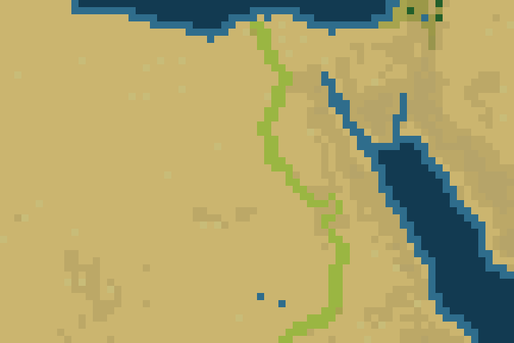

## Scenario 2: A desert

**Prompt.** A desert map with a Nile-like exotic river running from a mountain rim to the sea, an oasis belt along the river, a salt pan basin, and a semi-arid steppe fringe on one edge.

**Result: 7/7 assertions pass.**

| assertion | result | detail |
|---|---|---|
| desert >= 55% of land | pass | 95.8% desert (flood plains and oases counted as desert) |
| plains/grass <= 25% of land | pass | 0.8% plains/grass/forest |
| plains/grass within 3 tiles of the river or on the steppe edge | pass | 22/22 green tiles near the river or the north edge |
| >= 1 river with >= 15 edges reaching the coast | pass | river 1759 73 edges |
| hills+peaks 10-25% of land | pass | 17.7% relief |
| relief forms a connected ridge along one side | pass | largest spine 264t of 527 relief tiles, NW-SE, bbox 47,0,71,35 |
| flood plains present along the river | pass | 97 flood-plain tiles |

**describe.** 1 landmass: #1 2981t at 33,24 (arid 100%, temperate 0%). Bay of 280t on #1 at 60,30 opening E; Bay of 154t on #1 at 33,1 opening N. Peninsula of 13t on #1 at 57,1 pointing NE; Peninsula of 7t on #1 at 53,18 pointing E. Mountain spine NW-SE 38 long (264t, 90 peaks, chain 37, 6 ends, 0 knots) on #1 at 60,16; Mountain spine NW-SE 44 long (179t, 10 peaks, chain 40, 4 ends, 0 knots) on #1 at 51,29; Mountain spine NW-SE 11 long (34t, 0 peaks, chain 12, 2 ends, 0 knots) on #1 at 12,39. 3 river systems (91 edges): 2 reach water, 1 leave the map, 0 dead-end.

Warnings: none



<details><summary>Tool-call sequence and feedback</summary>

```
>>> set_game {"id":"civ4"}
game civ4 | mode compose | frame 8x8 | bounds W 172.79 S 1.19 E 173.31 N 1.71
compose canvas 160x100: 13 patches, 30 erased | shelf 16 snapshot(s) | fill ocean | mask none
games: civ4 (square 8x8..160x120), civ5 (hex 8x8..160x120), openfront (square 16x16..512x512 step 4), culture_wars (square 16x16..512x512 step 4)
params: islandBias=0.6 seawayBias=0 islandExpand=0.9 expandSteep=1 expandMaxMult=1.5 roughHalo=0 mtnPass=0 flatSpots=0 coastThr=30 nudgeX=0 nudgeY=0 riverN=12 riverEstuaries=true hill=0.55 peak=0.8 blendHill=0.9 blendPeak=0.7 fill=ocean
game params: sea=0.5 dryPlains=0.42 dryDesert=0.66 tempTundra=0.39 tempSnow=0.27 latTundra=55 latIce=70 alpine=0.2 clim=0.46 feat=true fpKoppen=true fpThresh=0.36 oasisThresh=0.33 oasisRatio=0.14 oasisMultDesert=10 oasisMultSemiArid=3 forestDens=0.5 jungleDens=0.5
legend: ~ ocean  , coast  g grass  p plains  d desert  t tundra  s snow  f forest  j jungle  r flood plains  o oasis  ^ peak  A-Z hills (uppercase terrain letter) | relief: flat / hills / peaks
```
```
>>> tune {"params":{},"reset":true,"report":false}
{
 "params": {
  "islandBias": 0,
  "seawayBias": 0,
  "islandExpand": 0,
  "expandSteep": 1,
  "expandMaxMult": 1.5,
  "roughHalo": 0,
  "mtnPass": 0,
  "flatSpots": 0,
  "coastThr": 30,
  "nudgeX": 0,
  "nudgeY": 0,
  "riverN": 12,
  "riverEstuaries": true,
  "hill": 0.55,
  "peak": 0.8,
  "blendHill": 0.9,
  "blendPeak": 0.7,
  "fill": "ocean"
 },
 "gameParams": {
  "sea": 0.5,
  "dryPlains": 0.42,
  "dryDesert": 0.66,
  "tempTundra": 0.39,
  "tempSnow": 0.27,
  "latTundra": 55,
  "latIce": 70,
  "alpine": 0.6,
  "clim": 0.46,
  "feat": false,
  "fpKoppen": true,
  "fpThresh": 0.3588188204120155,
  "oasisThresh": 0.32999999999999996,
  "oasisRatio": 0.14,
  "oasisMultDesert": 10,
  "oasisMultSemiArid": 3,
  "forestDens": 0.5,
  "jungleDens": 0.5
 }
}
```
```
>>> tune {"params":{"feat":true,"fpAmt":0.9,"oasisDens":0.3,"riverN":5,"hill":0.8,"peak":0.94,"alpine":0.3},"report":false}
{
 "params": {
  "islandBias": 0,
  "seawayBias": 0,
  "islandExpand": 0,
  "expandSteep": 1,
  "expandMaxMult": 1.5,
  "roughHalo": 0,
  "mtnPass": 0,
  "flatSpots": 0,
  "coastThr": 30,
  "nudgeX": 0,
  "nudgeY": 0,
  "riverN": 5,
  "riverEstuaries": true,
  "hill": 0.8,
  "peak": 0.94,
  "blendHill": 0.9,
  "blendPeak": 0.7,
  "fill": "ocean"
 },
 "gameParams": {
  "sea": 0.5,
  "dryPlains": 0.42,
  "dryDesert": 0.66,
  "tempTundra": 0.39,
  "tempSnow": 0.27,
  "latTundra": 55,
  "latIce": 70,
  "alpine": 0.3,
  "clim": 0.46,
  "feat": true,
  "fpKoppen": true,
  "fpThresh": 0.25315478672240094,
  "oasisThresh": 0.258,
  "oasisRatio": 0.3,
  "oasisMultDesert": 10,
  "oasisMultSemiArid": 3,
  "forestDens": 0.5,
  "jungleDens": 0.5
 }
}
```
```
>>> set_frame {"bounds":[24,22,37,32],"W":72,"H":48,"grid":false}
frame 72x48 civ4 | bounds W 23 S 22 E 38 N 32
land 2981 (86%)  water 475 | hills 427  peaks 100 | river edges 91
terrain: d=desert 2308  A-Z=hills (uppercase terrain letter) 427  ~=ocean 302  ,=coast 173  ^=peak 100  r=flood plains 97  o=oasis 39  p=plains 10
landmasses 1: #1 2981t x0-71 y0-47
landforms: 1 landmass | 2 bays | 2 peninsulas | spines NW-SE 38L at 60,16, NW-SE 44L at 51,29 | rivers 2/3 reach water
```
```
>>> frame_view {"overlay":"rivers"}
frame 72x48 civ4 | bounds W 23 S 22 E 38 N 32
land 2981 (86%)  water 475 | hills 427  peaks 100 | river edges 91
terrain: d=desert 2308  A-Z=hills (uppercase terrain letter) 427  ~=ocean 302  ,=coast 173  ^=peak 100  r=flood plains 97  o=oasis 39  p=plains 10
landmasses 1: #1 2981t x0-71 y0-47
landforms: 1 landmass | 2 bays | 2 peninsulas | spines NW-SE 38L at 60,16, NW-SE 44L at 51,29 | rivers 2/3 reach water
grid step 1: x 0..71, y 0..47 (row 0 = north, col 0 = west; ruler = x of every 10th column)
    0         10        20        30        40        50        60        70
  0|dddddddddd,~~~~~~~~~~~~~~~~~~~~~~~~~~~~~~~~~~~~~~~~~~~,,====DFDddddddddd
  1|dddddddddd,,,,,,,,,~~~~~~~~~~~~~~~~,,,,,,,~~~~~~~~~~~~,ppFP=DPdddddddddd
  2|dddddddddddddddddd,,,,~~~~~~~~~~,,,,d,ddd,,,~~~~~~~~,,,ppPP,PFdddddddDdd
  3|ddddddddddddddddddddd,,,,,,~~~~,,dd==ddoddd,,,,,,,,,,pppdDDPPDDddddddddo
  4|dddddddddddddddddddddddddd,,,,,,ddop=rdddddddd,ddddddddddDDDPDddddddoddd
  5|ddddddddddddddddddddddddddddd,dddddd=rdoddoddddddddddddDDDDD^Ddddddddddd
  6|dddddddddddddddddddddddddddddddddddd==dddddddddddDDdDDDDDDdD^Ddddddddddd
  7|ddddddddddddddddddddddddddddddddddddd=rdodddddddddDdddDDDDdDDddddddddddd
  8|dddddddddddoddddddddddoddoddddddddddd==ddddddodDDdDddddDDDD^Dddddddddddd
  9|ddddddddddddddddddddoddddddddddddddddd==dddDDddDDdddddDddDD^Dddddddddddd
 10|ddodddddddddddddddddddddddddddddddddddd=rDDDD,dDDddddDdddD^D^DdddddDDDdd
 11|ddddddddddddddddddddddddddddddddddddddd=rDDDD,,dDDddodDDDD^^^DDdddDDDDdd
 12|dddddddddddddddddddddddddodddddddddddd=rDDDD^D,dDDdDDDDDDD^^^DdddDDDDDod
 13|ddddddddddddddddddododdddddddddddddddo=rdddDDD,,DDDDD^^D,D^^DDdddDDddddd
 14|dddddddddddddddddddddddddddddddddddddd=rddddDD,,,DD^^^^D,^^^^DddddDDdddd
 15|ddddddddddddddddddddddddddddddddddddd=rddddD^^d,,D^^^^DD,^^^^^ddddddDddd
 16|ddddddddddddddddddddddddddddddddddddd=rddddDDDDd,DD^^^^,,D^^D^DddddDDdod
 17|dddddddddddddddddddddddddddddddddddd=rdddddDDDDd,,DD^^D,DdD^^DDDddddDddd
 18|dddddddddddddddddddddddddddddddddddd==dddddodDDDd,,d^^D,dddD^^DDDDdddddd
 19|ddddddddddddddddddddddddddddddddddddd=rdddddDdDDDd,,dDD,,,,dD^DD^^DDdddd
 20|ddddddddddddddddddddddddddddddodddddd=rddddddDdDDd,,,,,,~~,,D^^^^^DDDddd
 21|ddddddddddddddddddddddddddddddddddddd=rddddddDdDDdd,,~~~~~~,DDDDD^=DDDdd
 22|ddddddddddddddddddddddddddddddddddddd===dddddDdDDDdd,~~~~~~,,dDDD^==DDdd
 23|ddddddddddddddddddddddddddddddddddddddr==ddddDdDD^Dd,,~~~~~~,,dDD^^==DDD
 24|dddddddddddddddddddddddodddddddddddddddd=DdddDDdD^^DD,~~~~~~~,,ddDD^==^D
 25|dddddddddddddddddddddddddddddddddddddddd==ddddDddDDDD,~~~~~~~~,ddDD^^==^
 26|ddddddddddddddddddddddddddddddddddddddddd==DDDDDdDDDD,,~~~~~~~,,DdD^^^==
 27|dddddddddddddddddddddddddddddddddddddddddd=====ddDDDDD,~~~~~~~~,DdDD^^^=
 28|dddddodddddddddddddddddddddddddddddddddddddrrr=rddDDDD,,~~~~~~~,,ddDD^^^
 29|dddddddddddddddddddddddddddDDddddDDDddddddddDD=rddDdDDD,,~~~~~~~,,dddD^D
 30|ddDodddddddddddddddddddddddDDDDddDDdddddddddD=rDDdDDDDDD,~~~~~~~~,,ddDDD
 31|ddddddddddddddddddddddddddddodoDddddddddddddD=DDDddddDDD,,~~~~~~~~,,dDDD
 32|ddddddddddodddddddddddddddddddddddddddddddddD==ddddddDDDD,~~~~~~~~~,ddD^
 33|oddddddddddddddddddddddddddddddddddddddddddddd==ddddDddDD,,~~~~~~~~,dD^^
 34|dddddddddddddddddddddddddddddddddddddddddddddDd=rdddddD^Dd,~~~~~~~~,dD^^
 35|dddddddddDDdddddddddddddddddddddddddddddddddddd=rdddodddDD,,~~~~~~~,,dD^
 36|dddddddddDDddDddddddddddddddddddddddddddddddddd=rddddddDDDd,,~~~~~~~,ddd
 37|dddddddddDDDDDddddddDddddddddddddddddddddddddd=rdddddddo^^Dd,~~~~~~~,,,D
 38|ddddddddddDdDDdddddddddddddddddddddddddddddddd=rdddddddddDDd,~~~~~~~~~,,
 39|dddddddddoDoDDdDdddddddddddddddddddddddddddddd=rddddddddddDD,~~~~~~~~~~~
 40|ddddddddddDDDDdoDddddddddddddddddddddddddddddd=rdddddddDDDDD,~~~~~~~~~~~
 41|ddddddddddddDDddDddddddddddddddddddd,ddddddddd=rddddddDDDdDD,,~~~~~~~~~~
 42|dddddddddddddDDDDdddDdddddddddddddddddd,dddddd=rddddddDDDDodd,~~~~~~~~~~
 43|dddddddddddddDDDddddddddddddddddddddddddddddd=rpdddDDDDdddDdd,,~~~~~~~~~
 44|dddddddddddDdDDddddddddddddddddddoddddddddd===rddddDdDDdDDDDdd,,,~~~~~~~
 45|dddddddddddDddddddddddddddddddddddddddddd==rrrddddodDoddddDdDddd,,~~~~~~
 46|ddddddddDddddddddddddddddddddddddddddddd=rrDddddddddddddDDDDDDDdd,,~~~~~
 47|dddddddddDdddddDddddddddddddddddddddddd=rdddddDddddoddddDDD^DDDDDd,~~~~~
```
```
>>> frame_view {"step":1}
frame 72x48 civ4 | bounds W 23 S 22 E 38 N 32
land 2981 (86%)  water 475 | hills 427  peaks 100 | river edges 91
terrain: d=desert 2308  A-Z=hills (uppercase terrain letter) 427  ~=ocean 302  ,=coast 173  ^=peak 100  r=flood plains 97  o=oasis 39  p=plains 10
landmasses 1: #1 2981t x0-71 y0-47
landforms: 1 landmass | 2 bays | 2 peninsulas | spines NW-SE 38L at 60,16, NW-SE 44L at 51,29 | rivers 2/3 reach water
grid step 1: x 0..71, y 0..47 (row 0 = north, col 0 = west; ruler = x of every 10th column)
    0         10        20        30        40        50        60        70
  0|dddddddddd,~~~~~~~~~~~~~~~~~~~~~~~~~~~~~~~~~~~~~~~~~~~,,pPPPDFDddddddddd
  1|dddddddddd,,,,,,,,,~~~~~~~~~~~~~~~~,,,,,,,~~~~~~~~~~~~,ppFPPDPdddddddddd
  2|dddddddddddddddddd,,,,~~~~~~~~~~,,,,d,ddd,,,~~~~~~~~,,,ppPP,PFdddddddDdd
  3|ddddddddddddddddddddd,,,,,,~~~~,,ddrrddoddd,,,,,,,,,,pppdDDPPDDddddddddo
  4|dddddddddddddddddddddddddd,,,,,,ddoprrdddddddd,ddddddddddDDDPDddddddoddd
  5|ddddddddddddddddddddddddddddd,ddddddrrdoddoddddddddddddDDDDD^Ddddddddddd
  6|ddddddddddddddddddddddddddddddddddddrrdddddddddddDDdDDDDDDdD^Ddddddddddd
  7|dddddddddddddddddddddddddddddddddddddrrdodddddddddDdddDDDDdDDddddddddddd
  8|dddddddddddoddddddddddoddodddddddddddrrddddddodDDdDddddDDDD^Dddddddddddd
  9|ddddddddddddddddddddodddddddddddddddddrrdddDDddDDdddddDddDD^Dddddddddddd
 10|ddoddddddddddddddddddddddddddddddddddddrrDDDD,dDDddddDdddD^D^DdddddDDDdd
 11|dddddddddddddddddddddddddddddddddddddddrrDDDD,,dDDddodDDDD^^^DDdddDDDDdd
 12|dddddddddddddddddddddddddoddddddddddddrrDDDD^D,dDDdDDDDDDD^^^DdddDDDDDod
 13|ddddddddddddddddddododdddddddddddddddorrdddDDD,,DDDDD^^D,D^^DDdddDDddddd
 14|ddddddddddddddddddddddddddddddddddddddrrddddDD,,,DD^^^^D,^^^^DddddDDdddd
 15|dddddddddddddddddddddddddddddddddddddrrddddD^^d,,D^^^^DD,^^^^^ddddddDddd
 16|dddddddddddddddddddddddddddddddddddddrrddddDDDDd,DD^^^^,,D^^D^DddddDDdod
 17|ddddddddddddddddddddddddddddddddddddrrdddddDDDDd,,DD^^D,DdD^^DDDddddDddd
 18|ddddddddddddddddddddddddddddddddddddrrdddddodDDDd,,d^^D,dddD^^DDDDdddddd
 19|dddddddddddddddddddddddddddddddddddddrrdddddDdDDDd,,dDD,,,,dD^DD^^DDdddd
 20|ddddddddddddddddddddddddddddddoddddddrrddddddDdDDd,,,,,,~~,,D^^^^^DDDddd
 21|dddddddddddddddddddddddddddddddddddddrrddddddDdDDdd,,~~~~~~,DDDDD^^DDDdd
 22|dddddddddddddddddddddddddddddddddddddrrrdddddDdDDDdd,~~~~~~,,dDDD^^^DDdd
 23|ddddddddddddddddddddddddddddddddddddddrrrddddDdDD^Dd,,~~~~~~,,dDD^^^DDDD
 24|dddddddddddddddddddddddoddddddddddddddddrDdddDDdD^^DD,~~~~~~~,,ddDD^^^^D
 25|ddddddddddddddddddddddddddddddddddddddddrrddddDddDDDD,~~~~~~~~,ddDD^^^^^
 26|dddddddddddddddddddddddddddddddddddddddddrrDDDDDdDDDD,,~~~~~~~,,DdD^^^^D
 27|ddddddddddddddddddddddddddddddddddddddddddrrDDrddDDDDD,~~~~~~~~,DdDD^^^D
 28|dddddodddddddddddddddddddddddddddddddddddddrrrDrddDDDD,,~~~~~~~,,ddDD^^^
 29|dddddddddddddddddddddddddddDDddddDDDddddddddDDDrddDdDDD,,~~~~~~~,,dddD^D
 30|ddDodddddddddddddddddddddddDDDDddDDdddddddddDrrDDdDDDDDD,~~~~~~~~,,ddDDD
 31|ddddddddddddddddddddddddddddodoDddddddddddddDrDDDddddDDD,,~~~~~~~~,,dDDD
 32|ddddddddddodddddddddddddddddddddddddddddddddDDrddddddDDDD,~~~~~~~~~,ddD^
 33|odddddddddddddddddddddddddddddddddddddddddddddrrddddDddDD,,~~~~~~~~,dD^^
 34|dddddddddddddddddddddddddddddddddddddddddddddDdrrdddddD^Dd,~~~~~~~~,dD^^
 35|dddddddddDDddddddddddddddddddddddddddddddddddddrrdddodddDD,,~~~~~~~,,dD^
 36|dddddddddDDddDdddddddddddddddddddddddddddddddddrrddddddDDDd,,~~~~~~~,ddd
 37|dddddddddDDDDDddddddDdddddddddddddddddddddddddrrdddddddo^^Dd,~~~~~~~,,,D
 38|ddddddddddDdDDddddddddddddddddddddddddddddddddrrdddddddddDDd,~~~~~~~~~,,
 39|dddddddddoDoDDdDddddddddddddddddddddddddddddddrrddddddddddDD,~~~~~~~~~~~
 40|ddddddddddDDDDdoDdddddddddddddddddddddddddddddrrdddddddDDDDD,~~~~~~~~~~~
 41|ddddddddddddDDddDddddddddddddddddddd,dddddddddrrddddddDDDdDD,,~~~~~~~~~~
 42|dddddddddddddDDDDdddDdddddddddddddddddd,ddddddrrddddddDDDDodd,~~~~~~~~~~
 43|dddddddddddddDDDdddddddddddddddddddddddddddddrrpdddDDDDdddDdd,,~~~~~~~~~
 44|dddddddddddDdDDddddddddddddddddddodddddddddrrrrddddDdDDdDDDDdd,,,~~~~~~~
 45|dddddddddddDdddddddddddddddddddddddddddddrrrrrddddodDoddddDdDddd,,~~~~~~
 46|ddddddddDdddddddddddddddddddddddddddddddrrrDddddddddddddDDDDDDDdd,,~~~~~
 47|dddddddddDdddddDdddddddddddddddddddddddrrdddddDddddoddddDDD^DDDDDd,~~~~~
```
```
>>> frame_view {"step":1,"overlay":"rivers"}
frame 72x48 civ4 | bounds W 23 S 22 E 38 N 32
land 2981 (86%)  water 475 | hills 427  peaks 100 | river edges 91
terrain: d=desert 2308  A-Z=hills (uppercase terrain letter) 427  ~=ocean 302  ,=coast 173  ^=peak 100  r=flood plains 97  o=oasis 39  p=plains 10
landmasses 1: #1 2981t x0-71 y0-47
landforms: 1 landmass | 2 bays | 2 peninsulas | spines NW-SE 38L at 60,16, NW-SE 44L at 51,29 | rivers 2/3 reach water
grid step 1: x 0..71, y 0..47 (row 0 = north, col 0 = west; ruler = x of every 10th column)
    0         10        20        30        40        50        60        70
  0|dddddddddd,~~~~~~~~~~~~~~~~~~~~~~~~~~~~~~~~~~~~~~~~~~~,,====DFDddddddddd
  1|dddddddddd,,,,,,,,,~~~~~~~~~~~~~~~~,,,,,,,~~~~~~~~~~~~,ppFP=DPdddddddddd
  2|dddddddddddddddddd,,,,~~~~~~~~~~,,,,d,ddd,,,~~~~~~~~,,,ppPP,PFdddddddDdd
  3|ddddddddddddddddddddd,,,,,,~~~~,,dd==ddoddd,,,,,,,,,,pppdDDPPDDddddddddo
  4|dddddddddddddddddddddddddd,,,,,,ddop=rdddddddd,ddddddddddDDDPDddddddoddd
  5|ddddddddddddddddddddddddddddd,dddddd=rdoddoddddddddddddDDDDD^Ddddddddddd
  6|dddddddddddddddddddddddddddddddddddd==dddddddddddDDdDDDDDDdD^Ddddddddddd
  7|ddddddddddddddddddddddddddddddddddddd=rdodddddddddDdddDDDDdDDddddddddddd
  8|dddddddddddoddddddddddoddoddddddddddd==ddddddodDDdDddddDDDD^Dddddddddddd
  9|ddddddddddddddddddddoddddddddddddddddd==dddDDddDDdddddDddDD^Dddddddddddd
 10|ddodddddddddddddddddddddddddddddddddddd=rDDDD,dDDddddDdddD^D^DdddddDDDdd
 11|ddddddddddddddddddddddddddddddddddddddd=rDDDD,,dDDddodDDDD^^^DDdddDDDDdd
 12|dddddddddddddddddddddddddodddddddddddd=rDDDD^D,dDDdDDDDDDD^^^DdddDDDDDod
 13|ddddddddddddddddddododdddddddddddddddo=rdddDDD,,DDDDD^^D,D^^DDdddDDddddd
 14|dddddddddddddddddddddddddddddddddddddd=rddddDD,,,DD^^^^D,^^^^DddddDDdddd
 15|ddddddddddddddddddddddddddddddddddddd=rddddD^^d,,D^^^^DD,^^^^^ddddddDddd
 16|ddddddddddddddddddddddddddddddddddddd=rddddDDDDd,DD^^^^,,D^^D^DddddDDdod
 17|dddddddddddddddddddddddddddddddddddd=rdddddDDDDd,,DD^^D,DdD^^DDDddddDddd
 18|dddddddddddddddddddddddddddddddddddd==dddddodDDDd,,d^^D,dddD^^DDDDdddddd
 19|ddddddddddddddddddddddddddddddddddddd=rdddddDdDDDd,,dDD,,,,dD^DD^^DDdddd
 20|ddddddddddddddddddddddddddddddodddddd=rddddddDdDDd,,,,,,~~,,D^^^^^DDDddd
 21|ddddddddddddddddddddddddddddddddddddd=rddddddDdDDdd,,~~~~~~,DDDDD^=DDDdd
 22|ddddddddddddddddddddddddddddddddddddd===dddddDdDDDdd,~~~~~~,,dDDD^==DDdd
 23|ddddddddddddddddddddddddddddddddddddddr==ddddDdDD^Dd,,~~~~~~,,dDD^^==DDD
 24|dddddddddddddddddddddddodddddddddddddddd=DdddDDdD^^DD,~~~~~~~,,ddDD^==^D
 25|dddddddddddddddddddddddddddddddddddddddd==ddddDddDDDD,~~~~~~~~,ddDD^^==^
 26|ddddddddddddddddddddddddddddddddddddddddd==DDDDDdDDDD,,~~~~~~~,,DdD^^^==
 27|dddddddddddddddddddddddddddddddddddddddddd=====ddDDDDD,~~~~~~~~,DdDD^^^=
 28|dddddodddddddddddddddddddddddddddddddddddddrrr=rddDDDD,,~~~~~~~,,ddDD^^^
 29|dddddddddddddddddddddddddddDDddddDDDddddddddDD=rddDdDDD,,~~~~~~~,,dddD^D
 30|ddDodddddddddddddddddddddddDDDDddDDdddddddddD=rDDdDDDDDD,~~~~~~~~,,ddDDD
 31|ddddddddddddddddddddddddddddodoDddddddddddddD=DDDddddDDD,,~~~~~~~~,,dDDD
 32|ddddddddddodddddddddddddddddddddddddddddddddD==ddddddDDDD,~~~~~~~~~,ddD^
 33|oddddddddddddddddddddddddddddddddddddddddddddd==ddddDddDD,,~~~~~~~~,dD^^
 34|dddddddddddddddddddddddddddddddddddddddddddddDd=rdddddD^Dd,~~~~~~~~,dD^^
 35|dddddddddDDdddddddddddddddddddddddddddddddddddd=rdddodddDD,,~~~~~~~,,dD^
 36|dddddddddDDddDddddddddddddddddddddddddddddddddd=rddddddDDDd,,~~~~~~~,ddd
 37|dddddddddDDDDDddddddDddddddddddddddddddddddddd=rdddddddo^^Dd,~~~~~~~,,,D
 38|ddddddddddDdDDdddddddddddddddddddddddddddddddd=rdddddddddDDd,~~~~~~~~~,,
 39|dddddddddoDoDDdDdddddddddddddddddddddddddddddd=rddddddddddDD,~~~~~~~~~~~
 40|ddddddddddDDDDdoDddddddddddddddddddddddddddddd=rdddddddDDDDD,~~~~~~~~~~~
 41|ddddddddddddDDddDddddddddddddddddddd,ddddddddd=rddddddDDDdDD,,~~~~~~~~~~
 42|dddddddddddddDDDDdddDdddddddddddddddddd,dddddd=rddddddDDDDodd,~~~~~~~~~~
 43|dddddddddddddDDDddddddddddddddddddddddddddddd=rpdddDDDDdddDdd,,~~~~~~~~~
 44|dddddddddddDdDDddddddddddddddddddoddddddddd===rddddDdDDdDDDDdd,,,~~~~~~~
 45|dddddddddddDddddddddddddddddddddddddddddd==rrrddddodDoddddDdDddd,,~~~~~~
 46|ddddddddDddddddddddddddddddddddddddddddd=rrDddddddddddddDDDDDDDdd,,~~~~~
 47|dddddddddDdddddDddddddddddddddddddddddd=rdddddDddddoddddDDD^DDDDDd,~~~~~
```
```
>>> export {"name":"scenario2","dir":"C:\\Users\\cdupu\\Documents\\GitHub\\Civ-Tile\\.claude\\worktrees\\unruffled-visvesvaraya-0fe553\\mcp\\out"}
export frame civ4 72x48
wrote C:\Users\cdupu\Documents\GitHub\Civ-Tile\.claude\worktrees\unruffled-visvesvaraya-0fe553\mcp\out\scenario2.CivBeyondSwordWBSave (266420 bytes)
ok   plots written = 72×48 · 3456 / 3456
ok   land ↔ plot-type consistent · all 3456 ok
ok   river edges written · 91 / 91 (5 rivers)
ok   no river on all-water edge · ok
ok   no tile with rivers on all 4 sides · ok
ok   estuary bridges to open ocean · 4 edge(s)
ok   starting plots on land · 0 placed
ok   header + map block present · ok
```

</details>

