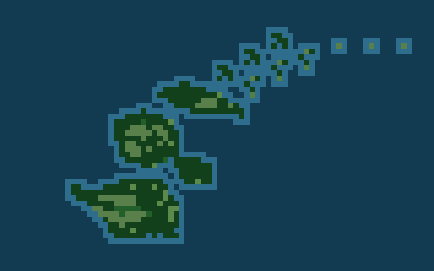

## Scenario 3: A tropical island chain

**Prompt.** An ocean map with a curving chain of atolls and a few larger volcanic islands, spaced so none touch, a size gradient from big in the southwest to tiny in the northeast.

**Result: 7/7 assertions pass.**

| assertion | result | detail |
|---|---|---|
| land 6-14% | pass | 9.4% land |
| 12-30 landmasses | pass | 12 landmasses |
| minimum gap between islands of 5+ tiles >= 2 water tiles | pass | closest pair of 5+ tile islands has 2 water tiles between them |
| 2-4 landmasses >= 20 tiles, the rest <= 6 | pass | 3 >= 20t, 0 between 7 and 19t, sizes 155 127 56 6 6 6 5 5 5 1 1 1 |
| centroids fit a circle (mean residual <= 2 tiles) | pass | r 38.1 centre 62,46 mean residual 1.27 |
| size falls monotonically along the arc SW -> NE (3 bins, non-increasing, first > last) | pass | mean log size per bin SW->NE: 3.93 >= 1.70 >= 0.40 |
| all land tropical (A) or arid-coastal | pass | all tropical/arid |

**describe.** 12 landmasses: #1 155t at 24,38 (tropical 94%, temperate 6%); #2 127t at 29,26 (tropical 100%); #3 56t at 36,18 (tropical 100%); #4 6t at 51,7 (tropical 100%); #5 6t at 46,10 (tropical 100%) and 7 smaller. Isthmus on #2 at 32,29, about 2 wide, joining 57t and 9t. Strait 2 wide between #4 and #5 at 48,10; Strait 2 wide between #1 and #2 at 24,32; Strait 2 wide between #2 and #3 at 29,20. Bay of 11t on #2 at 34,27 opening E; Bay of 9t on #2 at 31,31 opening SE; Bay of 5t on #1 at 17,39 opening W; Bay of 4t on #1 at 17,34 opening NW. Peninsula of 29t on #2 at 35,31 pointing SE; Peninsula of 14t on #1 at 15,36 pointing W; Peninsula of 4t on #2 at 21,24 pointing W. Mountain spine E-W 15 long (70t, 28 peaks, chain 12, 2 ends, 0 knots) on #1 at 22,38; Mountain spine NE-SW 10 long (48t, 23 peaks, chain 6, 0 ends, 0 knots) on #2 at 26,25; Mountain spine E-W 6 long (20t, 7 peaks, chain 5, 2 ends, 0 knots) on #3 at 37,18. No rivers.

Warnings: none



<details><summary>Tool-call sequence and feedback</summary>

```
>>> set_game {"id":"civ4"}
game civ4 | mode civ | frame 72x48 | bounds W 23 S 22 E 38 N 32
compose canvas 160x100: 13 patches, 30 erased | shelf 106 snapshot(s) | fill ocean | mask none
games: civ4 (square 8x8..160x120), civ5 (hex 8x8..160x120), openfront (square 16x16..512x512 step 4), culture_wars (square 16x16..512x512 step 4)
params: islandBias=0 seawayBias=0 islandExpand=0 expandSteep=1 expandMaxMult=1.5 roughHalo=0 mtnPass=0 flatSpots=0 coastThr=30 nudgeX=0 nudgeY=0 riverN=5 riverEstuaries=true hill=0.8 peak=0.94 blendHill=0.9 blendPeak=0.7 fill=ocean
game params: sea=0.5 dryPlains=0.42 dryDesert=0.66 tempTundra=0.39 tempSnow=0.27 latTundra=55 latIce=70 alpine=0.3 clim=0.46 feat=true fpKoppen=true fpThresh=0.25 oasisThresh=0.26 oasisRatio=0.3 oasisMultDesert=10 oasisMultSemiArid=3 forestDens=0.5 jungleDens=0.5
legend: ~ ocean  , coast  g grass  p plains  d desert  t tundra  s snow  f forest  j jungle  r flood plains  o oasis  ^ peak  A-Z hills (uppercase terrain letter) | relief: flat / hills / peaks
```
```
>>> tune {"params":{},"reset":true,"report":false}
{
 "params": {
  "islandBias": 0,
  "seawayBias": 0,
  "islandExpand": 0,
  "expandSteep": 1,
  "expandMaxMult": 1.5,
  "roughHalo": 0,
  "mtnPass": 0,
  "flatSpots": 0,
  "coastThr": 30,
  "nudgeX": 0,
  "nudgeY": 0,
  "riverN": 12,
...
```
```
>>> tune {"params":{"feat":true,"alpine":0.1},"report":false}
{
 "params": {
  "islandBias": 0,
  "seawayBias": 0,
  "islandExpand": 0,
  "expandSteep": 1,
  "expandMaxMult": 1.5,
  "roughHalo": 0,
  "mtnPass": 0,
  "flatSpots": 0,
  "coastThr": 30,
  "nudgeX": 0,
  "nudgeY": 0,
  "riverN": 12,
...
```
```
>>> snapshot_from_catalog {"entry":"Savaii","W":24,"H":15,"grid":false}
snapshot snap_mvbumrq2_15_ynzpqi "Savaii" 24x15 civ4 | lat -13.85..-13.4 | 0.030°/tile
land 155 (43%)  water 205 | hills 43  peaks 28 | river edges 0
terrain: ~=ocean 134  ,=coast 71  j=jungle 71  A-Z=hills (uppercase terrain letter) 43  ^=peak 28  g=grass 10  f=forest 3
landmasses 1: #1 155t x2-21 y2-12
landforms: 1 landmass | 2 bays | 1 peninsula | spine E-W 15L at 11,7
edges: N open sea | E open sea | S open sea [relief@11] | W open sea [relief@5]
corners: NW open sea | NE open sea | SE open sea | SW open sea
```
```
>>> snapshot_from_catalog {"entry":"Tahiti","W":24,"H":22,"grid":false}
snapshot snap_mvbumrto_16_g2uvyq "Tahiti" 24x22 civ4 | lat -17.95..-17.35 | 0.027°/tile
land 127 (24%)  water 401 | hills 32  peaks 23 | river edges 0
terrain: ~=ocean 330  ,=coast 71  j=jungle 66  A-Z=hills (uppercase terrain letter) 32  ^=peak 23  g=grass 4  f=forest 2
landmasses 1: #1 127t x3-20 y5-18
landforms: 1 landmass | 1 isthmus (14,14 w2) | 2 bays | 2 peninsulas | spines NE-SW 10L at 8,10, NW-SE 4L at 19,15
edges: N open sea | E open sea [relief@15] | S open sea [relief@16] | W open sea
corners: NW open sea | NE open sea | SE open sea | SW open sea
```
```
>>> snapshot_from_catalog {"entry":"Upolu","W":20,"H":9,"grid":false}
snapshot snap_mvbumrvf_17_y07tb9 "Upolu" 20x9 civ4 | lat -14.11..-13.75 | 0.040°/tile
land 56 (31%)  water 124 | hills 19  peaks 8 | river edges 0
terrain: ~=ocean 74  ,=coast 50  j=jungle 28  A-Z=hills (uppercase terrain letter) 19  ^=peak 8  g=grass 1
landmasses 1: #1 56t x2-17 y1-7
landforms: 1 landmass | spine E-W 6L at 10,4
edges: N open sea [relief@9] | E open sea [relief@5] | S open sea [relief@9] | W open sea [relief@2]
corners: NW open sea | NE open sea | SE open sea | SW open sea
```
```
>>> snapshot_from_catalog {"entry":"Funafuti","params":{"islandExpand":0.9},"grid":false}
snapshot snap_mvbumrxa_18_lexnom "Funafuti" 8x8 civ4 | lat -8.81..-8.29 | 0.066°/tile
land 5 (8%)  water 59 | hills 2  peaks 1 | river edges 0
terrain: ~=ocean 40  ,=coast 19  j=jungle 2  A-Z=hills (uppercase terrain letter) 2  ^=peak 1
landmasses 1: #1 5t x2-4 y2-5
landforms: 1 landmass
edges: N open sea [relief@2] | E open sea | S open sea [relief@3] | W open sea [relief@2]
corners: NW open sea | NE open sea | SE open sea | SW open sea
```
```
>>> snapshot_from_catalog {"entry":"Tarawa","params":{"islandExpand":0.3},"grid":false}
snapshot snap_mvbumry9_19_ifmpvb "Tarawa" 8x8 civ4 | lat 1.19..1.71 | 0.066°/tile
land 6 (9%)  water 58 | hills 3  peaks 0 | river edges 0
terrain: ~=ocean 40  ,=coast 18  j=jungle 3  A-Z=hills (uppercase terrain letter) 3
landmasses 1: #1 6t x3-5 y3-5
landforms: 1 landmass
edges: N open sea [relief@4] | E open sea [relief@4] | S open sea [relief@5] | W open sea
corners: NW open sea | NE open sea | SE open sea | SW open sea
```
```
>>> snapshot_from_catalog {"entry":"Majuro","params":{"islandExpand":0.5},"grid":false}
snapshot snap_mvbumshp_20_z5s5mp "Majuro" 8x8 civ4 | lat 6.86..7.39 | 0.066°/tile
land 0 (0%)  water 64 | hills 0  peaks 0 | river edges 0
terrain: ~=ocean 64
landmasses 0
landforms: 0 landmasses
edges: N open sea | E open sea | S open sea | W open sea
corners: NW open sea | NE open sea | SE open sea | SW open sea
```
```
>>> snapshot_from_catalog {"entry":"Addu Atoll","params":{"islandExpand":0.5},"grid":false}
snapshot snap_mvbumt9m_21_kqly5j "Addu Atoll" 8x8 civ4 | lat -0.89..-0.36 | 0.066°/tile
land 1 (2%)  water 63 | hills 0  peaks 1 | river edges 0
terrain: ~=ocean 55  ,=coast 8  ^=peak 1
landmasses 1: #1 1t x3-3 y4-4
landforms: 1 landmass
edges: N open sea | E open sea | S open sea [relief@3] | W open sea [relief@4]
corners: NW open sea | NE open sea | SE open sea | SW open sea
```
```
>>> compose_new {"W":80,"H":50,"fill":"water","latitudes":{"top":12,"bottom":-12},"grid":false}
compose canvas 80x50 civ4 | 0 patches | 0 erased tiles | latitudes 12..-12
land 0 (0%)  water 4000 | hills 0  peaks 0 | river edges 0
terrain: ~=ocean 4000
landmasses 0
patches: none
landforms: 0 landmasses
budget: land 0.0% of target 28-38% (add 1120..1520 land tiles)
warnings: none
```
```
>>> scatter {"snapshots":["Savaii"],"along":[[23,38]],"grid":false}
compose canvas 80x50 civ4 | 1 patch | 0 erased tiles | latitudes 12..-12
land 155 (4%)  water 3845 | hills 43  peaks 28 | river edges 0
terrain: ~=ocean 3774  ,=coast 71  j=jungle 71  A-Z=hills (uppercase terrain letter) 43  ^=peak 28  g=grass 10  f=forest 3
landmasses 1: #1 155t x13-32 y33-43
patches (bottom to top): [16] "Savaii" 24x15 @11,31
landforms: 1 landmass | 2 bays | 1 peninsula | spine E-W 15L at 22,38
budget: land 3.9% of target 28-38% (add 965..1365 land tiles)
warnings (1): [straight-edge-coast] ruler-straight coast: 8 land tiles of patch 16 along row 33 (x 22..29) face water to the N (no cut flag: a straight real coast)
scattered 1: [16] Savaii @11,31
```
```
>>> scatter {"snapshots":["Tahiti","Upolu"],"along":[[28,30],[34,23]],"spacing":9,"avoidLand":true,"gap":2,"grid":false}
compose canvas 80x50 civ4 | 3 patches | 0 erased tiles | latitudes 12..-12
land 338 (8%)  water 3662 | hills 94  peaks 59 | river edges 0
terrain: ~=ocean 3470  ,=coast 192  j=jungle 165  A-Z=hills (uppercase terrain letter) 94  ^=peak 59  g=grass 15  f=forest 5
landmasses 3: #1 155t x13-32 y33-43; #2 127t x21-38 y20-33; #3 56t x29-44 y15-21
patches (bottom to top): [16] "Savaii" 24x15 @11,31; [17] "Tahiti" 24x22 @18,15; [18] "Upolu" 20x9 @27,14
landforms: 3 landmasses | 1 isthmus (32,29 w2) | 2 straits (#1/#2 w2 at 24,32 #2/#3 w2 at 29,20) | 4 bays | 3 peninsulas | spines E-W 15L at 22,38, NE-SW 10L at 26,25
collisions: none
budget: land 8.5% of target 28-38% (add 782..1182 land tiles)
warnings (2): [straight-edge-coast] ruler-straight coast: 9 land tiles of patch 18 along row 20 (x 35..43) face water to the S (no cut flag: a straight real coast) ; [straight-edge-coast] ruler-straight coast: 8 land tiles of patch 16 along row 33 (x 22..29) face water to the N (no cut flag: a straight real coast)
scattered 2: [17] Tahiti @18,15 (shifted 2,-3); [18] Upolu @27,14 (shifted 3,-5)
```
```
>>> scatter {"snapshots":["Tarawa","Funafuti"],"along":[[39,18.5],[48,12.9],[56.5,9.8]],"spacing":3.5,"avoidLand":true,"gap":2,"grid":false}
compose canvas 80x50 civ4 | 9 patches | 0 erased tiles | latitudes 12..-12
land 371 (9%)  water 3629 | hills 109  peaks 62 | river edges 0
terrain: ~=ocean 3326  ,=coast 303  j=jungle 180  A-Z=hills (uppercase terrain letter) 109  ^=peak 62  g=grass 15  f=forest 5
landmasses 9: #1 155t x13-32 y33-43; #2 127t x21-38 y20-33; #3 56t x29-44 y15-21; #4 6t x50-52 y6-8; #5 6t x45-47 y9-11; #6 6t x40-42 y12-14; #7 5t x55-57 y9-12; #8 5t x50-52 y11-14; #9 5t x45-47 y14-17
patches (bottom to top): [16] "Savaii" 24x15 @11,31; [17] "Tahiti" 24x22 @18,15; [18] "Upolu" 20x9 @27,14; [19] "Tarawa" 8x8 @37,9; [20] "Funafuti" 8x8 @43,12; [21] "Tarawa" 8x8 @42,6; [22] "Funafuti" 8x8 @48,9; [23] "Tarawa" 8x8 @47,3; [24] "Funafuti" 8x8 @53,7
landforms: 9 landmasses | 1 isthmus (32,29 w2) | 3 straits (#4/#5 w2 at 48,10 #1/#2 w2 at 24,32) | 4 bays | 3 peninsulas | spines E-W 15L at 22,38, NE-SW 10L at 26,25
collisions: none
budget: land 9.3% of target 28-38% (add 749..1149 land tiles)
warnings (2): [straight-edge-coast] ruler-straight coast: 9 land tiles of patch 18 along row 20 (x 35..43) face water to the S (no cut flag: a straight real coast) ; [straight-edge-coast] ruler-straight coast: 8 land tiles of patch 16 along row 33 (x 22..29) face water to the N (no cut flag: a straight real coast)
scattered 6: [19] Tarawa @37,9 (shifted 2,-5); [20] Funafuti @43,12 (shifted 5,-1); [21] Tarawa @42,6 (shifted 2,-4); [22] Funafuti @48,9 (shifted 4,0); [23] Tarawa @47,3 (shifted 0,-4); [24] Funafuti @53,7 (shifted 2,0)
```
```
>>> scatter {"snapshots":["Majuro","Addu Atoll"],"along":[[60,9],[65.5,8.2],[76,8.5]],"spacing":3,"avoidLand":true,"gap":2,"grid":false}
compose canvas 80x50 civ4 | 15 patches | 0 erased tiles | latitudes 12..-12
land 374 (9%)  water 3626 | hills 109  peaks 65 | river edges 0
terrain: ~=ocean 3299  ,=coast 327  j=jungle 180  A-Z=hills (uppercase terrain letter) 109  ^=peak 65  g=grass 15  f=forest 5
landmasses 12: #1 155t x13-32 y33-43; #2 127t x21-38 y20-33; #3 56t x29-44 y15-21; #4 6t x50-52 y6-8; #5 6t x45-47 y9-11; #6 6t x40-42 y12-14; #7 5t x55-57 y9-12; #8 5t x50-52 y11-14; #9 5t x45-47 y14-17; #10 1t x62-62 y8-8 (+2 smaller)
patches (bottom to top): [16] "Savaii" 24x15 @11,31; [17] "Tahiti" 24x22 @18,15; [18] "Upolu" 20x9 @27,14; [19] "Tarawa" 8x8 @37,9; [20] "Funafuti" 8x8 @43,12; [21] "Tarawa" 8x8 @42,6; [22] "Funafuti" 8x8 @48,9; [23] "Tarawa" 8x8 @47,3; [24] "Funafuti" 8x8 @53,7; [25] "Majuro" 8x8 @56,5; [26] "Addu Atoll" 8x8 @59,4; [27] "Majuro" 8x8 @62,4; [28] "Addu Atoll" 8x8 @65,4; [29] "Majuro" 8x8 @68,4; [30] "Addu Atoll" 8x8 @71,4
landforms: 12 landmasses | 1 isthmus (32,29 w2) | 3 straits (#4/#5 w2 at 48,10 #1/#2 w2 at 24,32) | 4 bays | 3 peninsulas | spines E-W 15L at 22,38, NE-SW 10L at 26,25
collisions: none
budget: land 9.3% of target 28-38% (add 746..1146 land tiles)
warnings (2): [straight-edge-coast] ruler-straight coast: 9 land tiles of patch 18 along row 20 (x 35..43) face water to the S (no cut flag: a straight real coast) ; [straight-edge-coast] ruler-straight coast: 8 land tiles of patch 16 along row 33 (x 22..29) face water to the N (no cut flag: a straight real coast)
scattered 6: [25] Majuro @56,5; [26] Addu Atoll @59,4; [27] Majuro @62,4; [28] Addu Atoll @65,4; [29] Majuro @68,4; [30] Addu Atoll @71,4
```
```
>>> compose_view {"step":1}
compose canvas 80x50 civ4 | 15 patches | 0 erased tiles | latitudes 12..-12
land 374 (9%)  water 3626 | hills 109  peaks 65 | river edges 0
terrain: ~=ocean 3299  ,=coast 327  j=jungle 180  A-Z=hills (uppercase terrain letter) 109  ^=peak 65  g=grass 15  f=forest 5
landmasses 12: #1 155t x13-32 y33-43; #2 127t x21-38 y20-33; #3 56t x29-44 y15-21; #4 6t x50-52 y6-8; #5 6t x45-47 y9-11; #6 6t x40-42 y12-14; #7 5t x55-57 y9-12; #8 5t x50-52 y11-14; #9 5t x45-47 y14-17; #10 1t x62-62 y8-8 (+2 smaller)
patches (bottom to top): [16] "Savaii" 24x15 @11,31; [17] "Tahiti" 24x22 @18,15; [18] "Upolu" 20x9 @27,14; [19] "Tarawa" 8x8 @37,9; [20] "Funafuti" 8x8 @43,12; [21] "Tarawa" 8x8 @42,6; [22] "Funafuti" 8x8 @48,9; [23] "Tarawa" 8x8 @47,3; [24] "Funafuti" 8x8 @53,7; [25] "Majuro" 8x8 @56,5; [26] "Addu Atoll" 8x8 @59,4; [27] "Majuro" 8x8 @62,4; [28] "Addu Atoll" 8x8 @65,4; [29] "Majuro" 8x8 @68,4; [30] "Addu Atoll" 8x8 @71,4
landforms: 12 landmasses | 1 isthmus (32,29 w2) | 3 straits (#4/#5 w2 at 48,10 #1/#2 w2 at 24,32) | 4 bays | 3 peninsulas | spines E-W 15L at 22,38, NE-SW 10L at 26,25
collisions: none
budget: land 9.3% of target 28-38% (add 746..1146 land tiles)
warnings (2): [straight-edge-coast] ruler-straight coast: 9 land tiles of patch 18 along row 20 (x 35..43) face water to the S (no cut flag: a straight real coast) ; [straight-edge-coast] ruler-straight coast: 8 land tiles of patch 16 along row 33 (x 22..29) face water to the N (no cut flag: a straight real coast)
grid step 1: x 0..79, y 0..49 (row 0 = north, col 0 = west; ruler = x of every 10th column)
    0         10        20        30        40        50        60        70        
  0|~~~~~~~~~~~~~~~~~~~~~~~~~~~~~~~~~~~~~~~~~~~~~~~~~~~~~~~~~~~~~~~~~~~~~~~~~~~~~~~~
  1|~~~~~~~~~~~~~~~~~~~~~~~~~~~~~~~~~~~~~~~~~~~~~~~~~~~~~~~~~~~~~~~~~~~~~~~~~~~~~~~~
  2|~~~~~~~~~~~~~~~~~~~~~~~~~~~~~~~~~~~~~~~~~~~~~~~~~~~~~~~~~~~~~~~~~~~~~~~~~~~~~~~~
...
```
```
>>> export {"name":"scenario3","dir":"C:\\Users\\cdupu\\Documents\\GitHub\\Civ-Tile\\.claude\\worktrees\\unruffled-visvesvaraya-0fe553\\mcp\\out"}
export compose civ4 80x50
wrote C:\Users\cdupu\Documents\GitHub\Civ-Tile\.claude\worktrees\unruffled-visvesvaraya-0fe553\mcp\out\scenario3.CivBeyondSwordWBSave (306490 bytes)
ok   plots written = 80×50 · 4000 / 4000
ok   land ↔ plot-type consistent · all 4000 ok
ok   river edges written · 0 / 0
ok   no river on all-water edge · ok
ok   no tile with rivers on all 4 sides · ok
ok   estuary bridges to open ocean · 0 edge(s)
ok   starting plots on land · 0 placed
ok   header + map block present · ok
```

</details>

