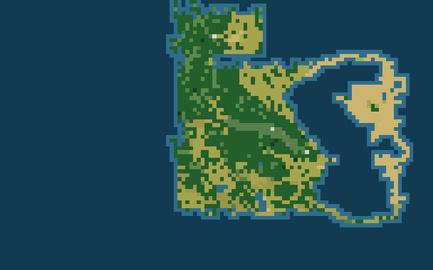

## Scenario 4: A temperate region with mountain chains

**Prompt.** A temperate land with two mountain chains meeting at a knot, forested windward slopes, drier basins in the lee, rivers draining from the ranges to two different coasts.

**Result: 4/7 assertions pass.**

| assertion | result | detail |
|---|---|---|
| temperate/continental >= 70% of land | FAIL | 64.9% temperate+continental |
| hills+peaks 18-35% of land | pass | 31% relief |
| 1-2 chains >= 25 tiles with a junction | FAIL | 3 chains >= 25t: NE-SW 362t chain 53 0 knots, N-S 91t chain 25 0 knots, N-S 47t chain 11 0 knots |
| forest density one side of the main chain >= 1.5x the other | pass | forest 632 vs 201 tiles across the NE-SW spine (ratio 3.14) |
| grass/plains ratio flips across the chain | FAIL | grass share 23% vs 4% |
| zero truncated-wall warnings | pass | none |
| >= 2 rivers reaching distinct coasts (water bodies) | pass | rivers reach water bodies [1,2,6,4]; 22/22 reach water |

**describe.** 1 landmass: #1 1787t at 67,31 (continental 41%, arid 35%). Bay of 709t on #1 at 89,36 opening E; Bay of 257t on #1 at 74,12 opening N; Bay of 62t on #1 at 45,24 opening W. Peninsula of 91t on #1 at 96,48 pointing SE; Peninsula of 87t on #1 at 91,18 pointing NE; Peninsula of 17t on #1 at 46,4 pointing NW. Mountain spine NE-SW 37 long (362t, 97 peaks, chain 53, 6 ends, 0 knots) on #1 at 64,42; Mountain spine N-S 26 long (91t, 7 peaks, chain 25, 3 ends, 0 knots) on #1 at 53,12; Mountain spine N-S 14 long (47t, 3 peaks, chain 11, 3 ends, 0 knots) on #1 at 48,32. 4 inland seas: 709t at 89,36; 10t at 67,52; 5t at 102,22; 5t at 57,48. 22 river systems (289 edges): 22 reach water (4 different water bodies), 0 leave the map, 0 dead-end.

Warnings: none



<details><summary>Tool-call sequence and feedback</summary>

```
>>> set_game {"id":"civ4"}
game civ4 | mode compose | frame 8x8 | bounds W 72.89 S -0.89 E 73.41 N -0.36
compose canvas 80x50: 15 patches, 0 erased | shelf 23 snapshot(s) | fill ocean | mask none
games: civ4 (square 8x8..160x120), civ5 (hex 8x8..160x120), openfront (square 16x16..512x512 step 4), culture_wars (square 16x16..512x512 step 4)
params: islandBias=0.6 seawayBias=0 islandExpand=0.5 expandSteep=1 expandMaxMult=1.5 roughHalo=0 mtnPass=0 flatSpots=0 coastThr=30 nudgeX=0 nudgeY=0 riverN=12 riverEstuaries=true hill=0.55 peak=0.8 blendHill=0.9 blendPeak=0.7 fill=ocean
game params: sea=0.5 dryPlains=0.42 dryDesert=0.66 tempTundra=0.39 tempSnow=0.27 latTundra=55 latIce=70 alpine=0.1 clim=0.46 feat=true fpKoppen=true fpThresh=0.36 oasisThresh=0.33 oasisRatio=0.14 oasisMultDesert=10 oasisMultSemiArid=3 forestDens=0.5 jungleDens=0.5
legend: ~ ocean  , coast  g grass  p plains  d desert  t tundra  s snow  f forest  j jungle  r flood plains  o oasis  ^ peak  A-Z hills (uppercase terrain letter) | relief: flat / hills / peaks
```
```
>>> tune {"params":{},"reset":true,"report":false}
{
 "params": {
  "islandBias": 0,
  "seawayBias": 0,
  "islandExpand": 0,
  "expandSteep": 1,
  "expandMaxMult": 1.5,
  "roughHalo": 0,
  "mtnPass": 0,
  "flatSpots": 0,
  "coastThr": 30,
  "nudgeX": 0,
  "nudgeY": 0,
  "riverN": 12,
...
```
```
>>> tune {"params":{"feat":true,"forestDens":0.7,"hill":0.68,"peak":0.88,"riverN":14,"alpine":0.3},"report":false}
{
 "params": {
  "islandBias": 0,
  "seawayBias": 0,
  "islandExpand": 0,
  "expandSteep": 1,
  "expandMaxMult": 1.5,
  "roughHalo": 0,
  "mtnPass": 0,
  "flatSpots": 0,
  "coastThr": 30,
  "nudgeX": 0,
  "nudgeY": 0,
  "riverN": 14,
...
```
```
>>> snapshot_from_catalog {"entry":"Caucasus isthmus","bounds":[40,36.5,55,47.2],"W":60,"H":44,"grid":false}
snapshot snap_mvbv12ay_21_kjmolq "Caucasus isthmus" 60x44 civ4 | lat 36.35..47.35 | 0.250°/tile
land 1857 (70%)  water 783 | hills 443  peaks 163 | river edges 228
terrain: ~=ocean 530  f=forest 463  A-Z=hills (uppercase terrain letter) 443  p=plains 387  d=desert 343  ,=coast 253  ^=peak 163  g=grass 42  j=jungle 9  o=oasis 4  r=flood plains 3
landmasses 1: #1 1857t x0-59 y0-43
landforms: 1 landmass | 3 bays | 3 peninsulas | spines E-W 39L at 15,27, NW-SE 19L at 37,40 | 4 inland seas | rivers 13/13 reach water
edges: N desert + river exit [land@29 (0..59)] | E desert [relief@42, land@21 (0..43)] | S temperate land + river exit [relief@40, land@29 (0..59)] | W continental land + river exit [relief@30, land@34 (26..43, 0..15)]
corners: NW continental land | NE desert | SE mountain wall | SW desert
```
```
>>> snapshot_from_catalog {"entry":"Cascades and Sierra","grid":false}
snapshot snap_mvbv13cn_22_teoise "Cascades and Sierra" 24x52 civ4 | lat 36..49 | 0.250°/tile
land 1156 (93%)  water 92 | hills 292  peaks 58 | river edges 198
terrain: f=forest 343  A-Z=hills (uppercase terrain letter) 292  p=plains 285  g=grass 96  d=desert 78  ^=peak 58  ~=ocean 52  ,=coast 40  r=flood plains 2  t=tundra 1  o=oasis 1
landmasses 1: #1 1156t x0-23 y0-51
landforms: 1 landmass | 2 bays | 1 peninsula | spines N-S 44L at 8,17, NW-SE 23L at 18,43 | rivers 5/14 reach water
edges: N mountain wall + river exit [relief@15, land@14 (5..23, 0..1)] | E desert + river exit [relief@47, land@25 (0..51)] | S desert [relief@21, land@16 (9..23)] | W temperate land + river exit [relief@31, land@24 (12..36, 0..10)]
corners: NW mountain wall | NE mountain wall | SE mountain wall | SW open sea
```
```
>>> compose_new {"W":112,"H":70,"fill":"water","latitudes":{"top":52,"bottom":32},"grid":false}
compose canvas 112x70 civ4 | 0 patches | 0 erased tiles | latitudes 52..32
land 0 (0%)  water 7840 | hills 0  peaks 0 | river edges 0
terrain: ~=ocean 7840
landmasses 0
patches: none
landforms: 0 landmasses
budget: land 0.0% of target 28-38% (add 2195..2979 land tiles)
warnings: none
```
```
>>> place {"snapshot":"Caucasus isthmus","x":46,"y":14,"landOnly":false,"grid":false}
compose canvas 112x70 civ4 | 1 patch | 0 erased tiles | latitudes 52..32
land 1857 (24%)  water 5983 | hills 443  peaks 163 | river edges 226
terrain: ~=ocean 5526  f=forest 463  ,=coast 457  A-Z=hills (uppercase terrain letter) 443  p=plains 387  d=desert 343  ^=peak 163  g=grass 42  j=jungle 9  o=oasis 4  r=flood plains 3
landmasses 1: #1 1857t x46-105 y14-57
patches (bottom to top): [31] "Caucasus isthmus" 60x44 @46,14 full-rect
landforms: 1 landmass | 3 bays | 3 peninsulas | spines E-W 39L at 61,41, NW-SE 19L at 83,54 | 4 inland seas | rivers 13/13 reach water
budget: land 23.7% of target 28-38% (add 338..1122 land tiles)
warnings (7): [straight-edge-coast] ruler-straight coast: 60 land tiles of patch 31 along row 57 (x 46..105) face water to the S, the capture rectangle edge (a rect or frame cut) ; [straight-edge-coast] ruler-straight coast: 60 land tiles of patch 31 along row 14 (x 46..105) face water to the N, the capture rectangle edge (a rect or frame cut) ; [straight-edge-coast] ruler-straight coast: 44 land tiles of patch 31 along column 105 (y 14..57) face water to the E, the capture rectangle edge (a rect or frame cut) ; [straight-edge-coast] ruler-straight coast: 18 land tiles of patch 31 along column 46 (y 40..57) face water to the W, the capture rectangle edge (a rect or frame cut) ; [straight-edge-coast] ruler-straight coast: 16 land tiles of patch 31 along column 46 (y 14..29) face water to the W, the capture rectangle edge (a rect or frame cut) ; [straight-edge-coast] ruler-straight coast: 8 land tiles of patch 31 along row 22 (x 91..98) face water to the N (no cut flag: a straight real coast) ; [straight-edge-coast] ruler-straight coast: 7 land tiles of patch 31 along row 57 (x 90..96) face water to the N (no cut flag: a straight real coast)
placed patch 31 at 46,14 (full rectangle)
```
```
>>> attach {"a":"Caucasus isthmus","edgeA":"W","b":"Cascades and Sierra","edgeB":"E","overlap":22,"align":"relief","ragged":true,"grid":false}
compose canvas 112x70 civ4 | 2 patches | 0 erased tiles | latitudes 52..32
land 1787 (23%)  water 6053 | hills 440  peaks 114 | river edges 317
terrain: ~=ocean 5442  ,=coast 611  f=forest 476  A-Z=hills (uppercase terrain letter) 440  p=plains 415  d=desert 243  ^=peak 114  g=grass 89  j=jungle 5  r=flood plains 4  o=oasis 1
landmasses 1: #1 1787t x44-105 y0-57
patches (bottom to top): [31] "Caucasus isthmus" 60x44 @46,14 full-rect; [32] "Cascades and Sierra" 24x52 @44,0
landforms: 1 landmass | 3 bays | 3 peninsulas | spines NE-SW 37L at 64,42, N-S 26L at 53,12 | 4 inland seas | rivers 22/25 reach water
collisions: [31]x[32] 300 land tiles
budget: land 22.8% of target 28-38% (add 408..1192 land tiles)
warnings (12): [climate-jump] Csb next to Dfa (never adjacent in the Köppen raster) across the seam between patches 32 and 31 (10 tiles) near 48,19 ; [climate-jump] Csb next to Dfa (never adjacent in the Köppen raster) across the seam between patches 32 and 31 (6 tiles) near 52,48 ; [truncated-wall] mountain run of 362 tiles from patch 31/32 stops against flat land of patch 32/31 along 46 tiles near 59,29 ; [truncated-wall] mountain run of 91 tiles from patch 32 stops against flat land of patch 31 along 6 tiles near 48,21 ; [river-dead-end] river 252191 has 1 edge ending on land with no continuation, first at 62,48 (not in its source: cut at a patch boundary, by an erase or by an overlapping stamp) ; [straight-edge-coast] ruler-straight coast: 13 land tiles of patch 32 along row 13 (x 55..67) face water to the S (no cut flag: a straight real coast) ; [straight-edge-coast] ruler-straight coast: 13 land tiles of patch 31 along column 46 (y 41..53) face water to the W, the capture rectangle edge (a rect or frame cut) ; [straight-edge-coast] ruler-straight coast: 12 land tiles of patch 31 along column 46 (y 18..29) face water to the W, the capture rectangle edge (a rect or frame cut) ; +4 more
attached patch 32 to patch 31 along W/E at 44,0 (A continental land + river exit meets B desert + river exit) | aligned relief: A@30 to B@47 (shift -13) | seam cost 1.123 over 836 tiles (water 111, climate 485, relief 343) | best shift -19 (cost 0.962, window ±16) | clamped +3 along the seam to stay on the canvas | ragged: 539 tiles of B and 387 of A skipped, min-cut seam 38 long through a 22-wide strip (cost/tile 0.434)
```
```
>>> trim_rivers {"grid":false}
compose canvas 112x70 civ4 | 2 patches | 0 erased tiles | latitudes 52..32
land 1787 (23%)  water 6053 | hills 440  peaks 114 | river edges 289
terrain: ~=ocean 5442  ,=coast 611  f=forest 476  A-Z=hills (uppercase terrain letter) 440  p=plains 415  d=desert 243  ^=peak 114  g=grass 89  j=jungle 5  r=flood plains 4  o=oasis 1
landmasses 1: #1 1787t x44-105 y0-57
patches (bottom to top): [31] "Caucasus isthmus" 60x44 @46,14 full-rect; [32] "Cascades and Sierra" 24x52 @44,0
landforms: 1 landmass | 3 bays | 3 peninsulas | spines NE-SW 37L at 64,42, N-S 26L at 53,12 | 4 inland seas | rivers 22/22 reach water
collisions: [31]x[32] 300 land tiles
budget: land 22.8% of target 28-38% (add 408..1192 land tiles)
warnings (11): [climate-jump] Csb next to Dfa (never adjacent in the Köppen raster) across the seam between patches 32 and 31 (10 tiles) near 48,19 ; [climate-jump] Csb next to Dfa (never adjacent in the Köppen raster) across the seam between patches 32 and 31 (6 tiles) near 52,48 ; [truncated-wall] mountain run of 362 tiles from patch 31/32 stops against flat land of patch 32/31 along 46 tiles near 59,29 ; [truncated-wall] mountain run of 91 tiles from patch 32 stops against flat land of patch 31 along 6 tiles near 48,21 ; [straight-edge-coast] ruler-straight coast: 13 land tiles of patch 32 along row 13 (x 55..67) face water to the S (no cut flag: a straight real coast) ; [straight-edge-coast] ruler-straight coast: 13 land tiles of patch 31 along column 46 (y 41..53) face water to the W, the capture rectangle edge (a rect or frame cut) ; [straight-edge-coast] ruler-straight coast: 12 land tiles of patch 31 along column 46 (y 18..29) face water to the W, the capture rectangle edge (a rect or frame cut) ; [straight-edge-coast] ruler-straight coast: 10 land tiles of patch 32 along column 67 (y 4..13) face water to the E, the capture rectangle edge (a rect or frame cut) ; +3 more
trimmed 3 river systems and 1 edge(s) of cut side branches (28 edges): 31951, 32060, 683595
```
```
>>> compose_view {"step":1}
compose canvas 112x70 civ4 | 2 patches | 0 erased tiles | latitudes 52..32
land 1787 (23%)  water 6053 | hills 440  peaks 114 | river edges 289
terrain: ~=ocean 5442  ,=coast 611  f=forest 476  A-Z=hills (uppercase terrain letter) 440  p=plains 415  d=desert 243  ^=peak 114  g=grass 89  j=jungle 5  r=flood plains 4  o=oasis 1
landmasses 1: #1 1787t x44-105 y0-57
patches (bottom to top): [31] "Caucasus isthmus" 60x44 @46,14 full-rect; [32] "Cascades and Sierra" 24x52 @44,0
landforms: 1 landmass | 3 bays | 3 peninsulas | spines NE-SW 37L at 64,42, N-S 26L at 53,12 | 4 inland seas | rivers 22/22 reach water
collisions: [31]x[32] 300 land tiles
budget: land 22.8% of target 28-38% (add 408..1192 land tiles)
warnings (11): [climate-jump] Csb next to Dfa (never adjacent in the Köppen raster) across the seam between patches 32 and 31 (10 tiles) near 48,19 ; [climate-jump] Csb next to Dfa (never adjacent in the Köppen raster) across the seam between patches 32 and 31 (6 tiles) near 52,48 ; [truncated-wall] mountain run of 362 tiles from patch 31/32 stops against flat land of patch 32/31 along 46 tiles near 59,29 ; [truncated-wall] mountain run of 91 tiles from patch 32 stops against flat land of patch 31 along 6 tiles near 48,21 ; [straight-edge-coast] ruler-straight coast: 13 land tiles of patch 32 along row 13 (x 55..67) face water to the S (no cut flag: a straight real coast) ; [straight-edge-coast] ruler-straight coast: 13 land tiles of patch 31 along column 46 (y 41..53) face water to the W, the capture rectangle edge (a rect or frame cut) ; [straight-edge-coast] ruler-straight coast: 12 land tiles of patch 31 along column 46 (y 18..29) face water to the W, the capture rectangle edge (a rect or frame cut) ; [straight-edge-coast] ruler-straight coast: 10 land tiles of patch 32 along column 67 (y 4..13) face water to the E, the capture rectangle edge (a rect or frame cut) ; +3 more
grid step 1: x 0..111, y 0..69 (row 0 = north, col 0 = west; ruler = x of every 10th column)
    0         10        20        30        40        50        60        70        80        90        100       11
  0|~~~~~~~~~~~~~~~~~~~~~~~~~~~~~~~~~~~~~~~~~~~~,f,~,ff,~~~~~~~~~~~~~~~~~~~~~~~~~~~~~~~~~~~~~~~~~~~~~~~~~~~~~~~~~~~~
  1|~~~~~~~~~~~~~~~~~~~~~~~~~~~~~~~~~~~~~~~~~~~~,f,~,,g,,~,,,,,,,,~~~,,,,~~~~~~~~~~~~~~~~~~~~~~~~~~~~~~~~~~~~~~~~~~~
  2|~~~~~~~~~~~~~~~~~~~~~~~~~~~~~~~~~~~~~~~~~~~~,g,,,ffF,,,^,,^,F,~~,,Fg,~~~~~~~~~~~~~~~~~~~~~~~~~~~~~~~~~~~~~~~~~~~
...
```
```
>>> export {"name":"scenario4","dir":"C:\\Users\\cdupu\\Documents\\GitHub\\Civ-Tile\\.claude\\worktrees\\unruffled-visvesvaraya-0fe553\\mcp\\out"}
export compose civ4 112x70
wrote C:\Users\cdupu\Documents\GitHub\Civ-Tile\.claude\worktrees\unruffled-visvesvaraya-0fe553\mcp\out\scenario4.CivBeyondSwordWBSave (624144 bytes)
ok   plots written = 112×70 · 7840 / 7840
ok   land ↔ plot-type consistent · all 7840 ok
ok   river edges written · 289 / 289 (14 rivers)
ok   no river on all-water edge · ok
WARN no tile with rivers on all 4 sides · 1 tile(s)
ok   estuary bridges to open ocean · 8 edge(s)
ok   starting plots on land · 0 placed
ok   header + map block present · ok
```

</details>

